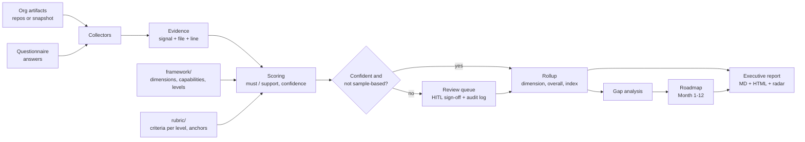

# Agentic AI maturity assessment

[](https://github.com/jagadishmazure-jpg/Jagadish-ai-maturity-assessment/actions/workflows/ci.yml)

An offline, evidence-first agent that positions an organisation on the **Enterprise Agentic AI
Maturity Model (EAMM)**, a model I designed for enterprises that build, run and govern AI agents in
production. It reads what a team has actually built (Terraform, pipelines, eval gates, agent tool
contracts, model and risk cards, identity and secret policies, data contracts, cost guards, plans),
asks a short questionnaire only for the things code cannot show, scores all 23 capabilities with a
confidence value and cited evidence, routes weak calls to a human reviewer, and turns the result into
a gap list, a twelve-month roadmap and an executive report with a radar chart.

## At a glance (for recruiters)

- **What it shows:** an original maturity model for agentic AI (eight weighted dimensions, five
  levels, must/support evidence rules, crosswalked to NIST AI RMF, ISO/IEC 42001 and the EU AI Act),
  an agent that scores against it from real artifacts, and the governance around that agent
  (confidence, human sign-off, audit trail, eval gates).
- **Scale:** 8 dimensions, 23 capabilities, 5 levels, 76 evidence signals, 48 questionnaire items,
  **762 automated tests**, 3 eval gates, 9 read-only MCP tools, an A2A agent card.
- **Honest sample:** my own eight public project repositories, plus the profile repository that holds
  my written AI principles, roadmap and skills matrix, are assessed as the sample organisation
  (overall level 2 Prove, Agentic Readiness Index 57.1, provisional, with 9 capabilities waiting for a
  reviewer). Operating-model and people items for the portfolio come from **sample answers**,
  labelled as such, never inferred.
- **Two fictional organisations** ([Kestrel Bay Bank](docs/samples/kestrel-bay-bank.md) and
  [Valemont Revenue Agency](docs/samples/valemont-revenue-agency.md)) show the same engine on a
  regulated bank and a public agency.
- **Engineering standards:** Python, pytest, ruff, JSON Schemas, Terraform and Bicep with the
  smallest SKUs, checkov and tflint, GitHub Actions pinned to commit SHAs with OIDC, CodeQL and a
  dev-to-prod approval, every doc's command output re-rendered and checked in CI.
- **Nothing is deployed.** Deploy and teardown stay off until a repository variable
  `DEPLOY_ENABLED` is set to `true`, and it is not set.

## The maturity model

Eight dimensions, weighted by how expensively an agent fails when they are weak:

| Id | Dimension | Weight | Capabilities |
| --- | --- | --- | --- |
| SV | Strategy & Value | 0.12 | SV-1 Agentic AI Thesis, SV-2 Use-Case Portfolio & Prioritisation, SV-3 Value Realisation |
| DF | Data Foundation | 0.13 | DF-1 Knowledge & Grounding Sources, DF-2 Data Quality & Contracts, DF-3 Governed Access & Synthetic Data |
| PL | Platform & LLMOps | 0.13 | PL-1 Paved-Road Engineering Platform, PL-2 Release & Lifecycle Automation, PL-3 Observability & Runtime Operations |
| AE | Agent Engineering | 0.14 | AE-1 Evaluation & Quality Gates, AE-2 Tool & Interoperability Design, AE-3 Autonomy & Human Oversight |
| SI | Security & Identity | 0.14 | SI-1 Agent Identity & Secrets, SI-2 AI Threat Defence, SI-3 Supply Chain & Platform Hardening |
| GR | Governance, Risk & Compliance | 0.14 | GR-1 AI Policy & Accountability, GR-2 Risk & Impact Management, GR-3 Regulatory Compliance & Transparency |
| PO | People & Operating Model | 0.10 | PO-1 Sponsorship & Operating Model, PO-2 Skills & AI Literacy, PO-3 Adoption & Change |
| FC | FinOps & Cost | 0.10 | FC-1 Cost Guardrails, FC-2 Unit Economics & Model Routing |

Five levels, named after what the organisation is doing: **1 Explore** (individuals try tools),
**2 Prove** (bounded pilots with an owner and success criteria), **3 Operate** (agents in production
on a paved road with gates and monitoring), **4 Scale** (a shared platform and federated guardrails
serve many teams), **5 Optimise** (telemetry, evaluation, cost and risk data steer the portfolio).
Every capability maps to NIST AI RMF, ISO/IEC 42001 and EU AI Act references
([standards crosswalk](docs/standards-crosswalk.md)); the design rationale is in
[ADR 0007](docs/adr/0007-original-agentic-maturity-model.md).

## Results

Every number below is printed by the CLI and re-checked in CI, so it cannot drift from the code.

<!-- output: summary -->
```text
organisation               overall    readiness index  SV  DF  PL  AE  SI  GR  PO  FC  review queue  status
-------------------------  ---------  ---------------  --  --  --  --  --  --  --  --  ------------  -----------
Kestrel Bay Bank           2 Prove    57.4             3   2   3   3   4   4   2   2   2             provisional
Jagadish Meduri portfolio  2 Prove    57.1             3   2   4   4   4   3   1   3   9             provisional
Valemont Revenue Agency    1 Explore  29.2             2   2   1   2   2   3   2   1   0             final
```
<!-- /output -->

Portfolio by dimension (from `samples/portfolio`):

<!-- output: assess --org portfolio -->
```text
Jagadish Meduri portfolio: overall Level 2 (Prove), mean 3.29, Agentic Readiness Index 57.1
dimension  name                           level           mean  capped by
---------  -----------------------------  -----  -------  ----  ---------
SV         Strategy & Value               3      Operate  3     -
DF         Data Foundation                2      Prove    2     -
PL         Platform & LLMOps              4      Scale    4     -
AE         Agent Engineering              4      Scale    4.33  -
SI         Security & Identity            4      Scale    4.33  -
GR         Governance, Risk & Compliance  3      Operate  3.33  -
PO         People & Operating Model       1      Explore  1.67  -
FC         FinOps & Cost                  3      Operate  3     -

capability  level  computed  conf  status          target
----------  -----  --------  ----  --------------  ------
SV-1        3      3         0.41  pending-review  3
SV-2        2      2         0.71  auto            3
SV-3        4      4         0.71  auto            3
DF-1        1      1         0.57  pending-review  3
DF-2        4      4         0.71  auto            3
DF-3        1      1         0.3   pending-review  3
PL-1        4      4         0.76  auto            4
PL-2        4      4         0.76  auto            4
PL-3        4      4         0.71  auto            4
AE-1        5      5         1.0   auto            4
AE-2        4      4         0.76  auto            4
AE-3        4      4         0.63  pending-review  4
SI-1        4      4         0.67  auto            3
SI-2        4      4         0.64  auto            3
SI-3        5      5         1.0   auto            3
GR-1        2      2         0.57  pending-review  4
GR-2        4      4         0.71  auto            4
GR-3        4      4         0.68  auto            4
PO-1        2      2         0.38  pending-review  3
PO-2        2      2         0.26  pending-review  3
PO-3        1      1         0.3   pending-review  3
FC-1        4      4         0.64  auto            3
FC-2        2      2         0.59  pending-review  3

review queue: SV-1, DF-1, DF-3, AE-3, GR-1, PO-1, PO-2, PO-3, FC-2; final: False
```
<!-- /output -->

Full reports: [portfolio](samples/portfolio/report/report.md),
[Kestrel Bay Bank](samples/kestrel-bay-bank/report/report.md),
[Valemont Revenue Agency](samples/valemont-revenue-agency/report/report.md)
(each also as HTML with an embedded radar chart).

## How it works



1. **Collectors** search a target's files for the 76 signals in `rubric/signals.yaml` (for example a
   Terraform backend, an OIDC login step, an agent eval suite in CI, an MCP tool contract, a model
   card with intended use, a residual risk score, a cost guard, a data contract). Each hit keeps the
   file and line.
2. **Questionnaire answers** cover sponsorship, skills, adoption and policy items; answers labelled
   `sample-answers` lower confidence and always send the capability to a reviewer.
3. **Scoring** climbs the five levels stepwise: a level counts only when every **must** criterion is
   present, at least half its **support** criteria are present and the level below holds. From Scale
   upwards every must list includes a file-based artifact, so answers alone stop at Operate.
   Confidence combines evidence trust, decision margin and verifiability.
4. **Rollup** floors the mean per dimension, capped one level above its weakest **anchor**
   capability, then floors the weighted mean of dimensions, capped one above the weakest dimension.
   The 0-100 **Agentic Readiness Index** shows progress inside a level.
5. **HITL**: reviewers confirm or override queued capabilities; each sign-off is bound to a digest of
   the evidence, and the audit log is hash-chained.
6. **Gaps and roadmap** rank the next level per capability into quick wins and strategic items with
   dependencies, laid out as Month 1 to Month 12 (no calendar dates).
7. **Report**: Markdown and HTML with a matplotlib radar chart.

The assessor agent is a small graph (collect, score, verify citations, route) driven by a mock LLM,
so runs are deterministic and need no network or key.

## Quick start

```bash
python -m venv .venv && . .venv/bin/activate
pip install -e ".[dev]"
aimaturity summary                                      # all three sample orgs
aimaturity explain --org portfolio --capability GR-2    # evidence behind one score
aimaturity roadmap --org kestrel-bay-bank               # Month 1-12 plan
aimaturity report --all                                 # regenerate MD + HTML + radar
aimaturity evals                                        # stability, citations, calibration
pytest -q
```

Assess your own organisation: copy `samples/valemont-revenue-agency/` as a template, point
`org.yaml` at your repositories, fill in `questionnaire.yaml`, then run
`aimaturity assess --org <your-org>`. See [docs/adopt-this.md](docs/adopt-this.md).

## Cross-links to my other repositories

The portfolio assessment draws on specific repositories for specific capabilities:

| Capabilities | Evidence source |
| --- | --- |
| Governance, Risk & Compliance (GR-1, GR-2, GR-3) | [Jagadish-agentic-ai-model-risk](https://github.com/jagadishmazure-jpg/Jagadish-agentic-ai-model-risk): AI inventory, risk scoring, model cards, HITL sign-off |
| Value and cost (SV-3, FC-1, FC-2) | [Jagadish-azure-finops](https://github.com/jagadishmazure-jpg/Jagadish-azure-finops): budgets, cost guards, unit economics, value metrics |
| Data Foundation (DF-2) | [Jagadish-fabric-enterprise-bi](https://github.com/jagadishmazure-jpg/Jagadish-fabric-enterprise-bi): data contracts, quality checks, lineage |

The other scanned repositories are
[Jagadish-agentic-ai](https://github.com/jagadishmazure-jpg/Jagadish-agentic-ai),
[Jagadish-azure-agent-platform](https://github.com/jagadishmazure-jpg/Jagadish-azure-agent-platform),
[Jagadish-azure-ai-integration-platform](https://github.com/jagadishmazure-jpg/Jagadish-azure-ai-integration-platform),
[Jagadish-azure-agent-labs](https://github.com/jagadishmazure-jpg/Jagadish-azure-agent-labs) and
[Jagadish-ai-learning-lab](https://github.com/jagadishmazure-jpg/Jagadish-ai-learning-lab).
They were scanned read-only; the evidence is frozen in `samples/portfolio/evidence.json` so CI
works without them.

## Repository map

| Folder | What it holds |
| --- | --- |
| `framework/` | The maturity model: dimensions, weights, capabilities, level descriptors, actions, crosswalk |
| `rubric/` | Evidence signals, must and support criteria per level, anchors and questionnaire |
| `src/aimaturity/` | Collectors, scoring, rollup, HITL, gaps, roadmap, report, evals, CLI, MCP server, agent |
| `samples/` | The portfolio, Kestrel Bay Bank and Valemont Revenue Agency |
| `evals/` | Eval gate thresholds |
| `schemas/` | JSON Schemas for org files, answers and evidence snapshots |
| `a2a/` | The A2A agent card |
| `infra/` | Terraform and Bicep for the evidence store and scheduled job |
| `.github/` | CI, CodeQL, infra, deploy and teardown workflows |
| `docs/` | Dimension, component, sample and infra docs, standards crosswalk, ADRs and guides |
| `scripts/` | Doc rendering |
| `tests/` | The pytest suite |

## Documentation

- [Architecture](docs/architecture.md), [implementation guide](docs/implementation-guide.md),
  [interview guide](docs/interview-guide.md), [best practices](docs/best-practices.md),
  [deployment](docs/deployment.md), [adopt this](docs/adopt-this.md),
  [standards crosswalk](docs/standards-crosswalk.md)
- [Dimensions](docs/dimensions/README.md) (8), [components](docs/components/README.md) (13),
  [samples](docs/samples/README.md) (3), [infra](docs/infra/README.md) (4); each has the same 17
  sections, from purpose to interview talking points and an "Adopt this" section
- [Decision records](docs/adr/README.md) (7)

## Honesty notes

- All organisations except my own portfolio are fictional. Kestrel Bay Bank and Valemont Revenue
  Agency do not exist; their artifacts are synthetic.
- Portfolio operating-model and people answers are sample answers I wrote to exercise the
  questionnaire. They are labelled `sample-answers`, keep the result provisional and wait for a
  reviewer.
- The LLM is a mock. Scores come from the rubric; the mock only phrases rationales, and a verifier
  rejects any rationale citing evidence that was not collected.
- The standards crosswalk is for orientation; a level is not a compliance or certification claim.
- Nothing is deployed and no cloud account is referenced.

## License

[MIT](LICENSE), for the whole repository: code, maturity model, rubric, samples, infrastructure and
docs.
