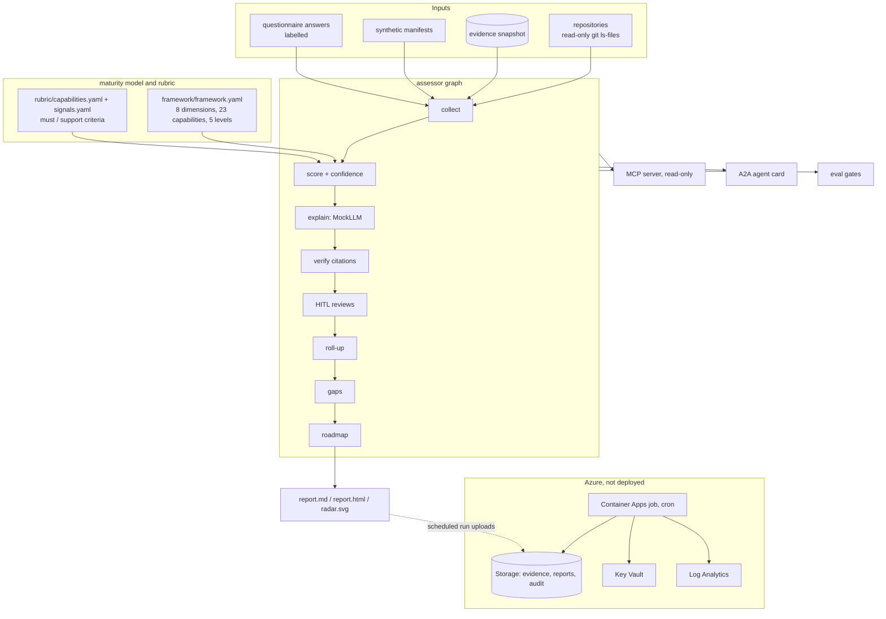

# Architecture

The assessor scores organisations against the Enterprise Agentic AI Maturity Model (EAMM): eight weighted
dimensions, 23 capabilities and five levels (Explore, Prove, Operate, Scale, Optimise), each capability
crosswalked to NIST AI RMF, ISO/IEC 42001 and the EU AI Act. Design rationale: [ADR 0007](adr/0007-original-agentic-maturity-model.md).

## Components

## Data flow

1. **Collect.** Sources list files; signals match by glob and pattern; questionnaire answers become evidence with an origin label. Evidence gets stable ids.
2. **Score.** Each capability reaches the highest level, in order, whose must criteria are all present and whose support criteria are at least half present; from Scale up a must has to be an artifact. Confidence blends source trust, decision margin and verifiability.
3. **Explain and verify.** A mock LLM writes a rationale that cites evidence ids; the verifier rejects unknown or foreign citations and level mismatches.
4. **Review.** Low-confidence and sample-answer capabilities wait for a human; reviews are digest-bound and audit-logged.
5. **Roll up, gap, plan.** Floored mean per dimension capped by its anchors; weighted overall capped at weakest dimension + 1; Agentic Readiness Index 0-100; gaps against targets; Month 1-12 schedule.
6. **Report.** Markdown, HTML and a radar SVG, checked in and drift-checked.

## Model and rubric split

| Path | Holds | Changes when |
|---|---|---|
| `framework/framework.yaml` | Dimensions, weights, capabilities, level descriptors, actions, crosswalk | What good looks like changes |
| `rubric/` | Signals, questions, must and support criteria, anchors, effort, dependencies | How evidence proves a level changes |
| `src/aimaturity/` | Scoring, rollup, agent, report | Behaviour changes |

The whole repository, model included, is MIT licensed. `aimaturity validate` ties the model and the
rubric together (ADR 0001).

## Azure mapping

| Concern | Azure service |
|---|---|
| Scheduled assessments | Container Apps job (consumption, schedule trigger) |
| Evidence, reports, audit log | Storage account (LRS, keyless, versioned; immutability optional) |
| Optional hosted-LLM key | Key Vault (RBAC) |
| Logs and trends | Log Analytics / Azure Monitor |
| Hosted rationales | Microsoft Foundry model + evaluations |
| Catalogue and lineage | Microsoft Purview |
| Guardrails on the plane | Azure Policy |
