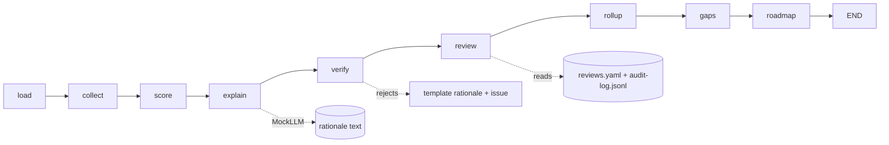

# Component: assessor agent (state graph, mock LLM, verifier)

The assessor is a small LangGraph-style state graph. Nine deterministic nodes load an organisation,
collect evidence, score each capability, ask a mock LLM for a rationale, verify the rationale against the
evidence, apply human reviews, roll up, analyse gaps and plan the roadmap. It runs offline in under a
second per organisation.

Sections: [1. Purpose](#1-purpose) · [2. Architecture](#2-architecture) · [3. How it works](#3-how-it-works) · [4. Key files](#4-key-files) · [5. Code excerpts](#5-code-excerpts) · [6. Configuration](#6-configuration) · [7. Commands](#7-commands) · [8. Real output](#8-real-output) · [9. Tests and gates](#9-tests-and-gates) · [10. Guardrails](#10-guardrails) · [11. Security and governance](#11-security-and-governance) · [12. Observability](#12-observability) · [13. Failure modes](#13-failure-modes) · [14. Mapping to Azure services](#14-mapping-to-azure-services) · [15. Limitations](#15-limitations) · [16. Interview talking points](#16-interview-talking-points) · [17. Adopt this](#17-adopt-this)

## 1. Purpose

* One entry point (`assess`) that every interface uses: CLI, MCP server, report, scheduled job and evals.
* Keep judgement (scores) separate from language (rationales), so a language model can never change a level.

## 2. Architecture



## 3. How it works

1. **load** reads `samples/<org>/org.yaml`.
2. **collect** gathers evidence from a live scan, the checked-in snapshot or a manifest, plus questionnaire answers, and numbers it (`E001`...).
3. **score** computes level, confidence and cited evidence for all 23 capabilities, plus the musts that blocked the next level.
4. **explain** asks `MockLLM` for a one-paragraph rationale per capability that cites evidence ids.
5. **verify** rejects any rationale that cites an unknown id, cites evidence from another capability, or claims a level other than the computed one, and replaces it with a template, recording a verification issue.
6. **review** applies valid human reviews (see the HITL component) and builds the queue.
7. **rollup**, **gaps** and **roadmap** produce dimension and overall levels, the readiness index, gaps against targets and the Month 1-12 plan.
8. The run is `final` only when the review queue is empty and the audit log chain is intact.

## 4. Key files

| File | Role |
|---|---|
| `src/aimaturity/agents/assessor.py` | Nodes, graph, `assess`, `summary` |
| `src/aimaturity/agents/graph.py` | StateGraph runtime with step limit and interrupts |
| `src/aimaturity/agents/llm.py` | MockLLM with `hallucinate` and `overclaim` knobs, citation parsing |

## 5. Code excerpts

<!-- code: src/aimaturity/agents/assessor.py::_verify -->
```python
def _verify(s):
    """Reject rationales that cite unknown evidence, cite evidence outside the capability, or claim another level."""
    issues, fixed = [], {}
    for cid, text in s["rationales"].items():
        res = s["results"][cid]
        cites = cited_ids(text)
        bad = [c for c in cites if c not in s["evidence_by_id"]]
        foreign = [c for c in cites if c in s["evidence_by_id"] and c not in res.evidence]
        lvl = claimed_level(text)
        problems = []
        if bad:
            problems.append(f"unknown evidence {bad}")
        if foreign:
            problems.append(f"evidence not used by this capability {foreign}")
        if lvl != res.level:
            problems.append(f"claims level {lvl}, scored {res.level}")
        if problems:
            issues.append({"capability": cid, "problems": problems})
            text = template_rationale(_facts(res))
        fixed[cid] = text
    return {**s, "rationales": fixed, "verification_issues": issues}
```
<!-- /code -->

<!-- code: src/aimaturity/agents/llm.py::MockLLM -->
```python
@dataclass
class MockLLM:
    hallucinate: bool = False
    overclaim: bool = False
    calls: int = 0

    def rationale(self, facts: dict) -> str:
        self.calls += 1
        level = min(TOP, facts["level"] + 1) if self.overclaim else facts["level"]
        cites = list(facts["evidence"][:4])
        if self.hallucinate:
            cites.append("E999")
        parts = [f"Level {level} ({LEVEL_NAMES[level]})."]
        if cites:
            parts.append("Supported by " + ", ".join(f"[{c}]" for c in cites) + ".")
        else:
            parts.append("No artifact or answer supports a level above Explore.")
        if facts["missing"]:
            parts.append(f"Next level needs: {', '.join(facts['missing'])}.")
        parts.append(f"Confidence {facts['confidence']:.2f}.")
        return " ".join(parts)
```
<!-- /code -->

## 6. Configuration

| Setting | Where | Default |
|---|---|---|
| Step limit | `build_graph` | nodes + 2 |
| Mock LLM knobs | `MockLLM(hallucinate=, overclaim=)` | off |
| Evidence mode | `assess(org, live=)` | snapshot or manifest |
| Checkout root for live scans | `assess(root=)` | parent of the repository |

## 7. Commands

```bash
aimaturity assess --org valemont-revenue-agency
aimaturity explain --org kestrel-bay-bank --capability GR-1
aimaturity assess --org portfolio --live      # scan the sibling checkouts read-only
```

## 8. Real output

<!-- output: assess --org valemont-revenue-agency -->
```text
Valemont Revenue Agency: overall Level 1 (Explore), mean 2.17, Agentic Readiness Index 29.2
dimension  name                           level           mean  capped by
---------  -----------------------------  -----  -------  ----  ---------
SV         Strategy & Value               2      Prove    2     -
DF         Data Foundation                2      Prove    2.33  -
PL         Platform & LLMOps              1      Explore  1.67  -
AE         Agent Engineering              2      Prove    2     -
SI         Security & Identity            2      Prove    2     -
GR         Governance, Risk & Compliance  3      Operate  3.67  -
PO         People & Operating Model       2      Prove    2.33  -
FC         FinOps & Cost                  1      Explore  1     -

capability  level  computed  conf  status      target
----------  -----  --------  ----  ----------  ------
SV-1        2      2         0.77  auto        3
SV-2        2      2         0.74  auto        3
SV-3        2      2         0.96  auto        3
DF-1        3      3         0.82  auto        3
DF-2        2      2         0.96  auto        3
DF-3        2      2         0.75  auto        3
PL-1        2      2         0.82  auto        3
PL-2        2      2         0.98  auto        3
PL-3        1      1         0.93  auto        3
AE-1        1      1         0.93  auto        3
AE-2        2      2         0.96  auto        3
AE-3        3      3         0.88  auto        3
SI-1        1      1         0.93  auto        3
SI-2        2      2         0.96  auto        3
SI-3        3      3         0.98  auto        3
GR-1        5      5         0.86  auto        3
GR-2        2      2         0.96  auto        4
GR-3        4      4         0.73  auto        4
PO-1        2      2         0.43  confirmed   3
PO-2        2      3         0.4   overridden  3
PO-3        3      3         0.73  auto        3
FC-1        1      1         0.93  auto        3
FC-2        1      1         0.93  auto        2

review queue: empty; final: True
```
<!-- /output -->

<!-- output: explain --org kestrel-bay-bank --capability GR-1 -->
```text
GR-1 AI Policy & Accountability: level 5 (Optimise), confidence 0.86, status auto
rationale: Level 5 (Optimise). Supported by [E002], [E067], [E037], [E083]. Confidence 0.86.
  [x] ai_policy_doc                artifact         E002
  [x] q_ethics_principles          self-reported    E067
  [x] inventory                    artifact         E037
  [x] q_review_board               self-reported    E083
  [x] lifecycle_gates              artifact         E040
  [x] compliance_in_pipeline       artifact         E014, E015
  E002 kb-model-governance:docs/best-practices.md (file present)
  E067 questionnaire:q_ethics_principles (answer yes)
  E037 kb-model-governance:registry/inventory.yaml (file present)
  E083 questionnaire:q_review_board (answer yes)
  E040 kb-model-governance:src/gov/lifecycle.py (matched 'lifecycle')
  E014 kb-ai-platform:.github/workflows/ci.yml (matched 'gate')
  E015 kb-model-governance:.github/workflows/ci.yml (matched 'checkov')
```
<!-- /output -->

## 9. Tests and gates

* `tests/test_agent.py`: node order, clean runs, verifier catches both injected faults, determinism, step limit, interrupts.
* Eval gate `citations`: every injected bad rationale across all orgs is caught (`verifier_catch = 1.0`).

## 10. Guardrails

* The language model only writes text; levels come from the rubric.
* The verifier is not optional and its fallback is deterministic.
* A step limit stops a mis-wired graph.

## 11. Security and governance

Runs offline with no credentials. Reads repositories through `git ls-files` and never executes their code; evidence holds paths and short match details, never file contents or secrets.

## 12. Observability

Each run carries `trace` (nodes visited), `verification_issues`, `review_queue` and `audit_problems`; the scheduled job writes them into `summary.json`.

## 13. Failure modes

| Failure | Behaviour |
|---|---|
| Model cites a non-existent evidence id | rationale replaced, issue recorded |
| Model overclaims a level | rationale replaced, issue recorded |
| Evidence snapshot missing | `FileNotFoundError` names the file |
| Graph loops | `StepLimitExceeded` |

## 14. Mapping to Azure services

* **Microsoft Agent Framework** or **Foundry Agent Service** can host the same nodes, with **Microsoft Foundry** models replacing `MockLLM` for rationales.
* **Azure Container Apps jobs** run the graph on a schedule (see the scheduled-job doc).
* **Microsoft Purview**: register the evidence store and reports as data assets with lineage back to the scanned repositories, and keep questionnaire answers under a sensitivity label.
* **Azure Policy**: audit that the evidence store stays keyless and versioned and that the Key Vault keeps RBAC, so the controls the assessment relies on cannot drift silently.
* **Azure Monitor / Log Analytics**: job logs, blob access logs and Key Vault audit events land in one workspace, where a query can trend maturity runs over time.

## 15. Limitations

* Rationales are templated; a real model would write richer text but must pass the same verifier.
* No persistence between nodes beyond the state dict.

## 16. Interview talking points

* "The model cannot change a score. It explains one, and a verifier checks every citation."
* "One `assess` function powers the CLI, MCP, reports, evals and the scheduled job, so they cannot disagree."

## 17. Adopt this

1. Call `assess("<org>")` from your own code, or run `aimaturity assess --org <org> --json`.
2. To use a hosted model, implement a class with `rationale(facts) -> str` and pass it as `llm=`; keep `_verify` unchanged.
3. Add a node (for example, a notification step) with `g.add_node` and an edge after `roadmap`.
