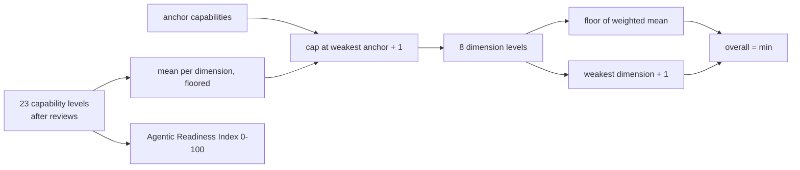

# Component: dimension and overall roll-up

Capability levels roll up to eight dimension levels, one weighted overall level and the 0-100 Agentic
Readiness Index. Anchor capabilities cap their dimension, and the overall level cannot sit more than one
level above the weakest dimension.

Sections: [1. Purpose](#1-purpose) · [2. Architecture](#2-architecture) · [3. How it works](#3-how-it-works) · [4. Key files](#4-key-files) · [5. Code excerpts](#5-code-excerpts) · [6. Configuration](#6-configuration) · [7. Commands](#7-commands) · [8. Real output](#8-real-output) · [9. Tests and gates](#9-tests-and-gates) · [10. Guardrails](#10-guardrails) · [11. Security and governance](#11-security-and-governance) · [12. Observability](#12-observability) · [13. Failure modes](#13-failure-modes) · [14. Mapping to Azure services](#14-mapping-to-azure-services) · [15. Limitations](#15-limitations) · [16. Interview talking points](#16-interview-talking-points) · [17. Adopt this](#17-adopt-this)

## 1. Purpose

* Summarise without hiding weak spots: anchors make foundations count, and the weakest-dimension cap stops one strong area from carrying the whole organisation.
* Weight what fails expensively: Agent Engineering, Security & Identity and Governance carry 0.14 each.
* Give leaders a number that moves between assessments: the readiness index shows progress inside a level.

## 2. Architecture



## 3. How it works

1. Final capability levels include human overrides.
2. Dimension level = floor(mean of its capabilities), capped at the weakest anchor capability in that dimension + 1.
3. Overall level = floor(weighted mean of dimension levels, weights from `framework/framework.yaml`), capped at the weakest dimension + 1.
4. Agentic Readiness Index = 100 x sum over dimensions of weight x (dimension mean - 1) / 4, using unrounded means.
5. Anchors default to one per dimension (SV-1, DF-2, PL-2, AE-1, SI-1, GR-1, PO-1, FC-1); `org.yaml` can override them.

## 4. Key files

| File | Role |
|---|---|
| `src/aimaturity/rollup.py` | dimension_rollup, overall, readiness_index |
| `framework/framework.yaml` | Dimension weights |
| `rubric/capabilities.yaml` | Default anchor list |
| `samples/valemont-revenue-agency/org.yaml` | Example of a custom anchor list |

## 5. Code excerpts

<!-- code: src/aimaturity/rollup.py::dimension_rollup -->
```python
def dimension_rollup(levels: dict[str, int], anchors: list[str]) -> list[dict[str, Any]]:
    out = []
    w = dimension_weights()
    for d in dimensions():
        ids = [c["id"] for c in d["capabilities"]]
        vals = [levels[i] for i in ids]
        mean = statistics.mean(vals)
        raw = math.floor(mean)
        anc = [levels[i] for i in ids if i in anchors]
        cap = min(anc) + 1 if anc else TOP
        lvl = min(raw, cap)
        out.append(
            {
                "id": d["id"],
                "name": d["name"],
                "weight": w[d["id"]],
                "level": lvl,
                "level_name": LEVEL_NAMES[lvl],
                "mean": round(mean, 2),
                "capped_by": [i for i in ids if i in anchors and levels[i] + 1 < raw],
            }
        )
    return out
```
<!-- /code -->

<!-- code: src/aimaturity/rollup.py::overall -->
```python
def overall(dimension_rows: list[dict[str, Any]]) -> dict[str, Any]:
    lv = [d["level"] for d in dimension_rows]
    weighted = sum(d["weight"] * d["level"] for d in dimension_rows)
    raw = math.floor(round(weighted, 6))
    lvl = min(raw, min(lv) + 1)
    return {
        "level": lvl,
        "level_name": LEVEL_NAMES[lvl],
        "mean": round(sum(d["weight"] * d["mean"] for d in dimension_rows), 2),
        "index": readiness_index(dimension_rows),
        "capped": lvl < raw,
    }
```
<!-- /code -->

## 6. Configuration

| Setting | Where |
|---|---|
| Dimension weights (sum to 1.0) | `framework/framework.yaml` `dimensions[].weight` |
| Default anchors | `rubric/capabilities.yaml` `anchors` |
| Per-org anchors | `org.yaml` `anchors` |

## 7. Commands

```bash
aimaturity assess --org portfolio
aimaturity assess --org kestrel-bay-bank --json
```

## 8. Real output

<!-- output: assess --org portfolio -->
```text
Jagadish Meduri portfolio: overall Level 2 (Prove), mean 3.29, Agentic Readiness Index 57.1
dimension  name                           level           mean  capped by
---------  -----------------------------  -----  -------  ----  ---------
SV         Strategy & Value               3      Operate  3     -
DF         Data Foundation                2      Prove    2     -
PL         Platform & LLMOps              4      Scale    4     -
AE         Agent Engineering              4      Scale    4.33  -
SI         Security & Identity            4      Scale    4.33  -
GR         Governance, Risk & Compliance  3      Operate  3.33  -
PO         People & Operating Model       1      Explore  1.67  -
FC         FinOps & Cost                  3      Operate  3     -

capability  level  computed  conf  status          target
----------  -----  --------  ----  --------------  ------
SV-1        3      3         0.41  pending-review  3
SV-2        2      2         0.71  auto            3
SV-3        4      4         0.71  auto            3
DF-1        1      1         0.57  pending-review  3
DF-2        4      4         0.71  auto            3
DF-3        1      1         0.3   pending-review  3
PL-1        4      4         0.76  auto            4
PL-2        4      4         0.76  auto            4
PL-3        4      4         0.71  auto            4
AE-1        5      5         1.0   auto            4
AE-2        4      4         0.76  auto            4
AE-3        4      4         0.63  pending-review  4
SI-1        4      4         0.67  auto            3
SI-2        4      4         0.64  auto            3
SI-3        5      5         1.0   auto            3
GR-1        2      2         0.57  pending-review  4
GR-2        4      4         0.71  auto            4
GR-3        4      4         0.68  auto            4
PO-1        2      2         0.38  pending-review  3
PO-2        2      2         0.26  pending-review  3
PO-3        1      1         0.3   pending-review  3
FC-1        4      4         0.64  auto            3
FC-2        2      2         0.59  pending-review  3

review queue: SV-1, DF-1, DF-3, AE-3, GR-1, PO-1, PO-2, PO-3, FC-2; final: False
```
<!-- /output -->

## 9. Tests and gates

* `tests/test_rollup.py`: uniform levels, mean floors, anchor cap, non-anchor does not cap, weights on every row, weighted overall, weakest-dimension cap, readiness index bounds and arithmetic.

## 10. Guardrails

* Overrides change final levels, never computed ones; the report shows both.

## 11. Security and governance

Runs offline with no credentials. Reads repositories through `git ls-files` and never executes their code; evidence holds paths and short match details, never file contents or secrets.

## 12. Observability

Dimension rows include `capped_by`, so a report reader sees which anchor held a dimension down; `summary.json` carries the means and the readiness index for trending.

## 13. Failure modes

| Failure | Behaviour |
|---|---|
| Strong dimension hides a weak one | overall capped at weakest + 1 |
| A weak foundation in a strong dimension | anchor cap |
| Weights edited so they no longer sum to one | `aimaturity validate` fails |

## 14. Mapping to Azure services

* **Power BI** or an **Azure Monitor workbook** can chart dimension means and the readiness index across runs from `summary.json`.
* **Microsoft Foundry**: a hosted model replaces `MockLLM` for rationales, and Foundry evaluations score rationale groundedness against the cited evidence.
* **Microsoft Purview**: register the evidence store and reports as data assets with lineage back to the scanned repositories, and keep questionnaire answers under a sensitivity label.
* **Azure Policy**: audit that the evidence store stays keyless and versioned and that the Key Vault keeps RBAC, so the controls the assessment relies on cannot drift silently.

## 15. Limitations

* Means of two or three capabilities move in coarse steps; the readiness index is the finer signal.
* Weights are a design choice, not an empirical fit; ADR 0007 records why they are set this way.

## 16. Interview talking points

* "Anchors are the capabilities the rest of a dimension stands on. A dimension can't be two levels above its own foundation."
* "The level is conservative on purpose; the readiness index is the number I trend, because it moves before the level does."

## 17. Adopt this

1. Set `anchors:` in your `org.yaml` to the capabilities you cannot compromise on, one or more per dimension.
2. If your board wants different weights, change them in `framework/framework.yaml`, record why in an ADR and rerun `aimaturity evals`.
