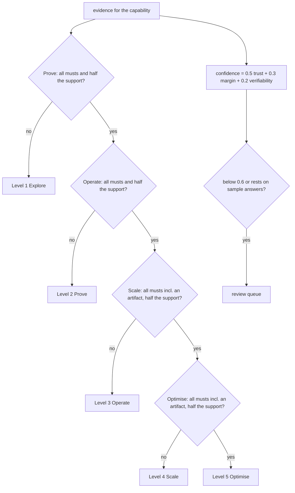

# Component: scoring and confidence

Each capability gets a level from 1 (Explore) to 5 (Optimise), a confidence between 0 and 1, the
evidence ids that justify the level and the must criteria that blocked the next one. The rules are short enough to explain in an interview and strict enough to test.

Sections: [1. Purpose](#1-purpose) · [2. Architecture](#2-architecture) · [3. How it works](#3-how-it-works) · [4. Key files](#4-key-files) · [5. Code excerpts](#5-code-excerpts) · [6. Configuration](#6-configuration) · [7. Commands](#7-commands) · [8. Real output](#8-real-output) · [9. Tests and gates](#9-tests-and-gates) · [10. Guardrails](#10-guardrails) · [11. Security and governance](#11-security-and-governance) · [12. Observability](#12-observability) · [13. Failure modes](#13-failure-modes) · [14. Mapping to Azure services](#14-mapping-to-azure-services) · [15. Limitations](#15-limitations) · [16. Interview talking points](#16-interview-talking-points) · [17. Adopt this](#17-adopt-this)

## 1. Purpose

* A level must be earned in order: evidence for Scale does not count if Operate is missing.
* Defining practices are **must** criteria; helpful ones are **support** criteria, so a changelog can never stand in for an evaluation gate.
* Confidence says how much to trust the level, so humans spend time where it matters.

## 2. Architecture



## 3. How it works

1. Each level from 2 to 5 has `must` and `support` criteria (signals or questions) in `rubric/capabilities.yaml`.
2. A level is reached when the level below is reached, every must is fully present (a partial answer never satisfies a must) and at least half the support criteria are present (a partial answer counts half). A level with no support criteria is decided by its musts.
3. Evidence ceiling: every must list at Scale and Optimise contains an artifact signal, so answers alone stop at Operate.
4. Source weights: artifact found 1.0; artifact searched for and absent 0.85 (0.5 when no repository was scanned); self-reported answer 0.55; sample answer 0.3; unanswered 0.15.
5. Margin: how far the decision sits from the edge on both sides (0 on the edge, 1 clear-cut).
6. Confidence = 0.5 x trust (mean source weight of the deciding criteria) + 0.3 x margin + 0.2 x verifiability (share of deciding criteria that are file-based).
7. Review if confidence < 0.6 or a reached level rests on a sample answer. `blocked_by` lists the musts that stopped the next level.

## 4. Key files

| File | Role |
|---|---|
| `src/aimaturity/scoring.py` | SignalState, CapabilityResult, score_capability |
| `rubric/capabilities.yaml` | Must and support criteria per level, support share |

## 5. Code excerpts

<!-- code: src/aimaturity/scoring.py::score_capability -->
```python
def score_capability(capability_id: str, evidence: list[Evidence], scanned_repos: bool = True) -> CapabilityResult:
    cap = capabilities()[capability_id]
    levels = cap["rubric"]["levels"]
    need = rubric()["support_share"]
    states = signal_states(capability_id, evidence, scanned_repos)
    ratios = {lvl: round(sum(states[s].present for s in criteria(capability_id, lvl)) / len(criteria(capability_id, lvl)), 3) for lvl in STEPS}
    level = 1
    for lvl in STEPS:
        if not level_passes(states, levels[lvl], need):
            break
        level = lvl
    # margin: 0 = the decision sits on the edge, 1 = clear-cut on both sides
    held = 1.0 if level == 1 else (support_share(states, levels[level]["support"]) - need) / (1 - need)
    failed = 1.0 if level == TOP else 1 - ratios[level + 1]
    margin = max(0.0, min(held, failed, 1.0))
    decided = list(dict.fromkeys(s for lvl in range(2, min(level + 1, TOP) + 1) for s in criteria(capability_id, lvl)))
    trust = sum(states[s].weight for s in decided) / len(decided)
    verifiable = sum(not is_question(s) for s in decided) / len(decided)
    mix = CONFIDENCE_MIX
    confidence = round(mix["trust"] * trust + mix["margin"] * margin + mix["verifiability"] * verifiable, 2)
    cited = list(dict.fromkeys(i for lvl in range(2, level + 1) for s in criteria(capability_id, lvl) for i in states[s].evidence))
    if level == TOP:
        missing, blocked = [], []
    else:
        missing = [s for s in criteria(capability_id, level + 1) if states[s].present < 1]
        blocked = [s for s in levels[level + 1]["must"] if states[s].present < 1]
    reasons = []
    if confidence < REVIEW_BELOW:
        reasons.append(f"confidence {confidence:.2f} below {REVIEW_BELOW}")
    sample = sorted(
        {s for lvl in range(2, level + 1) for s in criteria(capability_id, lvl) if states[s].basis == "sample-answers" and states[s].present > 0}
    )
    if sample:
        reasons.append("level rests on sample answers: " + ", ".join(sample))
    return CapabilityResult(
        capability_id,
        cap["name"],
        cap["dimension"],
        cap["anchor"],
        level,
        LEVEL_NAMES[level],
        confidence,
        ratios,
        states,
        cited,
        missing,
        bool(reasons),
        reasons,
        blocked,
    )
```
<!-- /code -->

<!-- code: src/aimaturity/scoring.py::WEIGHTS -->
```python
WEIGHTS = {"artifact": 1.0, "absent-scanned": 0.85, "absent-unscanned": 0.5, "self-reported": 0.55, "sample-answers": 0.3, "unanswered": 0.15}
```
<!-- /code -->

## 6. Configuration

| Knob | Where | Default |
|---|---|---|
| Support share | `rubric/capabilities.yaml` `support_share` | 0.5 |
| Review bar | `scoring.REVIEW_BELOW` | 0.6 |
| Confidence mix | `scoring.CONFIDENCE_MIX` | trust 0.5, margin 0.3, verifiability 0.2 |
| Source weights | `scoring.WEIGHTS` | see above |

## 7. Commands

```bash
aimaturity explain --org portfolio --capability DF-3
aimaturity explain --org valemont-revenue-agency --capability PO-2
```

## 8. Real output

<!-- output: explain --org portfolio --capability DF-3 -->
```text
DF-3 Governed Access & Synthetic Data: level 1 (Explore), confidence 0.30, status pending-review
rationale: Level 1 (Explore). No artifact or answer supports a level above Explore. Next level needs: q_access_process. Confidence 0.30.
  [~] q_access_process             sample-answers   E570
  [x] synthetic_generator          artifact         E690, E691, E692
  [x] data_access_platform         artifact         E222, E223, E224
  [ ] q_self_service_data          sample-answers   
  [x] synthetic_validation         artifact         E708, E709, E710
  [~] q_synthetic_strategy         sample-answers   E614
needs review: confidence 0.30 below 0.6
```
<!-- /output -->

<!-- output: explain --org valemont-revenue-agency --capability PO-2 -->
```text
PO-2 Skills & AI Literacy: level 3 (Operate), confidence 0.40, status overridden
rationale: Level 3 (Operate). Supported by [E035], [E030], [E022], [E066]. Next level needs: q_hr_integration. Confidence 0.40.
  [x] q_awareness_material         self-reported    E035
  [x] q_ai_roles_defined           self-reported    E030
  [x] learning_material            artifact         E022
  [x] q_role_literacy              self-reported    E066
  [ ] q_training_paths             self-reported    
  [x] onboarding_guide             artifact         E025
  [ ] q_hr_integration             self-reported    
  [ ] q_continuous_learning        self-reported    
  E035 questionnaire:q_awareness_material (answer yes)
  E030 questionnaire:q_ai_roles_defined (answer yes)
  E022 vra-digital-office:training/intro-to-ai.md (file present)
  E066 questionnaire:q_role_literacy (answer yes)
needs review: confidence 0.40 below 0.6
```
<!-- /output -->

## 9. Tests and gates

* `tests/test_scoring.py`: Explore with no evidence and Optimise with all for every capability, each level reached exactly, musts alone reach a level, a missing must blocks even with full support, half the support is enough, partial answers never satisfy a must, answers alone stop at Operate, `blocked_by`, weight order, review flags.
* Eval gates: calibration (exact agreement >= 0.80, within one >= 0.97, high-confidence accuracy >= low-confidence accuracy).

## 10. Guardrails

* Levels never skip; the margin term means borderline capabilities are reviewed.
* The scorer is pure: same evidence, same result (the stability gate checks shuffled order).
* `aimaturity validate` rejects a Scale or Optimise must list without an artifact.

## 11. Security and governance

Runs offline with no credentials. Reads repositories through `git ls-files` and never executes their code; evidence holds paths and short match details, never file contents or secrets.

## 12. Observability

`explain` prints each signal with its basis (artifact, absent-scanned, self-reported, sample-answers, unanswered) and the cited ids.

## 13. Failure modes

| Failure | Behaviour |
|---|---|
| One missing foundation artifact | capability drops to the level below it; dropout eval measures how often |
| Strong answers, no artifacts | capped at Operate by the evidence ceiling |
| Odd number of support criteria | half is computed exactly, so one of two passes and two of three pass |

## 14. Mapping to Azure services

* **Azure Monitor** custom metrics can carry level and confidence per capability per run.
* **Microsoft Foundry**: a hosted model replaces `MockLLM` for rationales, and Foundry evaluations score rationale groundedness against the cited evidence.
* **Microsoft Purview**: register the evidence store and reports as data assets with lineage back to the scanned repositories, and keep questionnaire answers under a sensitivity label.
* **Azure Policy**: audit that the evidence store stays keyless and versioned and that the Key Vault keeps RBAC, so the controls the assessment relies on cannot drift silently.

## 15. Limitations

* Linear weights are a modelling choice; the calibration eval is the evidence that they are reasonable, not proof.
* Stepwise levels make a single missing foundation artifact costly; that is intentional and documented.

## 16. Interview talking points

* "A level needs every must, half its support and the level below. From Scale up, a must has to be a file, not an answer."
* "Confidence blends source trust, how close the call was and how much of it I could verify from files."

## 17. Adopt this

1. Tune `support_share` and `REVIEW_BELOW`, then run `aimaturity evals`; keep calibration above its gates.
2. Change source weights in `WEIGHTS` if your answers are audited (for example, raise self-reported to 0.7).
3. Move a criterion between must and support, or between levels, in `rubric/capabilities.yaml` to reflect your own definition of Operate or Scale; `aimaturity validate` keeps the evidence ceiling.
