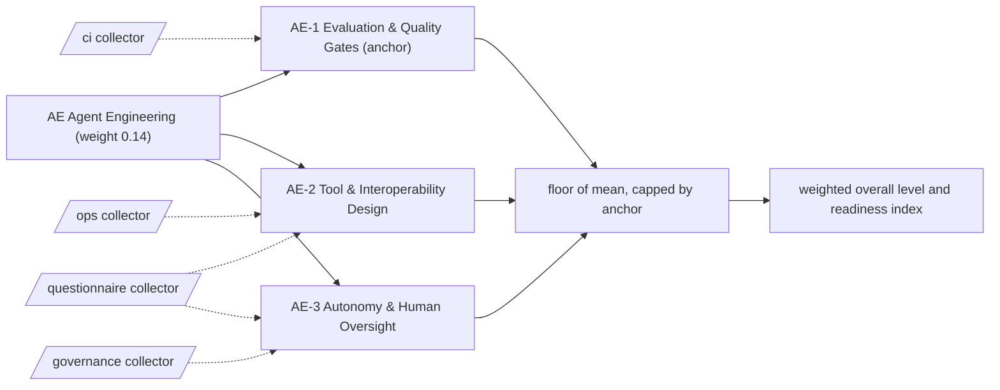

# AE: Agent Engineering

How agents are evaluated, how their tools are designed and how much autonomy they are allowed. 3 capabilities; weight 0.14 in the overall level and the Agentic Readiness Index; levels Explore, Prove, Operate, Scale, Optimise.

Sections: [1. Purpose](#1-purpose) · [2. Architecture](#2-architecture) · [3. How it works](#3-how-it-works) · [4. Key files](#4-key-files) · [5. Code excerpts](#5-code-excerpts) · [6. Configuration](#6-configuration) · [7. Commands](#7-commands) · [8. Real output](#8-real-output) · [9. Tests and gates](#9-tests-and-gates) · [10. Guardrails](#10-guardrails) · [11. Security and governance](#11-security-and-governance) · [12. Observability](#12-observability) · [13. Failure modes](#13-failure-modes) · [14. Mapping to Azure services](#14-mapping-to-azure-services) · [15. Limitations](#15-limitations) · [16. Interview talking points](#16-interview-talking-points) · [17. Adopt this](#17-adopt-this)

## 1. Purpose

* Agent Engineering asks how agents are evaluated, how they expose and call tools, and how much autonomy they have. It carries one of the highest weights because an agent that acts on systems fails expensively when evaluation, interfaces or autonomy limits are weak.
* Default anchor: AE-1. The dimension cannot sit more than one level above its weakest anchor.

## 2. Architecture



## 3. How it works

Evidence comes from the `ci`, `api` and `governance` collectors: evaluation suites, evaluation gates in CI, tracked experiment history, doc-drift checks, API contracts, MCP servers, A2A agent cards, event integration, reuse catalogues, human approval steps, explanations and audit logs. Questions cover autonomy tiers, measured reuse and involvement of the people affected.

A capability reaches a level when the level below is reached, every **must** criterion is fully present and at least half of the **support** criteria are present (a partial answer counts half and never satisfies a must). From Scale upwards every must list holds a file-based artifact. The dimension level is the floor of the mean of its capability levels, capped one level above its weakest anchor.

**AE-1 Evaluation & Quality Gates** (anchor): Whether agent behaviour is measured by an evaluation suite and whether those results gate releases.

| Level | What it looks like | Evidence the assessor needs |
|---|---|---|
| 1 Explore | Quality is judged by trying a few prompts by hand. | nothing (starting point) |
| 2 Prove | An evaluation suite exists for the main agent behaviours. | must `eval_suite` |
| 3 Operate | CI blocks merges on evaluation results. | must `eval_gate_ci` |
| 4 Scale | Evaluation results are tracked as history across runs. | must `experiment_tracking` |
| 5 Optimise | Documentation and published numbers are regenerated from real evaluation runs and drift-checked in CI. | must `doc_drift_check` |

Crosswalk: NIST AI RMF MEASURE 1, MEASURE 2; ISO/IEC 42001 9.1, A.6; EU AI Act Art. 15.

**AE-2 Tool & Interoperability Design**: How agent tools and agent-to-agent interfaces are specified, exposed and reused.

| Level | What it looks like | Evidence the assessor needs |
|---|---|---|
| 1 Explore | Agents call internal systems through ad hoc scripts. | nothing (starting point) |
| 2 Prove | Services that agents call expose documented API contracts. | must `api_contract` |
| 3 Operate | Tools are exposed over the Model Context Protocol. | must `mcp_server` |
| 4 Scale | Agents publish A2A agent cards and can integrate through events as well as calls. | must `a2a_card`; support `event_driven` |
| 5 Optimise | Tools and agents are listed in a reuse catalogue and reuse is measured. | must `reuse_catalog`, `q_reuse_measured` |

Crosswalk: NIST AI RMF MAP 4, GOVERN 6; ISO/IEC 42001 A.10, A.6; EU AI Act Art. 15.

**AE-3 Autonomy & Human Oversight**: Which actions an agent may take alone, where a human must approve, and how decisions are recorded.

| Level | What it looks like | Evidence the assessor needs |
|---|---|---|
| 1 Explore | Agents act with whatever permissions they were given and nobody reviews actions. | nothing (starting point) |
| 2 Prove | Risky actions require a human approval step. | must `hitl_approval` |
| 3 Operate | Agent outputs carry their reasons so a reviewer can follow each decision. | must `explainability` |
| 4 Scale | Each agent has an autonomy tier and every decision is written to an audit log. | must `audit_log`, `q_autonomy_tiers` |
| 5 Optimise | The people affected help set autonomy limits, and every decision stays auditable. | must `audit_log`, `q_affected_people` |

Crosswalk: NIST AI RMF GOVERN 2, MANAGE 2; ISO/IEC 42001 A.9, A.6; EU AI Act Art. 12, Art. 14.

## 4. Key files

| File | Role |
|---|---|
| `framework/framework.yaml` | AE weight, capabilities, level descriptors, actions and standards crosswalk |
| `rubric/capabilities.yaml` | Must and support criteria per level, effort, dependencies, anchors |
| `rubric/signals.yaml` | What each file-based signal looks for |
| `rubric/questionnaire.yaml` | Questions for what code cannot show |

## 5. Code excerpts

<!-- code: src/aimaturity/agents/llm.py::cited_ids -->
```python
def cited_ids(text: str) -> list[str]:
    return CITE.findall(text)
```
<!-- /code -->

<!-- code: src/aimaturity/agents/assessor.py::_verify -->
```python
def _verify(s):
    """Reject rationales that cite unknown evidence, cite evidence outside the capability, or claim another level."""
    issues, fixed = [], {}
    for cid, text in s["rationales"].items():
        res = s["results"][cid]
        cites = cited_ids(text)
        bad = [c for c in cites if c not in s["evidence_by_id"]]
        foreign = [c for c in cites if c in s["evidence_by_id"] and c not in res.evidence]
        lvl = claimed_level(text)
        problems = []
        if bad:
            problems.append(f"unknown evidence {bad}")
        if foreign:
            problems.append(f"evidence not used by this capability {foreign}")
        if lvl != res.level:
            problems.append(f"claims level {lvl}, scored {res.level}")
        if problems:
            issues.append({"capability": cid, "problems": problems})
            text = template_rationale(_facts(res))
        fixed[cid] = text
    return {**s, "rationales": fixed, "verification_issues": issues}
```
<!-- /code -->

## 6. Configuration

| Capability | Effort per step | Depends on | Anchor (default) |
|---|---|---|---|
| AE-1 | 2:S, 3:M, 4:M, 5:L | PL-1 | yes |
| AE-2 | 2:S, 3:M, 4:M, 5:M | PL-1 | no |
| AE-3 | 2:S, 3:M, 4:M, 5:L | AE-1, GR-1 | no |

| Signal or question | Collector | Meaning |
|---|---|---|
| `a2a_card` | ops | Agents publish an A2A agent card |
| `api_contract` | ops | Services expose documented APIs |
| `audit_log` | governance | Decisions are written to an audit log (ideally tamper-evident) |
| `doc_drift_check` | ci | Documentation is regenerated and drift-checked in CI |
| `eval_gate_ci` | ci | CI blocks merges on evaluation results |
| `eval_suite` | ci | An evaluation suite for AI behaviour exists |
| `event_driven` | ops | Event or message infrastructure connects systems |
| `experiment_tracking` | ci | Experiment or evaluation results are tracked as files or in a tracking tool |
| `explainability` | governance | Outputs carry explanations (key factors, rationale, citations) |
| `hitl_approval` | governance | Human-in-the-loop approval or sign-off is implemented |
| `mcp_server` | ops | Tools are exposed over the Model Context Protocol |
| `q_affected_people` | questionnaire | Are people affected by AI involved in design and in tracking ethical outcomes? |
| `q_autonomy_tiers` | questionnaire | Is every agent assigned an autonomy tier that fixes which actions need human approval? |
| `q_reuse_measured` | questionnaire | Is reuse of shared AI components funded and measured? |
| `reuse_catalog` | ops | A catalogue of reusable components is published |

## 7. Commands

```bash
aimaturity framework --dimension AE
aimaturity capability AE-1
aimaturity explain --org portfolio --capability AE-1
aimaturity gaps --org kestrel-bay-bank
```

## 8. Real output

<!-- output: framework --dimension AE -->
```text
capability  name                            anchor
----------  ------------------------------  ------
AE-1        Evaluation & Quality Gates      yes
AE-2        Tool & Interoperability Design
AE-3        Autonomy & Human Oversight
```
<!-- /output -->

<!-- output: capability AE-1 -->
```text
AE-1 Evaluation & Quality Gates (AE Agent Engineering) - anchor
Whether agent behaviour is measured by an evaluation suite and whether those results gate releases.
  1 Explore: Quality is judged by trying a few prompts by hand.
  2 Prove: An evaluation suite exists for the main agent behaviours.
  3 Operate: CI blocks merges on evaluation results.
  4 Scale: Evaluation results are tracked as history across runs.
  5 Optimise: Documentation and published numbers are regenerated from real evaluation runs and drift-checked in CI.
  must for 2: eval_suite (An evaluation suite for AI behaviour exists)
  must for 3: eval_gate_ci (CI blocks merges on evaluation results)
  must for 4: experiment_tracking (Experiment or evaluation results are tracked as files or in a tracking tool)
  must for 5: doc_drift_check (Documentation is regenerated and drift-checked in CI)
```
<!-- /output -->

<!-- output: explain --org portfolio --capability AE-1 -->
```text
AE-1 Evaluation & Quality Gates: level 5 (Optimise), confidence 1.00, status auto
rationale: Level 5 (Optimise). Supported by [E326], [E327], [E328], [E329]. Confidence 1.00.
  [x] eval_suite                   artifact         E326, E327, E328
  [x] eval_gate_ci                 artifact         E321, E322, E323
  [x] experiment_tracking          artifact         E359, E360, E361
  [x] doc_drift_check              artifact         E287, E288, E289
  E326 agentic-ai-portfolio:evals/README.md (file present)
  E327 agentic-ai-portfolio:evals/__init__.py (file present)
  E328 agentic-ai-portfolio:evals/__main__.py (file present)
  E329 azure-agent-labs:labs/disaster-signal-fusion/evals/README.md (file present)
  E330 azure-agent-labs:labs/disaster-signal-fusion/evals/gold/README.md (file present)
  E331 azure-agent-labs:labs/disaster-signal-fusion/evals/gold/replay.jsonl (file present)
  E332 azure-agent-platform:src/agentplatform/evals/README.md (file present)
  E333 azure-agent-platform:src/agentplatform/evals/__init__.py (file present)
```
<!-- /output -->

## 9. Tests and gates

* `tests/test_framework.py`: every capability has five descriptors, four actions, a must list per level and a three-standard crosswalk.
* `tests/test_scoring.py`: no evidence gives Explore, full evidence gives Optimise, each level is reached exactly, musts gate and half the support is enough.
* `tests/test_repo_hygiene.py`: this page names every capability and every signal it scores, and its output blocks match a fresh run.
* Eval gates: calibration against labelled levels covers every AE capability; stability checks that dropping one artifact moves at most two capabilities.

## 10. Guardrails

* AE is capped by AE-1 by default: without the anchor, the rest of the dimension cannot lift it more than one level.
* Answers alone stop at Operate: every Scale and Optimise must list contains an artifact.
* Anything that rests on sample answers goes to human review, whatever its confidence.

## 11. Security and governance

Assessments read repositories without executing them and cite file paths, never file contents. Questionnaire answers can hold internal judgements: keep them in the evidence store's `evidence` container (private, versioned, Entra-only).

## 12. Observability

Each scheduled run writes a `summary.json` per organisation with the AE level, mean, weight, confidence per capability and the review queue; upload it to Log Analytics and trend the Agentic Readiness Index between assessments.

## 13. Failure modes

| Failure | What the assessor does |
|---|---|
| Evaluations run by hand | AE-1 stays at Prove; `eval_gate_ci` blocks Operate |
| Tools wired directly into prompts | AE-2 stays at Prove until an MCP server exposes them |
| Agents without autonomy tiers | AE-3 stops at Operate even with an audit log |

## 14. Mapping to Azure services

* **Foundry** evaluations and tracing supply `eval_suite`, `experiment_tracking` and evaluation gates.
* **Azure API Management** fronts tools and MCP servers; **Azure Monitor** keeps the audit trail queryable.
* **Azure Policy** and **Microsoft Purview** classify which data an autonomous action may touch.

## 15. Limitations

* The assessor checks that an evaluation suite exists and gates CI, not that its metrics are the right ones.
* Autonomy tiers are questionnaire-led until they are written as code.

## 16. Interview talking points

* "The assessor is itself an agent: its rationales must cite evidence IDs, and a verifier rejects any citation that was not collected."
* "AE-1 Optimise needs docs regenerated from real runs; this repository fails CI when a number in a doc drifts from the code."

## 17. Adopt this

1. Add an evaluation suite and make it a required CI check.
2. Expose tools through an MCP server and publish an A2A card per agent.
3. Assign each agent an autonomy tier and log every decision.
