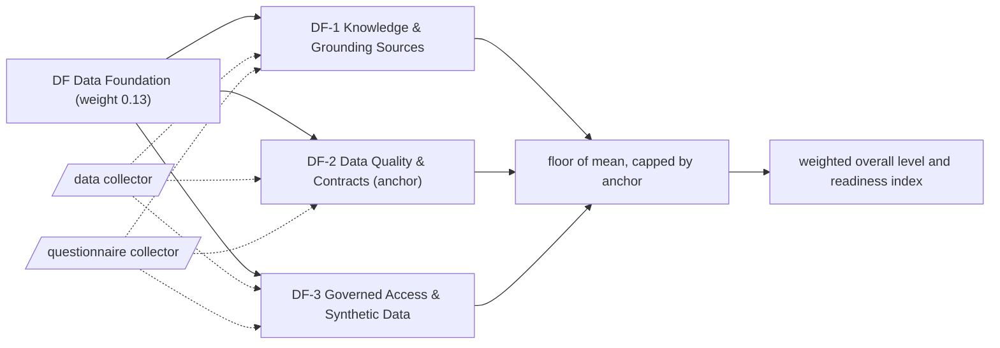

# DF: Data Foundation

The knowledge, data contracts, quality and access that agents depend on to give grounded answers. 3 capabilities; weight 0.13 in the overall level and the Agentic Readiness Index; levels Explore, Prove, Operate, Scale, Optimise.

Sections: [1. Purpose](#1-purpose) · [2. Architecture](#2-architecture) · [3. How it works](#3-how-it-works) · [4. Key files](#4-key-files) · [5. Code excerpts](#5-code-excerpts) · [6. Configuration](#6-configuration) · [7. Commands](#7-commands) · [8. Real output](#8-real-output) · [9. Tests and gates](#9-tests-and-gates) · [10. Guardrails](#10-guardrails) · [11. Security and governance](#11-security-and-governance) · [12. Observability](#12-observability) · [13. Failure modes](#13-failure-modes) · [14. Mapping to Azure services](#14-mapping-to-azure-services) · [15. Limitations](#15-limitations) · [16. Interview talking points](#16-interview-talking-points) · [17. Adopt this](#17-adopt-this)

## 1. Purpose

* Data Foundation asks whether agents are grounded on known, owned and tested data, and whether teams can get that data safely. Its weight reflects that an agent with unknown sources gives unknowable answers.
* Default anchor: DF-2. The dimension cannot sit more than one level above its weakest anchor.

## 2. Architecture



## 3. How it works

Evidence comes from the `data` collector (data-needs documents, glossaries and semantic models, catalogues, contracts, quality tests, data sheets, synthetic data generators and their validation) and from questions about domain experts, access processes and sharing agreements.

A capability reaches a level when the level below is reached, every **must** criterion is fully present and at least half of the **support** criteria are present (a partial answer counts half and never satisfies a must). From Scale upwards every must list holds a file-based artifact. The dimension level is the floor of the mean of its capability levels, capped one level above its weakest anchor.

**DF-1 Knowledge & Grounding Sources**: Which documents, tables and domain knowledge each agent is grounded on, and who vouches for them.

| Level | What it looks like | Evidence the assessor needs |
|---|---|---|
| 1 Explore | Agents are pointed at whatever folder is handy; nobody lists the sources. | nothing (starting point) |
| 2 Prove | Each use case lists the data it needs and a domain expert is attached to the project. | must `data_needs`; support `q_domain_experts` |
| 3 Operate | Domain knowledge is written down as glossaries or semantic models the agent can rely on. | must `domain_docs` |
| 4 Scale | Sources are catalogued with lineage and domain experts sit inside the agent teams. | must `data_catalog`; support `q_embedded_smes` |
| 5 Optimise | Grounding sources are planned ahead of demand, with sharing agreements in place before a use case asks. | must `data_catalog`, `q_data_sharing_agreements` |

Crosswalk: NIST AI RMF MAP 2, MAP 4; ISO/IEC 42001 A.7; EU AI Act Art. 10.

**DF-2 Data Quality & Contracts** (anchor): Whether datasets feeding agents have contracts, automated quality checks and continuous monitoring.

| Level | What it looks like | Evidence the assessor needs |
|---|---|---|
| 1 Explore | Data is used as found; problems surface as user complaints. | nothing (starting point) |
| 2 Prove | Data contracts or schemas define the datasets agents read. | must `data_contracts` |
| 3 Operate | Quality rules run automatically and block bad loads. | must `data_quality_tests` |
| 4 Scale | Every dataset agents read carries a data sheet describing meaning, owner and known limits. | must `data_sheets` |
| 5 Optimise | Quality is monitored continuously in production and issues are fixed before users notice. | must `data_sheets`, `q_dq_monitoring` |

Crosswalk: NIST AI RMF MEASURE 2, MANAGE 4; ISO/IEC 42001 A.7; EU AI Act Art. 10.

**DF-3 Governed Access & Synthetic Data**: How agent teams get policy-compliant access to data, and how synthetic data replaces sensitive data where it can.

| Level | What it looks like | Evidence the assessor needs |
|---|---|---|
| 1 Explore | Access is granted by favour and copies of production data sit on laptops. | nothing (starting point) |
| 2 Prove | A published request process governs which data agents may use. | must `q_access_process` |
| 3 Operate | Synthetic data is generated in code so agents can be tested without production records. | must `synthetic_generator` |
| 4 Scale | A governed data platform serves agent teams, with self-service access inside policy. | must `data_access_platform`; support `q_self_service_data` |
| 5 Optimise | Synthetic data is validated for fidelity and is a standard option in the data strategy. | must `synthetic_validation`, `q_synthetic_strategy` |

Crosswalk: NIST AI RMF GOVERN 1, MANAGE 1; ISO/IEC 42001 A.7, A.4; EU AI Act Art. 10.

## 4. Key files

| File | Role |
|---|---|
| `framework/framework.yaml` | DF weight, capabilities, level descriptors, actions and standards crosswalk |
| `rubric/capabilities.yaml` | Must and support criteria per level, effort, dependencies, anchors |
| `rubric/signals.yaml` | What each file-based signal looks for |
| `rubric/questionnaire.yaml` | Questions for what code cannot show |

## 5. Code excerpts

<!-- code: src/aimaturity/collectors/__init__.py::matches -->
```python
def matches(signal_id: str, rel_path: str, text: str) -> bool:
    s = signals()[signal_id]
    p = PurePosixPath(rel_path)
    if not any(p.full_match(g) for g in s["paths"]):
        return False
    rx = _compiled(signal_id)
    return rx is None or bool(rx.search(text))
```
<!-- /code -->

<!-- code: src/aimaturity/collectors/__init__.py::collect_source -->
```python
def collect_source(source, max_per_signal: int = 3) -> list[Evidence]:
    """All file-based evidence in one source; at most ``max_per_signal`` citations per signal."""
    out: list[Evidence] = []
    counts: dict[str, int] = {}
    file_signals = [sid for sid in signals()]
    for rel in source.files():
        text = None
        for sid in file_signals:
            if counts.get(sid, 0) >= max_per_signal:
                continue
            s = signals()[sid]
            if not any(PurePosixPath(rel).full_match(g) for g in s["paths"]):
                continue
            if text is None:
                text = source.read(rel)
            if matches(sid, rel, text):
                counts[sid] = counts.get(sid, 0) + 1
                out.append(Evidence(sid, s["collector"], source.name, rel, _detail(sid, text)))
    return out
```
<!-- /code -->

## 6. Configuration

| Capability | Effort per step | Depends on | Anchor (default) |
|---|---|---|---|
| DF-1 | 2:S, 3:M, 4:M, 5:L | SV-2 | no |
| DF-2 | 2:S, 3:M, 4:M, 5:L | DF-1 | yes |
| DF-3 | 2:S, 3:M, 4:L, 5:M | DF-1, SI-1 | no |

| Signal or question | Collector | Meaning |
|---|---|---|
| `data_access_platform` | data | Data is served through a governed data platform |
| `data_catalog` | data | Data is catalogued with lineage (for example Microsoft Purview) |
| `data_contracts` | data | Data contracts or schemas define datasets |
| `data_needs` | data | Data needs or sources are listed per use case |
| `data_quality_tests` | data | Data quality is tested automatically |
| `data_sheets` | data | Data sheets describe datasets and their meaning |
| `domain_docs` | data | Domain knowledge is documented (domain docs, glossary, semantic model) |
| `q_access_process` | questionnaire | Is there a published data access request process? |
| `q_data_sharing_agreements` | questionnaire | Are strategic data assets and sharing agreements planned ahead of need? |
| `q_domain_experts` | questionnaire | Are domain experts part of each AI project? |
| `q_dq_monitoring` | questionnaire | Is data quality monitored continuously in production? |
| `q_embedded_smes` | questionnaire | Are domain experts embedded in AI teams with a shared knowledge base? |
| `q_self_service_data` | questionnaire | Can AI teams get policy-compliant data access through self-service? |
| `q_synthetic_strategy` | questionnaire | Is synthetic data a standard option in the data strategy with fidelity and privacy checks? |
| `synthetic_generator` | data | Synthetic data is generated in code |
| `synthetic_validation` | data | Synthetic data is validated (determinism or property tests) |

## 7. Commands

```bash
aimaturity framework --dimension DF
aimaturity capability DF-2
aimaturity explain --org portfolio --capability DF-2
aimaturity gaps --org kestrel-bay-bank
```

## 8. Real output

<!-- output: framework --dimension DF -->
```text
capability  name                              anchor
----------  --------------------------------  ------
DF-1        Knowledge & Grounding Sources
DF-2        Data Quality & Contracts          yes
DF-3        Governed Access & Synthetic Data
```
<!-- /output -->

<!-- output: capability DF-2 -->
```text
DF-2 Data Quality & Contracts (DF Data Foundation) - anchor
Whether datasets feeding agents have contracts, automated quality checks and continuous monitoring.
  1 Explore: Data is used as found; problems surface as user complaints.
  2 Prove: Data contracts or schemas define the datasets agents read.
  3 Operate: Quality rules run automatically and block bad loads.
  4 Scale: Every dataset agents read carries a data sheet describing meaning, owner and known limits.
  5 Optimise: Quality is monitored continuously in production and issues are fixed before users notice.
  must for 2: data_contracts (Data contracts or schemas define datasets)
  must for 3: data_quality_tests (Data quality is tested automatically)
  must for 4: data_sheets (Data sheets describe datasets and their meaning)
  must for 5: data_sheets (Data sheets describe datasets and their meaning); q_dq_monitoring (Is data quality monitored continuously in production?)
```
<!-- /output -->

<!-- output: explain --org portfolio --capability DF-2 -->
```text
DF-2 Data Quality & Contracts: level 4 (Scale), confidence 0.71, status auto
rationale: Level 4 (Scale). Supported by [E252], [E253], [E254], [E255]. Next level needs: q_dq_monitoring. Confidence 0.71.
  [x] data_contracts               artifact         E252, E253, E254
  [x] data_quality_tests           artifact         E263, E264, E265
  [x] data_sheets                  artifact         E271, E272, E273
  [ ] q_dq_monitoring              sample-answers   
  E252 agentic-ai-model-risk:schemas/approvals.schema.json (file present)
  E253 agentic-ai-model-risk:schemas/data-sheet.schema.json (file present)
  E254 agentic-ai-model-risk:schemas/inventory.schema.json (file present)
  E255 fabric-enterprise-bi:contracts/README.md (file present)
  E256 fabric-enterprise-bi:contracts/products/README.md (file present)
  E257 fabric-enterprise-bi:contracts/products/customer-care-insights.yaml (file present)
  E263 agentic-ai-portfolio:projects/16-telecom-outage-care/outage_care/graph.py (matched 'freshness')
  E264 agentic-ai-portfolio:projects/16-telecom-outage-care/tests/test_outage_care.py (matched 'freshness')
```
<!-- /output -->

## 9. Tests and gates

* `tests/test_framework.py`: every capability has five descriptors, four actions, a must list per level and a three-standard crosswalk.
* `tests/test_scoring.py`: no evidence gives Explore, full evidence gives Optimise, each level is reached exactly, musts gate and half the support is enough.
* `tests/test_repo_hygiene.py`: this page names every capability and every signal it scores, and its output blocks match a fresh run.
* Eval gates: calibration against labelled levels covers every DF capability; stability checks that dropping one artifact moves at most two capabilities.

## 10. Guardrails

* DF is capped by DF-2 by default: without the anchor, the rest of the dimension cannot lift it more than one level.
* Answers alone stop at Operate: every Scale and Optimise must list contains an artifact.
* Anything that rests on sample answers goes to human review, whatever its confidence.

## 11. Security and governance

Assessments read repositories without executing them and cite file paths, never file contents. Questionnaire answers can hold internal judgements: keep them in the evidence store's `evidence` container (private, versioned, Entra-only).

## 12. Observability

Each scheduled run writes a `summary.json` per organisation with the DF level, mean, weight, confidence per capability and the review queue; upload it to Log Analytics and trend the Agentic Readiness Index between assessments.

## 13. Failure modes

| Failure | What the assessor does |
|---|---|
| Contracts without quality tests | DF-2 stays at Prove; `data_quality_tests` blocks Operate |
| A platform with no request process | DF-3 stays at Explore because `q_access_process` is the Prove must |
| Synthetic data that is never validated | DF-3 stops at Scale |

## 14. Mapping to Azure services

* **Microsoft Purview** Data Map and catalogue are the natural home for `data_catalog` and lineage.
* **Microsoft Fabric** semantic models and data pipelines supply `domain_docs` and `data_quality_tests`.
* **Foundry** connections and **Azure Policy** on storage accounts keep agent data access inside policy; **Azure Monitor** alerts on failed quality runs.

## 15. Limitations

* The assessor sees that a quality test exists, not whether it covers the right columns.
* Sharing agreements and expert embedding are questionnaire-led.

## 16. Interview talking points

* "Every evidence signal decides one capability, so a missing data sheet moves DF-2 and nothing else."
* "My Fabric repository is linked in `org.yaml`, and the link check fails CI if it stops supplying DF-2 evidence."

## 17. Adopt this

1. Write a `data-needs.md` per use case and a data contract per dataset.
2. Add quality tests that fail the load, then a data sheet per dataset.
3. Publish the data access process so DF-3 has a Prove must.
