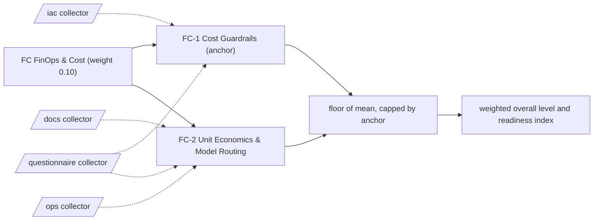

# FC: FinOps & Cost

Guardrails and unit economics for token, compute and platform spend. 2 capabilities; weight 0.10 in the overall level and the Agentic Readiness Index; levels Explore, Prove, Operate, Scale, Optimise.

Sections: [1. Purpose](#1-purpose) · [2. Architecture](#2-architecture) · [3. How it works](#3-how-it-works) · [4. Key files](#4-key-files) · [5. Code excerpts](#5-code-excerpts) · [6. Configuration](#6-configuration) · [7. Commands](#7-commands) · [8. Real output](#8-real-output) · [9. Tests and gates](#9-tests-and-gates) · [10. Guardrails](#10-guardrails) · [11. Security and governance](#11-security-and-governance) · [12. Observability](#12-observability) · [13. Failure modes](#13-failure-modes) · [14. Mapping to Azure services](#14-mapping-to-azure-services) · [15. Limitations](#15-limitations) · [16. Interview talking points](#16-interview-talking-points) · [17. Adopt this](#17-adopt-this)

## 1. Purpose

* FinOps & Cost asks whether agent spend is guarded, provisioned as code, elastic and tied to unit economics. Token costs scale with use, so a successful agent without cost controls becomes a budget incident.
* Default anchor: FC-1. The dimension cannot sit more than one level above its weakest anchor.

## 2. Architecture



## 3. How it works

Evidence comes from the `iac` and `ops` collectors (budgets and cost guards, model deployments in IaC, autoscale rules) and from value code (`value_tracking_code`, `business_metric_link`). Questions cover cost reviews, model routing and automatic improvement.

A capability reaches a level when the level below is reached, every **must** criterion is fully present and at least half of the **support** criteria are present (a partial answer counts half and never satisfies a must). From Scale upwards every must list holds a file-based artifact. The dimension level is the floor of the mean of its capability levels, capped one level above its weakest anchor.

**FC-1 Cost Guardrails** (anchor): Budgets, caps, teardown and scaling rules that keep agent spend inside agreed limits.

| Level | What it looks like | Evidence the assessor needs |
|---|---|---|
| 1 Explore | Spend is discovered on the monthly invoice. | nothing (starting point) |
| 2 Prove | Budgets or ingestion caps are provisioned as code. | must `cost_guard` |
| 3 Operate | Managed AI services are provisioned as code, so every model deployment has a known owner and cost. | must `cloud_ai_service` |
| 4 Scale | Workloads scale elastically with demand. | must `autoscale` |
| 5 Optimise | Spend is reviewed and optimised on a cadence across elastic workloads. | must `autoscale`, `q_cost_optimisation_cadence` |

Crosswalk: NIST AI RMF MANAGE 2; ISO/IEC 42001 A.4; EU AI Act no direct article.

**FC-2 Unit Economics & Model Routing**: Cost per task, cost per outcome and the routing of work to the cheapest model that meets quality.

| Level | What it looks like | Evidence the assessor needs |
|---|---|---|
| 1 Explore | Nobody knows what one agent task costs. | nothing (starting point) |
| 2 Prove | Unit cost per task is computed in tested code from real usage. | must `value_tracking_code` |
| 3 Operate | Requests are routed between models by measured cost, latency and quality. | must `q_model_routing`; support `telemetry` |
| 4 Scale | Unit cost is joined to business outcomes in monitoring. | must `business_metric_link` |
| 5 Optimise | Cost and quality regressions open improvement work automatically. | must `business_metric_link`, `q_auto_improve` |

Crosswalk: NIST AI RMF MAP 3, MEASURE 1; ISO/IEC 42001 9.1; EU AI Act no direct article.

## 4. Key files

| File | Role |
|---|---|
| `framework/framework.yaml` | FC weight, capabilities, level descriptors, actions and standards crosswalk |
| `rubric/capabilities.yaml` | Must and support criteria per level, effort, dependencies, anchors |
| `rubric/signals.yaml` | What each file-based signal looks for |
| `rubric/questionnaire.yaml` | Questions for what code cannot show |

## 5. Code excerpts

<!-- code: src/aimaturity/roadmap.py::schedule -->
```python
def schedule(items: list[dict[str, Any]], capacity: int = 4) -> dict[str, Any]:
    done_at: dict[str, int] = {}  # item id -> month it finishes (inclusive)
    running: list[tuple[str, int]] = []
    plan: list[dict[str, Any]] = []
    pending = list(items)
    for month in range(1, MONTHS + 1):
        running = [(i, end) for i, end in running if end >= month]
        ready = [it for it in pending if all(d in done_at and done_at[d] < month for d in it["depends_on"])]
        ready.sort(key=lambda it: (it["kind"] != "quick-win", -it["priority"], it["id"]))
        for it in ready:
            if len(running) >= capacity:
                break
            if it["kind"] == "quick-win" and month > 3:
                continue
            end = month + it["months"] - 1
            if end > MONTHS:
                continue
            running.append((it["id"], end))
            done_at[it["id"]] = end
            plan.append({**it, "start": month, "end": end})
            pending.remove(it)
    plan.sort(key=lambda p: (p["start"], -p["priority"], p["id"]))
    return {
        "capacity": capacity,
        "plan": plan,
        "backlog": sorted((p["id"] for p in pending), key=_item_order),
        "milestones": [
            {"month": 6, "what": "Re-assess all capabilities and refresh the plan"},
            {"month": 12, "what": "Full re-assessment and target reset"},
        ],
    }
```
<!-- /code -->

<!-- code: src/aimaturity/gaps.py::gap_analysis -->
```python
def gap_analysis(results, statuses, target_of) -> list[dict[str, Any]]:
    cats = capabilities()
    rows = []
    for cid, res in results.items():
        current = statuses[cid]["final_level"]
        target = target_of(cid)
        steps = []
        for lvl in range(current + 1, target + 1):
            missing = [s for s in criteria(cid, lvl) if res.signals[s].present < 1]
            must = cats[cid]["rubric"]["levels"][lvl]["must"]
            steps.append(
                {
                    "to_level": lvl,
                    "level_name": LEVEL_NAMES[lvl],
                    "missing": missing,
                    "missing_must": [s for s in missing if s in must],
                    "missing_text": [describe(s) for s in missing],
                    "action": cats[cid]["actions"].get(lvl, ""),
                    "effort": cats[cid]["rubric"]["effort"][lvl],
                }
            )
        rows.append(
            {
                "capability": cid,
                "name": res.name,
                "dimension": res.dimension,
                "anchor": res.anchor,
                "current": current,
                "target": target,
                "gap": max(0, target - current),
                "confidence": res.confidence,
                "status": statuses[cid]["status"],
                "steps": steps,
            }
        )
    return rows
```
<!-- /code -->

## 6. Configuration

| Capability | Effort per step | Depends on | Anchor (default) |
|---|---|---|---|
| FC-1 | 2:S, 3:S, 4:M, 5:M | PL-1 | yes |
| FC-2 | 2:S, 3:M, 4:M, 5:L | FC-1, SV-3 | no |

| Signal or question | Collector | Meaning |
|---|---|---|
| `autoscale` | iac | Elastic scaling is configured |
| `business_metric_link` | ops | Monitoring links model behaviour to business or cost metrics |
| `cloud_ai_service` | iac | Managed AI services are provisioned as code |
| `cost_guard` | iac | Cost guards (budgets or ingestion caps) are provisioned as code |
| `q_auto_improve` | questionnaire | Do monitoring results trigger improvement work automatically? |
| `q_cost_optimisation_cadence` | questionnaire | Is cloud cost and performance for AI reviewed and optimised on a cadence? |
| `q_model_routing` | questionnaire | Are requests routed between models by measured cost, latency and quality per task? |
| `telemetry` | ops | Services emit telemetry (OpenTelemetry or Application Insights) |
| `value_tracking_code` | docs | Value or cost is computed in code with tests, not only described |

## 7. Commands

```bash
aimaturity framework --dimension FC
aimaturity capability FC-1
aimaturity explain --org portfolio --capability FC-1
aimaturity gaps --org kestrel-bay-bank
```

## 8. Real output

<!-- output: framework --dimension FC -->
```text
capability  name                            anchor
----------  ------------------------------  ------
FC-1        Cost Guardrails                 yes
FC-2        Unit Economics & Model Routing
```
<!-- /output -->

<!-- output: capability FC-1 -->
```text
FC-1 Cost Guardrails (FC FinOps & Cost) - anchor
Budgets, caps, teardown and scaling rules that keep agent spend inside agreed limits.
  1 Explore: Spend is discovered on the monthly invoice.
  2 Prove: Budgets or ingestion caps are provisioned as code.
  3 Operate: Managed AI services are provisioned as code, so every model deployment has a known owner and cost.
  4 Scale: Workloads scale elastically with demand.
  5 Optimise: Spend is reviewed and optimised on a cadence across elastic workloads.
  must for 2: cost_guard (Cost guards (budgets or ingestion caps) are provisioned as code)
  must for 3: cloud_ai_service (Managed AI services are provisioned as code)
  must for 4: autoscale (Elastic scaling is configured)
  must for 5: autoscale (Elastic scaling is configured); q_cost_optimisation_cadence (Is cloud cost and performance for AI reviewed and optimised on a cadence?)
```
<!-- /output -->

<!-- output: explain --org portfolio --capability FC-1 -->
```text
FC-1 Cost Guardrails: level 4 (Scale), confidence 0.64, status auto
rationale: Level 4 (Scale). Supported by [E201], [E202], [E203], [E204]. Next level needs: q_cost_optimisation_cadence. Confidence 0.64.
  [x] cost_guard                   artifact         E201, E202, E203
  [x] cloud_ai_service             artifact         E150, E151, E152
  [x] autoscale                    artifact         E082, E083, E084
  [~] q_cost_optimisation_cadence  sample-answers   E584
  E201 agentic-ai-model-risk:infra/bicep/modules/registry.bicep (matched 'dailyQuotaGb')
  E202 agentic-ai-model-risk:infra/terraform/main.tf (matched 'daily_quota_gb')
  E203 agentic-ai-model-risk:infra/terraform/variables.tf (matched 'daily_quota_gb')
  E204 agentic-ai-portfolio:infra/bicep/main.bicep (matched 'dailyQuotaGb')
  E205 agentic-ai-portfolio:infra/terraform/main.tf (matched 'daily_quota_gb')
  E206 agentic-ai-portfolio:infra/terraform/modules/monitoring/main.tf (matched 'daily_quota_gb')
  E207 azure-agent-labs:infra/terraform/modules/lab-foundation/main.tf (matched 'daily_quota_gb')
  E208 azure-agent-labs:infra/terraform/modules/lab-foundation/variables.tf (matched 'daily_quota_gb')
```
<!-- /output -->

## 9. Tests and gates

* `tests/test_framework.py`: every capability has five descriptors, four actions, a must list per level and a three-standard crosswalk.
* `tests/test_scoring.py`: no evidence gives Explore, full evidence gives Optimise, each level is reached exactly, musts gate and half the support is enough.
* `tests/test_repo_hygiene.py`: this page names every capability and every signal it scores, and its output blocks match a fresh run.
* Eval gates: calibration against labelled levels covers every FC capability; stability checks that dropping one artifact moves at most two capabilities.

## 10. Guardrails

* FC is capped by FC-1 by default: without the anchor, the rest of the dimension cannot lift it more than one level.
* Answers alone stop at Operate: every Scale and Optimise must list contains an artifact.
* Anything that rests on sample answers goes to human review, whatever its confidence.

## 11. Security and governance

Assessments read repositories without executing them and cite file paths, never file contents. Questionnaire answers can hold internal judgements: keep them in the evidence store's `evidence` container (private, versioned, Entra-only).

## 12. Observability

Each scheduled run writes a `summary.json` per organisation with the FC level, mean, weight, confidence per capability and the review queue; upload it to Log Analytics and trend the Agentic Readiness Index between assessments.

## 13. Failure modes

| Failure | What the assessor does |
|---|---|
| No budget alerts | FC-1 stays at Explore; `cost_guard` is the Prove must |
| One model for every request | FC-2 stops at Prove until requests are routed by measured cost and quality |
| Fixed capacity | FC-1 stops at Operate without autoscale rules |

## 14. Mapping to Azure services

* **Azure Cost Management** budgets supply `cost_guard`; **Foundry** model deployments in Bicep or Terraform supply `cloud_ai_service`.
* **Azure Container Apps** and **Azure Monitor** autoscale rules supply `autoscale`; Log Analytics joins token counts to business KPIs.
* **Azure Policy** enforces cost tags; **Microsoft Purview** classifies which data a cheaper model may see.

## 15. Limitations

* The assessor sees a budget exists, not whether it is set at a sensible amount.
* Model routing is questionnaire-led until it is in code.

## 16. Interview talking points

* "FC-2 shares its unit-value signals with SV-3 on purpose: the same code proves value and unit cost."
* "My FinOps repository is linked to SV-3, FC-1 and FC-2, and CI fails if it stops supplying that evidence."

## 17. Adopt this

1. Set a budget with alerts per agent subscription or resource group.
2. Provision model deployments through IaC with owner and cost tags.
3. Compute cost per task in code and route requests by measured cost and quality.
