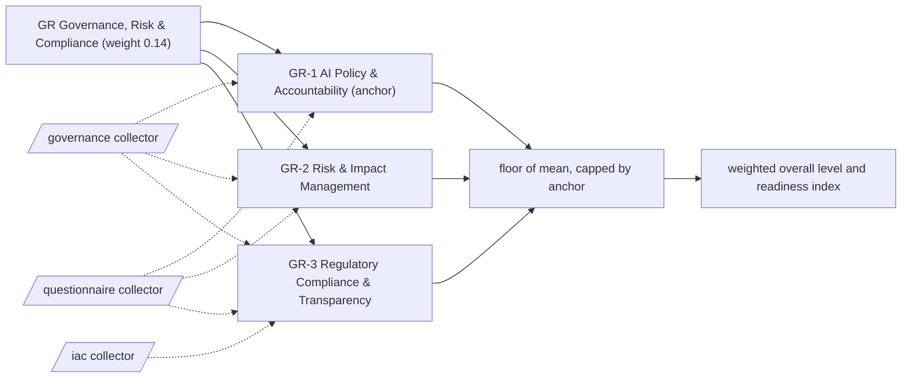

# GR: Governance, Risk & Compliance

Policy, accountability, risk treatment and regulatory evidence for every agent in the inventory. 3 capabilities; weight 0.14 in the overall level and the Agentic Readiness Index; levels Explore, Prove, Operate, Scale, Optimise.

Sections: [1. Purpose](#1-purpose) · [2. Architecture](#2-architecture) · [3. How it works](#3-how-it-works) · [4. Key files](#4-key-files) · [5. Code excerpts](#5-code-excerpts) · [6. Configuration](#6-configuration) · [7. Commands](#7-commands) · [8. Real output](#8-real-output) · [9. Tests and gates](#9-tests-and-gates) · [10. Guardrails](#10-guardrails) · [11. Security and governance](#11-security-and-governance) · [12. Observability](#12-observability) · [13. Failure modes](#13-failure-modes) · [14. Mapping to Azure services](#14-mapping-to-azure-services) · [15. Limitations](#15-limitations) · [16. Interview talking points](#16-interview-talking-points) · [17. Adopt this](#17-adopt-this)

## 1. Purpose

* Governance, Risk & Compliance asks whether each agent is owned, risk-assessed, compliant and explainable, and whether those controls run in the pipeline rather than in a binder. It shares the top weight with Agent Engineering and Security & Identity.
* Default anchor: GR-1. The dimension cannot sit more than one level above its weakest anchor.

## 2. Architecture



## 3. How it works

Evidence comes from the `governance` and `iac` collectors: AI policies, inventories, lifecycle gates, compliance gates in pipelines, risk cards, risk scoring, fairness tests, regulatory mappings, model cards and policy as code. Questions cover ethics principles, review bodies, enterprise risk reporting, regulatory watch and audience-specific explanations.

A capability reaches a level when the level below is reached, every **must** criterion is fully present and at least half of the **support** criteria are present (a partial answer counts half and never satisfies a must). From Scale upwards every must list holds a file-based artifact. The dimension level is the floor of the mean of its capability levels, capped one level above its weakest anchor.

**GR-1 AI Policy & Accountability** (anchor): The written policy, inventory and decision rights that make each agent somebody's responsibility.

| Level | What it looks like | Evidence the assessor needs |
|---|---|---|
| 1 Explore | General IT policy is assumed to cover AI. | nothing (starting point) |
| 2 Prove | An AI policy and ethics principles are written down. | must `ai_policy_doc`; support `q_ethics_principles` |
| 3 Operate | An inventory lists every agent with an owner, and a review body has decision rights. | must `inventory`; support `q_review_board` |
| 4 Scale | Lifecycle stages with approval gates enforce the policy in code. | must `lifecycle_gates` |
| 5 Optimise | Governance gates run in the delivery pipeline on every change. | must `compliance_in_pipeline` |

Crosswalk: NIST AI RMF GOVERN 1, GOVERN 2, GOVERN 4; ISO/IEC 42001 5.2, 5.3, A.2, A.3; EU AI Act Art. 17, Art. 26.

**GR-2 Risk & Impact Management**: How agent risks such as bias, harm and misuse are recorded, scored, tested and treated.

| Level | What it looks like | Evidence the assessor needs |
|---|---|---|
| 1 Explore | AI risk is not looked at separately from project risk. | nothing (starting point) |
| 2 Prove | A risk register or risk cards list the risks of each agent. | must `risk_cards` |
| 3 Operate | Risks are scored for likelihood and impact in code. | must `risk_scoring` |
| 4 Scale | Fairness is tested in code for every agent that affects people. | must `fairness_tests` |
| 5 Optimise | AI risk is reported through enterprise risk management with quantitative measures. | must `fairness_tests`, `q_erm_integration` |

Crosswalk: NIST AI RMF MAP 5, MEASURE 2, MANAGE 1; ISO/IEC 42001 6.1, 8.2, 8.4, A.5; EU AI Act Art. 9, Art. 27.

**GR-3 Regulatory Compliance & Transparency**: How obligations under the EU AI Act, NIST AI RMF, ISO/IEC 42001 and privacy law are mapped, evidenced and explained.

| Level | What it looks like | Evidence the assessor needs |
|---|---|---|
| 1 Explore | Compliance is assumed rather than mapped. | nothing (starting point) |
| 2 Prove | Obligations are mapped per system against the relevant regulations and standards. | must `reg_mapping` |
| 3 Operate | Model cards make each agent understandable to its users and reviewers. | must `model_cards` |
| 4 Scale | Rules are enforced as policy as code. | must `policy_as_code` |
| 5 Optimise | Regulatory change is tracked and fed into the policy rules, with explanations tailored to each audience. | must `policy_as_code`, `q_reg_watch`; support `q_audience_explanations` |

Crosswalk: NIST AI RMF GOVERN 1, MEASURE 2; ISO/IEC 42001 4.2, A.8; EU AI Act Art. 11, Art. 13, Art. 50.

## 4. Key files

| File | Role |
|---|---|
| `framework/framework.yaml` | GR weight, capabilities, level descriptors, actions and standards crosswalk |
| `rubric/capabilities.yaml` | Must and support criteria per level, effort, dependencies, anchors |
| `rubric/signals.yaml` | What each file-based signal looks for |
| `rubric/questionnaire.yaml` | Questions for what code cannot show |

## 5. Code excerpts

<!-- code: src/aimaturity/hitl.py::validate_review -->
```python
def validate_review(review: dict[str, Any], assessor: str, results: dict[str, CapabilityResult]) -> None:
    if review["capability"] not in results:
        raise ReviewError(f"unknown capability {review['capability']}")
    if review["reviewer"].strip().lower() == assessor.strip().lower():
        raise ReviewError("the assessor cannot review their own assessment")
    if review["decision"] not in DECISIONS:
        raise ReviewError(f"decision must be one of {DECISIONS}")
    if len(review.get("comment", "").strip()) < 10:
        raise ReviewError("a review needs a comment of at least 10 characters")
    if review["decision"] == "override" and review.get("level") not in LEVELS:
        raise ReviewError("an override needs a level from 1 to 5")
```
<!-- /code -->

<!-- code: src/aimaturity/hitl.py::apply_reviews -->
```python
def apply_reviews(
    results: dict[str, CapabilityResult], evidence: dict[str, Evidence], reviews: list[dict[str, Any]], assessor: str, log: list[dict[str, Any]]
) -> dict[str, dict[str, Any]]:
    """Status and final level per capability. The latest valid review for a capability wins."""
    logged = {e["hash"] for e in log}
    latest: dict[str, dict[str, Any]] = {}
    rejected: dict[str, str] = {}
    for r in reviews:
        try:
            validate_review(r, assessor, results)
        except ReviewError as err:
            rejected[r.get("capability", "?")] = str(err)
            continue
        if r.get("audit_hash") not in logged:
            rejected[r["capability"]] = "review has no matching audit log entry"
            continue
        latest[r["capability"]] = r
    out = {}
    for cid, res in results.items():
        r = latest.get(cid)
        if r and r["evidence_digest"] == capability_digest(res, evidence):
            status = "overridden" if r["decision"] == "override" and r["level"] != res.level else "confirmed"
            out[cid] = {"status": status, "final_level": r["level"], "review": r}
        elif r:
            out[cid] = {"status": "stale-review", "final_level": res.level, "review": r}
        elif res.needs_review:
            out[cid] = {"status": "pending-review", "final_level": res.level, "review": None}
        else:
            out[cid] = {"status": "auto", "final_level": res.level, "review": None}
        if cid in rejected and out[cid]["status"] in {"pending-review", "auto"}:
            out[cid]["rejected_review"] = rejected[cid]
    return out
```
<!-- /code -->

## 6. Configuration

| Capability | Effort per step | Depends on | Anchor (default) |
|---|---|---|---|
| GR-1 | 2:S, 3:M, 4:L, 5:L | PO-1 | yes |
| GR-2 | 2:S, 3:M, 4:M, 5:L | GR-1 | no |
| GR-3 | 2:S, 3:M, 4:M, 5:M | GR-1 | no |

| Signal or question | Collector | Meaning |
|---|---|---|
| `ai_policy_doc` | governance | Written AI practices or policy (best practices, responsible AI, AI policy) |
| `compliance_in_pipeline` | governance | Compliance or governance gates run in the pipeline |
| `fairness_tests` | governance | Fairness is tested (adverse impact, disparate impact, parity) |
| `inventory` | governance | An inventory of AI systems is kept |
| `lifecycle_gates` | governance | Lifecycle stages with approval gates are enforced in code |
| `model_cards` | governance | Model cards document AI systems |
| `policy_as_code` | iac | Azure Policy definitions or assignments are code |
| `q_audience_explanations` | questionnaire | Are explanations tailored for users, auditors and the public, with transparency notes? |
| `q_erm_integration` | questionnaire | Is AI risk reported through enterprise risk management with quantitative measures? |
| `q_ethics_principles` | questionnaire | Has the organisation adopted written AI ethics principles? |
| `q_reg_watch` | questionnaire | Is regulatory change tracked proactively with owners for each obligation? |
| `q_review_board` | questionnaire | Is there an AI review body with decision rights? |
| `reg_mapping` | governance | Regulatory obligations are mapped (EU AI Act, NIST AI RMF, ISO/IEC 42001, GDPR) |
| `risk_cards` | governance | Risk cards or a risk register list AI risks |
| `risk_scoring` | governance | Risks are scored (likelihood × impact, residual) in code |

## 7. Commands

```bash
aimaturity framework --dimension GR
aimaturity capability GR-1
aimaturity explain --org portfolio --capability GR-2
aimaturity gaps --org kestrel-bay-bank
```

## 8. Real output

<!-- output: framework --dimension GR -->
```text
capability  name                                  anchor
----------  ------------------------------------  ------
GR-1        AI Policy & Accountability            yes
GR-2        Risk & Impact Management
GR-3        Regulatory Compliance & Transparency
```
<!-- /output -->

<!-- output: capability GR-1 -->
```text
GR-1 AI Policy & Accountability (GR Governance, Risk & Compliance) - anchor
The written policy, inventory and decision rights that make each agent somebody's responsibility.
  1 Explore: General IT policy is assumed to cover AI.
  2 Prove: An AI policy and ethics principles are written down.
  3 Operate: An inventory lists every agent with an owner, and a review body has decision rights.
  4 Scale: Lifecycle stages with approval gates enforce the policy in code.
  5 Optimise: Governance gates run in the delivery pipeline on every change.
  must for 2: ai_policy_doc (Written AI practices or policy (best practices, responsible AI, AI policy))
  support for 2: q_ethics_principles (Has the organisation adopted written AI ethics principles?)
  must for 3: inventory (An inventory of AI systems is kept)
  support for 3: q_review_board (Is there an AI review body with decision rights?)
  must for 4: lifecycle_gates (Lifecycle stages with approval gates are enforced in code)
  must for 5: compliance_in_pipeline (Compliance or governance gates run in the pipeline)
```
<!-- /output -->

<!-- output: explain --org portfolio --capability GR-2 -->
```text
GR-2 Risk & Impact Management: level 4 (Scale), confidence 0.71, status auto
rationale: Level 4 (Scale). Supported by [E640], [E641], [E642], [E643]. Next level needs: q_erm_integration. Confidence 0.71.
  [x] risk_cards                   artifact         E640, E641, E642
  [x] risk_scoring                 artifact         E643, E644, E645
  [x] fairness_tests               artifact         E399, E400, E401
  [ ] q_erm_integration            sample-answers   
  E640 agentic-ai-model-risk:registry/bramblewood-claims-triage/risk-cards.yaml (file present)
  E641 agentic-ai-model-risk:registry/cedarhollow-underwriting-assistant/risk-cards.yaml (file present)
  E642 agentic-ai-model-risk:registry/halcyon-fraud-triage/risk-cards.yaml (file present)
  E643 agentic-ai-model-risk:src/modelrisk/cli.py (matched 'likelihood", "impact')
  E644 agentic-ai-model-risk:src/modelrisk/combine.py (matched 'residual risk')
  E645 agentic-ai-model-risk:src/modelrisk/gate.py (matched 'residual risk')
  E399 agentic-ai-model-risk:src/modelrisk/agents/mortgage.py (matched 'adverse impact')
  E400 agentic-ai-model-risk:src/modelrisk/combine.py (matched 'fairness')
```
<!-- /output -->

## 9. Tests and gates

* `tests/test_framework.py`: every capability has five descriptors, four actions, a must list per level and a three-standard crosswalk.
* `tests/test_scoring.py`: no evidence gives Explore, full evidence gives Optimise, each level is reached exactly, musts gate and half the support is enough.
* `tests/test_repo_hygiene.py`: this page names every capability and every signal it scores, and its output blocks match a fresh run.
* Eval gates: calibration against labelled levels covers every GR capability; stability checks that dropping one artifact moves at most two capabilities.

## 10. Guardrails

* GR is capped by GR-1 by default: without the anchor, the rest of the dimension cannot lift it more than one level.
* Answers alone stop at Operate: every Scale and Optimise must list contains an artifact.
* Anything that rests on sample answers goes to human review, whatever its confidence.

## 11. Security and governance

Assessments read repositories without executing them and cite file paths, never file contents. Questionnaire answers can hold internal judgements: keep them in the evidence store's `evidence` container (private, versioned, Entra-only).

## 12. Observability

Each scheduled run writes a `summary.json` per organisation with the GR level, mean, weight, confidence per capability and the review queue; upload it to Log Analytics and trend the Agentic Readiness Index between assessments.

## 13. Failure modes

| Failure | What the assessor does |
|---|---|
| Model cards without risk cards | GR-2 stays at Explore; `risk_cards` is the Prove must |
| A policy with no inventory | GR-1 stops at Prove |
| Regulation mapped but not enforced | GR-3 stops at Operate until rules are policy as code |

## 14. Mapping to Azure services

* **Azure Policy** supplies `policy_as_code`; **Microsoft Purview** Compliance Manager holds the regulatory mapping.
* **Foundry** evaluations and **Azure AI Content Safety** produce fairness and scenario evidence.
* **Azure Monitor / Log Analytics** keeps the review and audit trail queryable for auditors.

## 15. Limitations

* Regulatory mapping is detected, not verified; legal review is out of scope.
* Enterprise risk integration is questionnaire-led.

## 16. Interview talking points

* "Every capability carries a crosswalk to NIST AI RMF, ISO/IEC 42001 and the EU AI Act, so a gap reads as a control gap."
* "The governance dimension pulls its strongest evidence from my model risk repository: risk cards, risk scoring and fairness tests for fictional agents."

## 17. Adopt this

1. Keep model cards and risk cards next to the code so collectors can cite them.
2. Pick your anchors: a regulator-facing organisation might anchor GR-2 and GR-3 as well as GR-1.
3. Link a governance repository in `org.yaml` `links` so the report shows where the evidence comes from.
