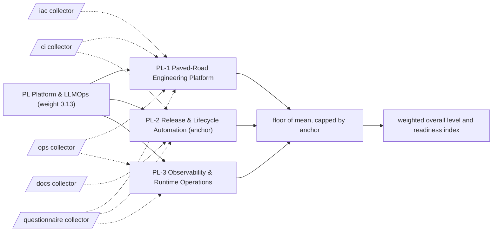

# PL: Platform & LLMOps

The paved road that builds, ships, observes and retires models and agents without heroics. 3 capabilities; weight 0.13 in the overall level and the Agentic Readiness Index; levels Explore, Prove, Operate, Scale, Optimise.

Sections: [1. Purpose](#1-purpose) · [2. Architecture](#2-architecture) · [3. How it works](#3-how-it-works) · [4. Key files](#4-key-files) · [5. Code excerpts](#5-code-excerpts) · [6. Configuration](#6-configuration) · [7. Commands](#7-commands) · [8. Real output](#8-real-output) · [9. Tests and gates](#9-tests-and-gates) · [10. Guardrails](#10-guardrails) · [11. Security and governance](#11-security-and-governance) · [12. Observability](#12-observability) · [13. Failure modes](#13-failure-modes) · [14. Mapping to Azure services](#14-mapping-to-azure-services) · [15. Limitations](#15-limitations) · [16. Interview talking points](#16-interview-talking-points) · [17. Adopt this](#17-adopt-this)

## 1. Purpose

* Platform & LLMOps asks whether agents are built, released and watched on a paved road: tested code, infrastructure as code, approved releases and monitoring that pages someone. It decides how fast a second and third agent can ship safely.
* Default anchor: PL-2. The dimension cannot sit more than one level above its weakest anchor.

## 2. Architecture



## 3. How it works

Evidence comes from the `ci`, `iac` and `ops` collectors: CI tests, Bicep or Terraform, IaC tests, devcontainers, shared libraries, deployment pipelines, environment approvals, OIDC federation, teardown jobs, telemetry, alert rules and drift checks. Questions cover self-service environments, automatic re-evaluation and feedback loops.

A capability reaches a level when the level below is reached, every **must** criterion is fully present and at least half of the **support** criteria are present (a partial answer counts half and never satisfies a must). From Scale upwards every must list holds a file-based artifact. The dimension level is the floor of the mean of its capability levels, capped one level above its weakest anchor.

**PL-1 Paved-Road Engineering Platform**: Shared CI, infrastructure as code and environments that every agent team starts from.

| Level | What it looks like | Evidence the assessor needs |
|---|---|---|
| 1 Explore | Each team builds from scratch on personal machines. | nothing (starting point) |
| 2 Prove | Automated tests run in CI on every change. | must `ci_tests` |
| 3 Operate | Infrastructure is defined as code and developer environments are reproducible. | must `iac_any`; support `dev_environment` |
| 4 Scale | Infrastructure code has automated tests. | must `iac_tests` |
| 5 Optimise | Shared platform libraries are published and teams create governed environments themselves. | must `shared_library`, `q_self_service_env` |

Crosswalk: NIST AI RMF MANAGE 2; ISO/IEC 42001 A.4, A.6; EU AI Act Art. 15.

**PL-2 Release & Lifecycle Automation** (anchor): How agents and prompts move from commit to production through gated, reversible pipelines.

| Level | What it looks like | Evidence the assessor needs |
|---|---|---|
| 1 Explore | Changes are copied to production by hand. | nothing (starting point) |
| 2 Prove | A deployment pipeline exists and changes are recorded in a changelog. | must `cd_pipeline`; support `changelog` |
| 3 Operate | Production deployments wait for an environment approval. | must `env_approval` |
| 4 Scale | Pipelines authenticate to the cloud by federation, with no stored secrets. | must `oidc` |
| 5 Optimise | Environments are disposable and torn down by pipeline, and re-evaluation or retraining triggers automatically. | must `teardown`, `q_auto_retrain` |

Crosswalk: NIST AI RMF MANAGE 1, MANAGE 4; ISO/IEC 42001 8.1, A.6; EU AI Act Art. 17.

**PL-3 Observability & Runtime Operations**: Telemetry, alerts and drift signals for agents in production, tied back to business impact.

| Level | What it looks like | Evidence the assessor needs |
|---|---|---|
| 1 Explore | Nothing is logged beyond what the hosting service keeps by default. | nothing (starting point) |
| 2 Prove | Services emit telemetry such as traces and metrics. | must `telemetry` |
| 3 Operate | Alert rules page an owner when an agent misbehaves. | must `alert_rules` |
| 4 Scale | Drift in inputs and outputs is measured in code. | must `drift_monitoring` |
| 5 Optimise | User feedback and monitoring findings flow into the backlog continuously. | must `drift_monitoring`, `q_feedback_loop` |

Crosswalk: NIST AI RMF MEASURE 3, MEASURE 4, MANAGE 4; ISO/IEC 42001 9.1, A.6; EU AI Act Art. 12, Art. 72.

## 4. Key files

| File | Role |
|---|---|
| `framework/framework.yaml` | PL weight, capabilities, level descriptors, actions and standards crosswalk |
| `rubric/capabilities.yaml` | Must and support criteria per level, effort, dependencies, anchors |
| `rubric/signals.yaml` | What each file-based signal looks for |
| `rubric/questionnaire.yaml` | Questions for what code cannot show |

## 5. Code excerpts

<!-- code: src/aimaturity/scoring.py::level_passes -->
```python
def level_passes(states: dict[str, SignalState], rule: dict[str, list[str]], need: float) -> bool:
    return all(states[s].present >= 1 for s in rule["must"]) and support_share(states, rule["support"]) >= need
```
<!-- /code -->

<!-- code: src/aimaturity/scoring.py::support_share -->
```python
def support_share(states: dict[str, SignalState], support: list[str]) -> float:
    return 1.0 if not support else sum(states[s].present for s in support) / len(support)
```
<!-- /code -->

## 6. Configuration

| Capability | Effort per step | Depends on | Anchor (default) |
|---|---|---|---|
| PL-1 | 2:S, 3:M, 4:M, 5:L | - | no |
| PL-2 | 2:S, 3:M, 4:M, 5:L | PL-1 | yes |
| PL-3 | 2:S, 3:S, 4:M, 5:L | PL-2 | no |

| Signal or question | Collector | Meaning |
|---|---|---|
| `alert_rules` | ops | Alert rules and action groups are defined |
| `cd_pipeline` | ci | A deployment pipeline exists |
| `changelog` | docs | Changes are recorded in a changelog |
| `ci_tests` | ci | CI runs automated tests |
| `dev_environment` | ci | A reproducible developer environment (devcontainer, compose or Makefile) |
| `drift_monitoring` | ops | Model or data drift is measured in code |
| `env_approval` | ci | Production deployment waits for an environment approval |
| `iac_any` | iac | Infrastructure is defined as code (Terraform or Bicep) |
| `iac_tests` | iac | Infrastructure code has automated tests |
| `oidc` | ci | Pipelines authenticate with OIDC federation (no stored cloud secret) |
| `q_auto_retrain` | questionnaire | Are re-evaluation or retraining triggered automatically, with staged rollout? |
| `q_feedback_loop` | questionnaire | Is user feedback collected continuously and fed into the backlog? |
| `q_self_service_env` | questionnaire | Can AI teams create governed environments on their own within minutes? |
| `shared_library` | ops | Shared code is packaged for reuse across projects |
| `teardown` | ci | Environments can be torn down by pipeline |
| `telemetry` | ops | Services emit telemetry (OpenTelemetry or Application Insights) |

## 7. Commands

```bash
aimaturity framework --dimension PL
aimaturity capability PL-2
aimaturity explain --org portfolio --capability PL-2
aimaturity gaps --org kestrel-bay-bank
```

## 8. Real output

<!-- output: framework --dimension PL -->
```text
capability  name                                anchor
----------  ----------------------------------  ------
PL-1        Paved-Road Engineering Platform
PL-2        Release & Lifecycle Automation      yes
PL-3        Observability & Runtime Operations
```
<!-- /output -->

<!-- output: capability PL-2 -->
```text
PL-2 Release & Lifecycle Automation (PL Platform & LLMOps) - anchor
How agents and prompts move from commit to production through gated, reversible pipelines.
  1 Explore: Changes are copied to production by hand.
  2 Prove: A deployment pipeline exists and changes are recorded in a changelog.
  3 Operate: Production deployments wait for an environment approval.
  4 Scale: Pipelines authenticate to the cloud by federation, with no stored secrets.
  5 Optimise: Environments are disposable and torn down by pipeline, and re-evaluation or retraining triggers automatically.
  must for 2: cd_pipeline (A deployment pipeline exists)
  support for 2: changelog (Changes are recorded in a changelog)
  must for 3: env_approval (Production deployment waits for an environment approval)
  must for 4: oidc (Pipelines authenticate with OIDC federation (no stored cloud secret))
  must for 5: teardown (Environments can be torn down by pipeline); q_auto_retrain (Are re-evaluation or retraining triggered automatically, with staged rollout?)
```
<!-- /output -->

<!-- output: explain --org portfolio --capability PL-2 -->
```text
PL-2 Release & Lifecycle Automation: level 4 (Scale), confidence 0.76, status auto
rationale: Level 4 (Scale). Supported by [E105], [E106], [E107], [E108]. Next level needs: q_auto_retrain. Confidence 0.76.
  [x] cd_pipeline                  artifact         E105, E106, E107
  [x] changelog                    artifact         E126, E127, E128
  [x] env_approval                 artifact         E314, E315, E316
  [x] oidc                         artifact         E535, E536, E537
  [x] teardown                     artifact         E723, E724, E725
  [ ] q_auto_retrain               sample-answers   
  E105 agentic-ai-model-risk:.github/workflows/deploy.yml (matched 'azure/login')
  E106 agentic-ai-model-risk:.github/workflows/infra.yml (matched 'azure/login')
  E107 agentic-ai-model-risk:.github/workflows/teardown.yml (matched 'azure/login')
  E108 agentic-ai-portfolio:.github/workflows/deploy.yml (matched 'azure/login')
  E109 agentic-ai-portfolio:.github/workflows/infra.yml (matched 'azure/login')
  E110 agentic-ai-portfolio:.github/workflows/teardown.yml (matched 'azure/login')
  E111 azure-agent-labs:.github/workflows/deploy.yml (matched 'azure/login')
  E112 azure-agent-labs:.github/workflows/infra.yml (matched 'azure/login')
```
<!-- /output -->

## 9. Tests and gates

* `tests/test_framework.py`: every capability has five descriptors, four actions, a must list per level and a three-standard crosswalk.
* `tests/test_scoring.py`: no evidence gives Explore, full evidence gives Optimise, each level is reached exactly, musts gate and half the support is enough.
* `tests/test_repo_hygiene.py`: this page names every capability and every signal it scores, and its output blocks match a fresh run.
* Eval gates: calibration against labelled levels covers every PL capability; stability checks that dropping one artifact moves at most two capabilities.

## 10. Guardrails

* PL is capped by PL-2 by default: without the anchor, the rest of the dimension cannot lift it more than one level.
* Answers alone stop at Operate: every Scale and Optimise must list contains an artifact.
* Anything that rests on sample answers goes to human review, whatever its confidence.

## 11. Security and governance

Assessments read repositories without executing them and cite file paths, never file contents. Questionnaire answers can hold internal judgements: keep them in the evidence store's `evidence` container (private, versioned, Entra-only).

## 12. Observability

Each scheduled run writes a `summary.json` per organisation with the PL level, mean, weight, confidence per capability and the review queue; upload it to Log Analytics and trend the Agentic Readiness Index between assessments.

## 13. Failure modes

| Failure | What the assessor does |
|---|---|
| Deployments from a laptop | PL-2 stays at Explore; `cd_pipeline` is the Prove must |
| Stored cloud keys in CI | PL-2 stops at Operate until `oidc` is present |
| Telemetry with no alert rules | PL-3 stays at Prove |

## 14. Mapping to Azure services

* **Azure Container Apps** jobs and **Bicep/Terraform** modules supply `iac_any`, `iac_tests` and `teardown`.
* **Azure Monitor** and **Application Insights** supply `telemetry`, `alert_rules` and drift workbooks.
* **Foundry** evaluation runs and deployments slot into the release pipeline; **Azure Policy** and **Microsoft Purview** guard what the pipeline may deploy.

## 15. Limitations

* A pipeline file proves a pipeline exists, not that it is green.
* Feedback loops and auto re-evaluation are questionnaire-led.

## 16. Interview talking points

* "PL-2 reaches Scale only with OIDC federation: no stored cloud secret anywhere in the pipeline."
* "This repository deploys nothing by default; the deploy job is gated by `DEPLOY_ENABLED` and an environment approval, which is PL-2 Operate evidence."

## 17. Adopt this

1. Run tests in CI on every pull request and add a protected production environment.
2. Replace stored credentials with OIDC federation.
3. Define alert rules with an action group per agent, then measure drift on a schedule.
