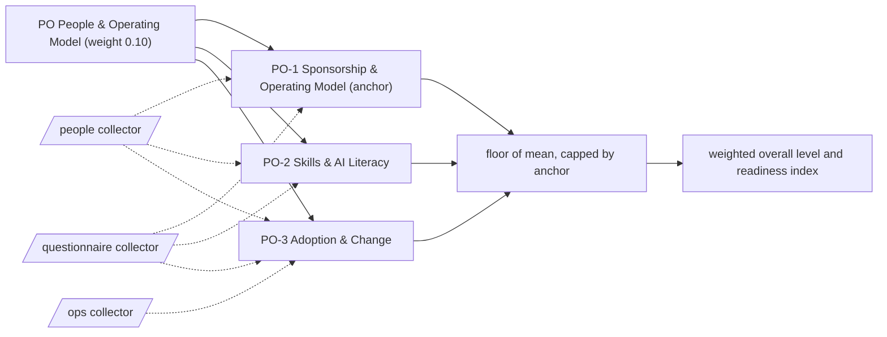

# PO: People & Operating Model

Sponsorship, skills and the adoption habits that let agents change how work gets done. 3 capabilities; weight 0.10 in the overall level and the Agentic Readiness Index; levels Explore, Prove, Operate, Scale, Optimise.

Sections: [1. Purpose](#1-purpose) · [2. Architecture](#2-architecture) · [3. How it works](#3-how-it-works) · [4. Key files](#4-key-files) · [5. Code excerpts](#5-code-excerpts) · [6. Configuration](#6-configuration) · [7. Commands](#7-commands) · [8. Real output](#8-real-output) · [9. Tests and gates](#9-tests-and-gates) · [10. Guardrails](#10-guardrails) · [11. Security and governance](#11-security-and-governance) · [12. Observability](#12-observability) · [13. Failure modes](#13-failure-modes) · [14. Mapping to Azure services](#14-mapping-to-azure-services) · [15. Limitations](#15-limitations) · [16. Interview talking points](#16-interview-talking-points) · [17. Adopt this](#17-adopt-this)

## 1. Purpose

* People & Operating Model asks who sponsors and owns agents, whether people have the skills to build and use them, and whether adoption is managed. Most of it lives outside repositories, so it leans on the questionnaire and is capped at Operate until artifacts appear.
* Default anchor: PO-1. The dimension cannot sit more than one level above its weakest anchor.

## 2. Architecture



## 3. How it works

Evidence comes mostly from questions (sponsors, coordinators, executive owners, centres of excellence, roles, literacy tracks, training paths, rollout communication, partnerships) plus a few artifacts: `CODEOWNERS`, learning material, onboarding guides, contributing guides and adoption guides.

A capability reaches a level when the level below is reached, every **must** criterion is fully present and at least half of the **support** criteria are present (a partial answer counts half and never satisfies a must). From Scale upwards every must list holds a file-based artifact. The dimension level is the floor of the mean of its capability levels, capped one level above its weakest anchor.

**PO-1 Sponsorship & Operating Model** (anchor): Who sponsors agent work, how teams are organised around it and how ownership is declared.

| Level | What it looks like | Evidence the assessor needs |
|---|---|---|
| 1 Explore | AI is treated as an IT topic and nobody sponsors it. | nothing (starting point) |
| 2 Prove | Pilots have named sponsors and a coordinator connects them. | must `q_project_sponsors`; support `q_coordinator` |
| 3 Operate | An executive owns the agenda and a central team or centre of excellence has a mandate. | must `q_exec_owner`; support `q_coe` |
| 4 Scale | Code ownership is declared and the operating model is reviewed and adjusted. | must `codeowners`; support `q_operating_model_review` |
| 5 Optimise | Leaders carry agentic outcomes in their objectives. | must `codeowners`, `q_leadership_objectives` |

Crosswalk: NIST AI RMF GOVERN 2, GOVERN 3; ISO/IEC 42001 5.1, 5.3, A.3; EU AI Act no direct article.

**PO-2 Skills & AI Literacy**: Whether staff understand agents well enough to use, build and challenge them.

| Level | What it looks like | Evidence the assessor needs |
|---|---|---|
| 1 Explore | Skills sit with a few enthusiasts. | nothing (starting point) |
| 2 Prove | Introductory material is available and AI roles are named. | must `q_awareness_material`; support `q_ai_roles_defined` |
| 3 Operate | Learning material is maintained, with role-based tracks and funded training paths. | must `learning_material`; support `q_role_literacy`, `q_training_paths` |
| 4 Scale | Onboarding guides exist and AI skills are part of performance and mobility. | must `onboarding_guide`; support `q_hr_integration` |
| 5 Optimise | Learning is part of routine work and onboarding keeps pace with the platform. | must `onboarding_guide`, `q_continuous_learning` |

Crosswalk: NIST AI RMF GOVERN 3, GOVERN 4; ISO/IEC 42001 7.2, 7.3; EU AI Act Art. 4.

**PO-3 Adoption & Change**: How agents are introduced to the people who use them and how feedback and partners shape them.

| Level | What it looks like | Evidence the assessor needs |
|---|---|---|
| 1 Explore | Rollouts are technical events and users find out late. | nothing (starting point) |
| 2 Prove | Rollouts come with communication and the team joins peer communities. | must `q_rollout_comms`; support `q_partnership_informal` |
| 3 Operate | Shared contribution rules and a change method are applied. | must `contributing_guide`; support `q_change_method` |
| 4 Scale | Adoption guides let other teams take up the work. | must `adopt_guide` |
| 5 Optimise | Formal partnerships exist and the enterprise contributes to its ecosystem. | must `adopt_guide`, `q_partnership_formal`; support `q_ecosystem_lead` |

Crosswalk: NIST AI RMF GOVERN 5, MEASURE 4; ISO/IEC 42001 7.4, A.8; EU AI Act no direct article.

## 4. Key files

| File | Role |
|---|---|
| `framework/framework.yaml` | PO weight, capabilities, level descriptors, actions and standards crosswalk |
| `rubric/capabilities.yaml` | Must and support criteria per level, effort, dependencies, anchors |
| `rubric/signals.yaml` | What each file-based signal looks for |
| `rubric/questionnaire.yaml` | Questions for what code cannot show |

## 5. Code excerpts

<!-- code: src/aimaturity/collectors/__init__.py::collect_questionnaire -->
```python
def collect_questionnaire(answers: dict[str, Any]) -> list[Evidence]:
    origin = answers.get("label", "self-reported")
    out = []
    for qid, a in sorted(answers.get("answers", {}).items()):
        if qid not in questions():
            raise ValueError(f"unknown question {qid}")
        value = a["answer"] if isinstance(a, dict) else a
        note = a.get("note", "") if isinstance(a, dict) else ""
        if isinstance(value, bool):  # YAML 1.1 reads bare yes/no as booleans
            value = "yes" if value else "no"
        strength = ANSWER_STRENGTH[value]
        out.append(Evidence(qid, "questionnaire", "questionnaire", qid, f"answer {value}" + (f": {note}" if note else ""), strength, origin))
    return out
```
<!-- /code -->

<!-- code: src/aimaturity/hitl.py::queue -->
```python
def queue(statuses: dict[str, dict[str, Any]]) -> list[str]:
    return [cid for cid, s in statuses.items() if s["status"] in {"pending-review", "stale-review"}]
```
<!-- /code -->

## 6. Configuration

| Capability | Effort per step | Depends on | Anchor (default) |
|---|---|---|---|
| PO-1 | 2:S, 3:M, 4:M, 5:M | - | yes |
| PO-2 | 2:S, 3:M, 4:L, 5:M | PO-1 | no |
| PO-3 | 2:S, 3:M, 4:M, 5:L | PO-2 | no |

| Signal or question | Collector | Meaning |
|---|---|---|
| `adopt_guide` | ops | Docs explain how another team adopts or reuses the work |
| `codeowners` | people | Ownership of code areas is declared (CODEOWNERS) |
| `contributing_guide` | people | A contribution guide sets shared working rules |
| `learning_material` | people | Learning or training material about AI is maintained |
| `onboarding_guide` | people | An onboarding or implementation guide helps new people adopt the work |
| `q_ai_roles_defined` | questionnaire | Are the AI roles the organisation needs named, with a skills matrix? |
| `q_awareness_material` | questionnaire | Is introductory AI material available to all staff? |
| `q_change_method` | questionnaire | Is a change method with stakeholder analysis and adoption metrics applied? |
| `q_coe` | questionnaire | Is there a chartered central AI team or centre of excellence with a mandate and reporting line? |
| `q_continuous_learning` | questionnaire | Is AI learning continuous and part of team routines? |
| `q_coordinator` | questionnaire | Is there a named AI coordinator or working group? |
| `q_ecosystem_lead` | questionnaire | Does the organisation help lead its AI ecosystem or contribute shared assets? |
| `q_exec_owner` | questionnaire | Does one executive own the agentic AI agenda and report on it regularly? |
| `q_hr_integration` | questionnaire | Are AI skills part of performance, mobility and cross-skilling processes? |
| `q_leadership_objectives` | questionnaire | Are agentic AI outcomes part of leadership objectives and resourcing reviews? |
| `q_operating_model_review` | questionnaire | Is the AI operating model reviewed and adjusted on a cadence? |
| `q_partnership_formal` | questionnaire | Are there formal AI partnerships with goals (academia, peers, vendors)? |
| `q_partnership_informal` | questionnaire | Does the organisation take part in AI communities or peer networks? |
| `q_project_sponsors` | questionnaire | Does every live agent or AI pilot have a named senior sponsor? |
| `q_role_literacy` | questionnaire | Do role-based AI literacy tracks (including ethics) run with completion tracking? |
| `q_rollout_comms` | questionnaire | Do agent rollouts come with communication and training for the people who use them? |
| `q_training_paths` | questionnaire | Do AI roles have funded training paths and appear in workforce planning? |

## 7. Commands

```bash
aimaturity framework --dimension PO
aimaturity capability PO-1
aimaturity explain --org portfolio --capability PO-1
aimaturity gaps --org kestrel-bay-bank
```

## 8. Real output

<!-- output: framework --dimension PO -->
```text
capability  name                           anchor
----------  -----------------------------  ------
PO-1        Sponsorship & Operating Model  yes
PO-2        Skills & AI Literacy
PO-3        Adoption & Change
```
<!-- /output -->

<!-- output: capability PO-1 -->
```text
PO-1 Sponsorship & Operating Model (PO People & Operating Model) - anchor
Who sponsors agent work, how teams are organised around it and how ownership is declared.
  1 Explore: AI is treated as an IT topic and nobody sponsors it.
  2 Prove: Pilots have named sponsors and a coordinator connects them.
  3 Operate: An executive owns the agenda and a central team or centre of excellence has a mandate.
  4 Scale: Code ownership is declared and the operating model is reviewed and adjusted.
  5 Optimise: Leaders carry agentic outcomes in their objectives.
  must for 2: q_project_sponsors (Does every live agent or AI pilot have a named senior sponsor?)
  support for 2: q_coordinator (Is there a named AI coordinator or working group?)
  must for 3: q_exec_owner (Does one executive own the agentic AI agenda and report on it regularly?)
  support for 3: q_coe (Is there a chartered central AI team or centre of excellence with a mandate and reporting line?)
  must for 4: codeowners (Ownership of code areas is declared (CODEOWNERS))
  support for 4: q_operating_model_review (Is the AI operating model reviewed and adjusted on a cadence?)
  must for 5: codeowners (Ownership of code areas is declared (CODEOWNERS)); q_leadership_objectives (Are agentic AI outcomes part of leadership objectives and resourcing reviews?)
```
<!-- /output -->

<!-- output: explain --org portfolio --capability PO-1 -->
```text
PO-1 Sponsorship & Operating Model: level 2 (Prove), confidence 0.38, status pending-review
rationale: Level 2 (Prove). Supported by [E603], [E583]. Next level needs: q_exec_owner, q_coe. Confidence 0.38.
  [x] q_project_sponsors           sample-answers   E603
  [x] q_coordinator                sample-answers   E583
  [~] q_exec_owner                 sample-answers   E592
  [ ] q_coe                        sample-answers   
  [x] codeowners                   artifact         E159, E160, E161
  [ ] q_operating_model_review     sample-answers   
  [ ] q_leadership_objectives      sample-answers   
  E603 questionnaire:q_project_sponsors (answer yes: the maintainer sponsors every repository)
  E583 questionnaire:q_coordinator (answer yes: single maintainer coordinates all AI work)
needs review: confidence 0.38 below 0.6; level rests on sample answers: q_coordinator, q_project_sponsors
```
<!-- /output -->

## 9. Tests and gates

* `tests/test_framework.py`: every capability has five descriptors, four actions, a must list per level and a three-standard crosswalk.
* `tests/test_scoring.py`: no evidence gives Explore, full evidence gives Optimise, each level is reached exactly, musts gate and half the support is enough.
* `tests/test_repo_hygiene.py`: this page names every capability and every signal it scores, and its output blocks match a fresh run.
* Eval gates: calibration against labelled levels covers every PO capability; stability checks that dropping one artifact moves at most two capabilities.

## 10. Guardrails

* PO is capped by PO-1 by default: without the anchor, the rest of the dimension cannot lift it more than one level.
* Answers alone stop at Operate: every Scale and Optimise must list contains an artifact.
* Anything that rests on sample answers goes to human review, whatever its confidence.

## 11. Security and governance

Assessments read repositories without executing them and cite file paths, never file contents. Questionnaire answers can hold internal judgements: keep them in the evidence store's `evidence` container (private, versioned, Entra-only).

## 12. Observability

Each scheduled run writes a `summary.json` per organisation with the PO level, mean, weight, confidence per capability and the review queue; upload it to Log Analytics and trend the Agentic Readiness Index between assessments.

## 13. Failure modes

| Failure | What the assessor does |
|---|---|
| Sponsors named in a deck only | PO-1 needs `q_project_sponsors` answered yes; partial never satisfies a must |
| Answers alone | PO capabilities stop at Operate until `codeowners`, `onboarding_guide` or `adopt_guide` exist |
| Sample answers in a demo | every PO capability that rests on them goes to human review |

## 14. Mapping to Azure services

* **Microsoft Entra ID** groups and **Azure RBAC** make ownership visible; `CODEOWNERS` mirrors them in code.
* **Foundry** projects map teams to agents; **Azure Monitor** workbooks show adoption.
* **Azure Policy** and **Microsoft Purview** enforce the operating model's guardrails so people do not have to remember them.

## 15. Limitations

* Skills and sponsorship cannot be verified from code; answers carry 0.55 weight and samples 0.3.
* Partnerships and change methods are judged from short answers.

## 16. Interview talking points

* "The evidence ceiling means questionnaire answers alone can never lift a capability past Operate."
* "In the portfolio demo every people answer is labelled a sample, so those capabilities always queue for human review."

## 17. Adopt this

1. Answer the questionnaire honestly and label it `self-reported`.
2. Add `CODEOWNERS`, an onboarding guide and a contributing guide to each agent repository.
3. Write an adoption guide for every reusable asset.
