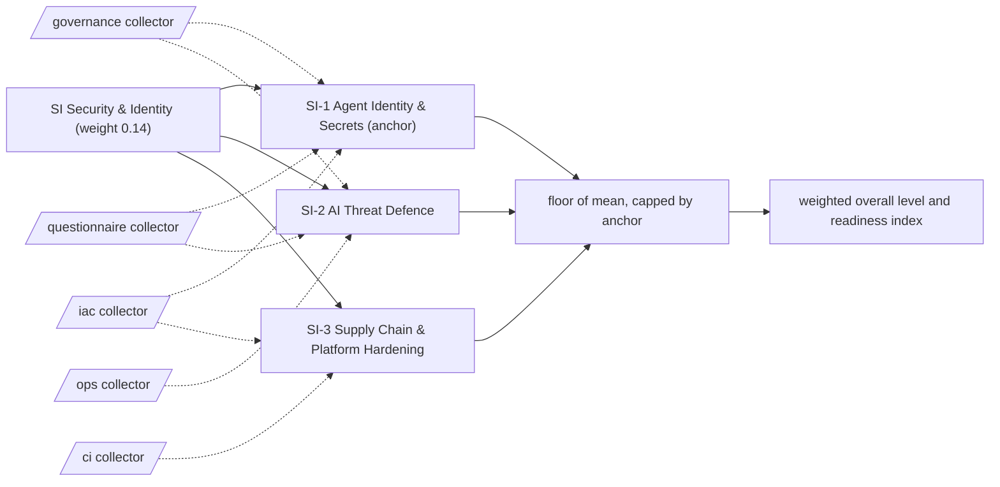

# SI: Security & Identity

Identity, secrets, threat defence and supply chain for systems that act on the enterprise's behalf. 3 capabilities; weight 0.14 in the overall level and the Agentic Readiness Index; levels Explore, Prove, Operate, Scale, Optimise.

Sections: [1. Purpose](#1-purpose) · [2. Architecture](#2-architecture) · [3. How it works](#3-how-it-works) · [4. Key files](#4-key-files) · [5. Code excerpts](#5-code-excerpts) · [6. Configuration](#6-configuration) · [7. Commands](#7-commands) · [8. Real output](#8-real-output) · [9. Tests and gates](#9-tests-and-gates) · [10. Guardrails](#10-guardrails) · [11. Security and governance](#11-security-and-governance) · [12. Observability](#12-observability) · [13. Failure modes](#13-failure-modes) · [14. Mapping to Azure services](#14-mapping-to-azure-services) · [15. Limitations](#15-limitations) · [16. Interview talking points](#16-interview-talking-points) · [17. Adopt this](#17-adopt-this)

## 1. Purpose

* Security & Identity asks whether agents run with least privilege, without stored secrets, behind a gateway and with their supply chain checked. Agents hold credentials and act on systems, so this dimension shares the top weight.
* Default anchor: SI-1. The dimension cannot sit more than one level above its weakest anchor.

## 2. Architecture



## 3. How it works

Evidence comes from the `security`, `iac` and `ci` collectors: secret scanning, managed identities, data-plane RBAC, Key Vault, security policies, API gateways, adversarial scenario tests, dependency pinning, linting, IaC scanning and container builds. Questions cover identity reviews and red-team cadence.

A capability reaches a level when the level below is reached, every **must** criterion is fully present and at least half of the **support** criteria are present (a partial answer counts half and never satisfies a must). From Scale upwards every must list holds a file-based artifact. The dimension level is the floor of the mean of its capability levels, capped one level above its weakest anchor.

**SI-1 Agent Identity & Secrets** (anchor): How agents authenticate, where their secrets live and how their permissions are kept minimal.

| Level | What it looks like | Evidence the assessor needs |
|---|---|---|
| 1 Explore | Agents use personal or shared keys stored in code or config files. | nothing (starting point) |
| 2 Prove | Secret hygiene is enforced by scanning, with no keys in code. | must `secret_hygiene` |
| 3 Operate | Agents and workloads use managed identities instead of keys. | must `managed_identity` |
| 4 Scale | Data access is granted through least-privilege data-plane roles. | must `rbac_data` |
| 5 Optimise | Remaining secrets sit in a vault and agent permissions are reviewed and pruned on a cadence. | must `key_vault`, `q_agent_identity_review` |

Crosswalk: NIST AI RMF GOVERN 1, MANAGE 1; ISO/IEC 42001 A.4, A.6; EU AI Act Art. 15.

**SI-2 AI Threat Defence**: Protection against prompt injection, tool misuse and data exfiltration, tested before and after release.

| Level | What it looks like | Evidence the assessor needs |
|---|---|---|
| 1 Explore | AI-specific threats are not considered. | nothing (starting point) |
| 2 Prove | A security policy covers AI systems and how to report issues. | must `security_policy` |
| 3 Operate | A gateway fronts AI services and filters traffic. | must `api_gateway` |
| 4 Scale | Adversarial scenarios such as prompt injection are tested in code. | must `scenario_tests` |
| 5 Optimise | Red-teaming runs on a schedule and findings are tracked to closure. | must `scenario_tests`, `q_red_team_cadence` |

Crosswalk: NIST AI RMF MEASURE 2, MANAGE 4; ISO/IEC 42001 8.2, A.6; EU AI Act Art. 15.

**SI-3 Supply Chain & Platform Hardening**: Pinned dependencies, scanned artifacts and policy-enforced platforms under every agent.

| Level | What it looks like | Evidence the assessor needs |
|---|---|---|
| 1 Explore | Dependencies float and nobody scans images or infrastructure. | nothing (starting point) |
| 2 Prove | Dependencies are pinned for reproducible builds. | must `dependency_pinning` |
| 3 Operate | Linting runs on every change. | must `ci_lint` |
| 4 Scale | Infrastructure code is scanned for misconfiguration. | must `iac_scan` |
| 5 Optimise | Workloads ship as built containers. | must `container_build` |

Crosswalk: NIST AI RMF GOVERN 6, MANAGE 3; ISO/IEC 42001 A.10, A.6; EU AI Act Art. 15.

## 4. Key files

| File | Role |
|---|---|
| `framework/framework.yaml` | SI weight, capabilities, level descriptors, actions and standards crosswalk |
| `rubric/capabilities.yaml` | Must and support criteria per level, effort, dependencies, anchors |
| `rubric/signals.yaml` | What each file-based signal looks for |
| `rubric/questionnaire.yaml` | Questions for what code cannot show |

## 5. Code excerpts

<!-- code: src/aimaturity/hitl.py::verify_audit_log -->
```python
def verify_audit_log(path: Path) -> list[str]:
    problems, prev = [], GENESIS
    for n, e in enumerate(read_log(path), 1):
        if e.get("seq") != n:
            problems.append(f"entry {n}: sequence {e.get('seq')} out of order")
        if e.get("prev") != prev:
            problems.append(f"entry {n}: previous hash does not match")
        if _entry_hash(e) != e.get("hash"):
            problems.append(f"entry {n}: content changed after it was written")
        prev = e.get("hash", "")
    return problems
```
<!-- /code -->

<!-- code: src/aimaturity/hitl.py::capability_digest -->
```python
def capability_digest(result: CapabilityResult, evidence: dict[str, Evidence]) -> str:
    """Stable fingerprint of what the capability was scored on (paths and answers, not evidence ids)."""
    rows = []
    for sid, st in sorted(result.signals.items()):
        refs = sorted(f"{evidence[i].source}:{evidence[i].path}" for i in st.evidence)
        rows.append([sid, st.present, st.basis, refs])
    return hashlib.sha256(json.dumps(rows, sort_keys=True).encode()).hexdigest()[:16]
```
<!-- /code -->

## 6. Configuration

| Capability | Effort per step | Depends on | Anchor (default) |
|---|---|---|---|
| SI-1 | 2:S, 3:M, 4:M, 5:M | PL-1 | yes |
| SI-2 | 2:S, 3:M, 4:M, 5:L | AE-1 | no |
| SI-3 | 2:S, 3:S, 4:M, 5:M | PL-1 | no |

| Signal or question | Collector | Meaning |
|---|---|---|
| `api_gateway` | ops | An API gateway fronts AI services |
| `ci_lint` | ci | CI runs a linter |
| `container_build` | ci | Workloads are packaged as containers |
| `dependency_pinning` | ci | Dependencies are pinned for reproducible environments |
| `iac_scan` | iac | Infrastructure code is scanned (checkov or tflint configuration) |
| `key_vault` | iac | Secrets are held in Key Vault |
| `managed_identity` | iac | Workloads use managed identities instead of keys |
| `q_agent_identity_review` | questionnaire | Are agent identities and their permissions reviewed on a cadence, with unused grants removed? |
| `q_red_team_cadence` | questionnaire | Are agents red-teamed on a schedule, with findings tracked to closure? |
| `rbac_data` | iac | Data access is granted through data-plane roles |
| `scenario_tests` | governance | Adversarial or what-if scenarios are tested (injection, red teaming, what-if) |
| `secret_hygiene` | governance | Secret hygiene is enforced (env example, secret scanning config or secret tests) |
| `security_policy` | governance | A security policy (SECURITY.md) exists |

## 7. Commands

```bash
aimaturity framework --dimension SI
aimaturity capability SI-1
aimaturity explain --org portfolio --capability SI-1
aimaturity gaps --org kestrel-bay-bank
```

## 8. Real output

<!-- output: framework --dimension SI -->
```text
capability  name                               anchor
----------  ---------------------------------  ------
SI-1        Agent Identity & Secrets           yes
SI-2        AI Threat Defence
SI-3        Supply Chain & Platform Hardening
```
<!-- /output -->

<!-- output: capability SI-1 -->
```text
SI-1 Agent Identity & Secrets (SI Security & Identity) - anchor
How agents authenticate, where their secrets live and how their permissions are kept minimal.
  1 Explore: Agents use personal or shared keys stored in code or config files.
  2 Prove: Secret hygiene is enforced by scanning, with no keys in code.
  3 Operate: Agents and workloads use managed identities instead of keys.
  4 Scale: Data access is granted through least-privilege data-plane roles.
  5 Optimise: Remaining secrets sit in a vault and agent permissions are reviewed and pruned on a cadence.
  must for 2: secret_hygiene (Secret hygiene is enforced (env example, secret scanning config or secret tests))
  must for 3: managed_identity (Workloads use managed identities instead of keys)
  must for 4: rbac_data (Data access is granted through data-plane roles)
  must for 5: key_vault (Secrets are held in Key Vault); q_agent_identity_review (Are agent identities and their permissions reviewed on a cadence, with unused grants removed?)
```
<!-- /output -->

<!-- output: explain --org portfolio --capability SI-1 -->
```text
SI-1 Agent Identity & Secrets: level 4 (Scale), confidence 0.67, status auto
rationale: Level 4 (Scale). Supported by [E665], [E666], [E667], [E668]. Next level needs: q_agent_identity_review. Confidence 0.67.
  [x] secret_hygiene               artifact         E665, E666, E667
  [x] managed_identity             artifact         E499, E500, E501
  [x] rbac_data                    artifact         E618, E619, E620
  [x] key_vault                    artifact         E466, E467, E468
  [~] q_agent_identity_review      sample-answers   E572
  E665 agentic-ai-model-risk:tests/test_iac.py (matched 'secret')
  E666 agentic-ai-model-risk:tests/test_repo_hygiene.py (matched 'secret')
  E667 azure-agent-platform:tests/test_evals.py (matched 'azure_')
  E668 azure-agent-platform:tests/test_infra.py (matched 'azure_')
  E669 azure-agent-platform:tests/test_knowledge.py (matched 'azure_')
  E670 azure-ai-integration-platform:tests/conftest.py (matched 'secret')
  E671 azure-ai-integration-platform:tests/test_27_integration_plane.py (matched 'secret')
  E672 azure-ai-integration-platform:tests/test_28_tool_gateway.py (matched 'secret')
```
<!-- /output -->

## 9. Tests and gates

* `tests/test_framework.py`: every capability has five descriptors, four actions, a must list per level and a three-standard crosswalk.
* `tests/test_scoring.py`: no evidence gives Explore, full evidence gives Optimise, each level is reached exactly, musts gate and half the support is enough.
* `tests/test_repo_hygiene.py`: this page names every capability and every signal it scores, and its output blocks match a fresh run.
* Eval gates: calibration against labelled levels covers every SI capability; stability checks that dropping one artifact moves at most two capabilities.

## 10. Guardrails

* SI is capped by SI-1 by default: without the anchor, the rest of the dimension cannot lift it more than one level.
* Answers alone stop at Operate: every Scale and Optimise must list contains an artifact.
* Anything that rests on sample answers goes to human review, whatever its confidence.

## 11. Security and governance

Assessments read repositories without executing them and cite file paths, never file contents. Questionnaire answers can hold internal judgements: keep them in the evidence store's `evidence` container (private, versioned, Entra-only).

## 12. Observability

Each scheduled run writes a `summary.json` per organisation with the SI level, mean, weight, confidence per capability and the review queue; upload it to Log Analytics and trend the Agentic Readiness Index between assessments.

## 13. Failure modes

| Failure | What the assessor does |
|---|---|
| Keys in code or env files | SI-1 stays at Explore; `secret_hygiene` is the Prove must |
| A gateway but no injection tests | SI-2 stops at Operate |
| Unpinned dependencies | SI-3 stays at Explore |

## 14. Mapping to Azure services

* **Microsoft Entra ID** managed identities and **Azure RBAC** supply `managed_identity` and `rbac_data`; **Key Vault** supplies `key_vault`.
* **Azure API Management** and **Azure AI Content Safety** supply `api_gateway`; **Foundry** red-teaming produces `scenario_tests`.
* **Azure Policy** and **Microsoft Purview** enforce and evidence data access; **Azure Monitor** keeps sign-in and Key Vault audit logs.

## 15. Limitations

* A scenario file proves tests exist, not that they cover current attack patterns.
* Identity review cadence is questionnaire-led.

## 16. Interview talking points

* "SI-1 reaches Scale only with data-plane RBAC, and Optimise needs a vault plus a review of agent grants."
* "Reviews in this tool are bound to an evidence digest and a hash-chained audit log, so a tampered sign-off is detected."

## 17. Adopt this

1. Turn on secret scanning and move workloads to managed identities.
2. Put a gateway with content filtering in front of model endpoints and add prompt-injection tests.
3. Pin dependencies, lint in CI and scan IaC.
