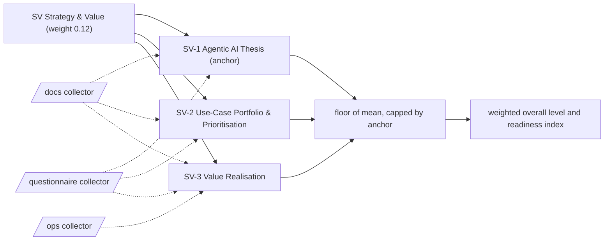

# SV: Strategy & Value

Why the enterprise uses agents, which outcomes it funds and whether the value shows up in the numbers. 3 capabilities; weight 0.12 in the overall level and the Agentic Readiness Index; levels Explore, Prove, Operate, Scale, Optimise.

Sections: [1. Purpose](#1-purpose) · [2. Architecture](#2-architecture) · [3. How it works](#3-how-it-works) · [4. Key files](#4-key-files) · [5. Code excerpts](#5-code-excerpts) · [6. Configuration](#6-configuration) · [7. Commands](#7-commands) · [8. Real output](#8-real-output) · [9. Tests and gates](#9-tests-and-gates) · [10. Guardrails](#10-guardrails) · [11. Security and governance](#11-security-and-governance) · [12. Observability](#12-observability) · [13. Failure modes](#13-failure-modes) · [14. Mapping to Azure services](#14-mapping-to-azure-services) · [15. Limitations](#15-limitations) · [16. Interview talking points](#16-interview-talking-points) · [17. Adopt this](#17-adopt-this)

## 1. Purpose

* Strategy & Value asks whether agents exist for a written reason, whether the money follows measured results and whether anyone can show the value after launch. It carries the lowest weight of the engineering-free dimensions because a weak thesis wastes money but rarely causes an incident.
* Default anchor: SV-1. The dimension cannot sit more than one level above its weakest anchor.

## 2. Architecture



## 3. How it works

Evidence comes from the `docs` collector (README purpose sections, numeric targets, roadmaps, business cases, decision records, experiment write-ups) and from code that computes value (`value_tracking_code`, `business_metric_link`). Questions cover what never lands in a repository: whether proposals name a goal, whether results move budget and whether strategy sessions happen.

A capability reaches a level when the level below is reached, every **must** criterion is fully present and at least half of the **support** criteria are present (a partial answer counts half and never satisfies a must). From Scale upwards every must list holds a file-based artifact. The dimension level is the floor of the mean of its capability levels, capped one level above its weakest anchor.

**SV-1 Agentic AI Thesis** (anchor): A written position on what agents are for in this business, which outcomes they must move and who sponsors them.

| Level | What it looks like | Evidence the assessor needs |
|---|---|---|
| 1 Explore | Agents are discussed as a trend; no document says what the business expects from them. | nothing (starting point) |
| 2 Prove | A short written thesis states what agents are for, and every proposal names the goal it serves. | must `vision_statement`; support `q_goal_field` |
| 3 Operate | The thesis carries numeric targets and is published to staff. | must `vision_targets`; support `q_vision_published` |
| 4 Scale | Recorded strategy reviews compare agent results with the targets, and the thesis shows up in the budget. | must `strategy_review`; support `q_vision_in_budget` |
| 5 Optimise | A maintained horizon scan and dedicated strategy sessions reshape the thesis from measured results. | must `scouting`, `q_strategy_session` |

Crosswalk: NIST AI RMF GOVERN 1, MAP 1; ISO/IEC 42001 4.1, 5.2, 6.2; EU AI Act no direct article.

**SV-2 Use-Case Portfolio & Prioritisation**: How candidate agent use cases are captured, scored and sequenced into a roadmap with owners.

| Level | What it looks like | Evidence the assessor needs |
|---|---|---|
| 1 Explore | Use cases arrive by email and are built in the order someone asks. | nothing (starting point) |
| 2 Prove | Each candidate has a business case or value estimate, and experiments are tried in a sandbox. | must `business_case`; support `experiments` |
| 3 Operate | A roadmap sequences the funded use cases and nothing is funded without a business case. | must `roadmap_doc`; support `q_business_case_mandatory` |
| 4 Scale | The roadmap names owners and phases, decisions are recorded and the plan is refreshed from delivery data. | must `roadmap_owned`; support `adr`, `q_roadmap_refresh` |
| 5 Optimise | Pilot write-ups feed a fast lane that turns winning experiments into funded products. | must `experiment_writeups`, `q_pilot_scaling` |

Crosswalk: NIST AI RMF MAP 1, MAP 3; ISO/IEC 42001 6.1, 6.2, A.6; EU AI Act no direct article.

**SV-3 Value Realisation**: Whether the benefits and costs of each agent are measured after launch and reported in business terms.

| Level | What it looks like | Evidence the assessor needs |
|---|---|---|
| 1 Explore | Benefits are anecdotes; nobody checks whether an agent saved anything. | nothing (starting point) |
| 2 Prove | Value metrics such as hours saved or cost per task are defined and reported for some agents. | must `value_metrics` |
| 3 Operate | Value is computed in tested code from real usage rather than estimated in slides. | must `value_tracking_code` |
| 4 Scale | Monitoring ties agent behaviour to business and cost metrics. | must `business_metric_link` |
| 5 Optimise | Benefits that are hard to price are measured next to hard value, and the portfolio is rebalanced on the result. | must `business_metric_link`, `q_intangible_value` |

Crosswalk: NIST AI RMF MAP 3, MEASURE 1, MANAGE 2; ISO/IEC 42001 9.1; EU AI Act no direct article.

## 4. Key files

| File | Role |
|---|---|
| `framework/framework.yaml` | SV weight, capabilities, level descriptors, actions and standards crosswalk |
| `rubric/capabilities.yaml` | Must and support criteria per level, effort, dependencies, anchors |
| `rubric/signals.yaml` | What each file-based signal looks for |
| `rubric/questionnaire.yaml` | Questions for what code cannot show |

## 5. Code excerpts

<!-- code: src/aimaturity/rollup.py::readiness_index -->
```python
def readiness_index(dimension_rows: list[dict[str, Any]]) -> float:
    return round(100 * sum(d["weight"] * (d["mean"] - 1) / (TOP - 1) for d in dimension_rows), 1)
```
<!-- /code -->

<!-- code: src/aimaturity/roadmap.py::work_items -->
```python
def work_items(gaps: list[dict[str, Any]]) -> list[dict[str, Any]]:
    cats = capabilities()
    weight = dimension_weights()
    items: dict[str, dict[str, Any]] = {}
    by_cat = {g["capability"]: g for g in gaps}
    for g in gaps:
        for n, step in enumerate(g["steps"]):
            iid = f"{g['capability']}->{step['to_level']}"
            deps = [f"{g['capability']}->{step['to_level'] - 1}"] if n else []
            for d in cats[g["capability"]]["rubric"]["depends_on"]:
                deps += [f"{d}->{s['to_level']}" for s in by_cat[d]["steps"] if s["to_level"] <= step["to_level"] - 1]
            items[iid] = {
                "id": iid,
                "capability": g["capability"],
                "name": g["name"],
                "dimension": g["dimension"],
                "to_level": step["to_level"],
                "effort": step["effort"],
                "months": DURATION[step["effort"]],
                "depends_on": deps,
                "anchor": g["anchor"],
                "weight": weight[g["dimension"]],
                "gap": g["gap"],
                "confidence": g["confidence"],
                "action": step["action"],
                "missing": step["missing"],
            }
    for it in items.values():
        it["unblocks"] = sorted(o["id"] for o in items.values() if it["id"] in o["depends_on"])
        it["priority"] = round(10 * it["gap"] + 5 * it["anchor"] + 2 * len(it["unblocks"]) + 3 * (1 - it["confidence"]) + 20 * it["weight"], 2)
        first = not any(d.startswith(it["capability"] + "->") for d in it["depends_on"])
        it["kind"] = "quick-win" if first and it["effort"] == "S" and not it["depends_on"] else "strategic"
    return sorted(items.values(), key=lambda i: (-i["priority"], i["id"]))
```
<!-- /code -->

## 6. Configuration

| Capability | Effort per step | Depends on | Anchor (default) |
|---|---|---|---|
| SV-1 | 2:S, 3:M, 4:M, 5:L | - | yes |
| SV-2 | 2:S, 3:S, 4:M, 5:L | SV-1 | no |
| SV-3 | 2:S, 3:M, 4:L, 5:L | SV-2 | no |

| Signal or question | Collector | Meaning |
|---|---|---|
| `adr` | docs | Architecture decision records with a status |
| `business_case` | docs | Use cases carry a business case or value estimate |
| `business_metric_link` | ops | Monitoring links model behaviour to business or cost metrics |
| `experiment_writeups` | docs | Experiments are written up with results or lessons |
| `experiments` | docs | A place for experiments (labs, notebooks, sandboxes, learning topics) |
| `q_business_case_mandatory` | questionnaire | Is a goal-linked business case required before an agent build is funded? |
| `q_goal_field` | questionnaire | Does every agent use-case proposal state which business goal it serves? |
| `q_intangible_value` | questionnaire | Are strategic or hard-to-price benefits of agents tracked and used to rebalance the portfolio? |
| `q_pilot_scaling` | questionnaire | Is there a fast, funded route from a successful agent pilot to a product? |
| `q_roadmap_refresh` | questionnaire | Is the agent roadmap refreshed from delivery data and horizon scanning? |
| `q_strategy_session` | questionnaire | Can agent capability proposals change business goals in strategy sessions? |
| `q_vision_in_budget` | questionnaire | Do measured agent results steer budget and prioritisation decisions? |
| `q_vision_published` | questionnaire | Is the agentic AI thesis published to staff with numeric targets? |
| `roadmap_doc` | docs | A roadmap document exists |
| `roadmap_owned` | docs | The roadmap names owners and phases or months |
| `scouting` | docs | Technology scouting (a tech radar or horizon scan) is kept |
| `strategy_review` | docs | A record of periodic strategy reviews that include AI results |
| `value_metrics` | docs | Value or cost metrics (ROI, savings, cost per task) are reported |
| `value_tracking_code` | docs | Value or cost is computed in code with tests, not only described |
| `vision_statement` | docs | A README or vision doc states what AI is for (purpose, vision or at-a-glance section) |
| `vision_targets` | docs | Measurable AI targets (OKRs or KPIs with numbers) are written down |

## 7. Commands

```bash
aimaturity framework --dimension SV
aimaturity capability SV-1
aimaturity explain --org portfolio --capability SV-3
aimaturity gaps --org kestrel-bay-bank
```

## 8. Real output

<!-- output: framework --dimension SV -->
```text
capability  name                                 anchor
----------  -----------------------------------  ------
SV-1        Agentic AI Thesis                    yes
SV-2        Use-Case Portfolio & Prioritisation
SV-3        Value Realisation
```
<!-- /output -->

<!-- output: capability SV-1 -->
```text
SV-1 Agentic AI Thesis (SV Strategy & Value) - anchor
A written position on what agents are for in this business, which outcomes they must move and who sponsors them.
  1 Explore: Agents are discussed as a trend; no document says what the business expects from them.
  2 Prove: A short written thesis states what agents are for, and every proposal names the goal it serves.
  3 Operate: The thesis carries numeric targets and is published to staff.
  4 Scale: Recorded strategy reviews compare agent results with the targets, and the thesis shows up in the budget.
  5 Optimise: A maintained horizon scan and dedicated strategy sessions reshape the thesis from measured results.
  must for 2: vision_statement (A README or vision doc states what AI is for (purpose, vision or at-a-glance section))
  support for 2: q_goal_field (Does every agent use-case proposal state which business goal it serves?)
  must for 3: vision_targets (Measurable AI targets (OKRs or KPIs with numbers) are written down)
  support for 3: q_vision_published (Is the agentic AI thesis published to staff with numeric targets?)
  must for 4: strategy_review (A record of periodic strategy reviews that include AI results)
  support for 4: q_vision_in_budget (Do measured agent results steer budget and prioritisation decisions?)
  must for 5: scouting (Technology scouting (a tech radar or horizon scan) is kept); q_strategy_session (Can agent capability proposals change business goals in strategy sessions?)
```
<!-- /output -->

<!-- output: explain --org portfolio --capability SV-3 -->
```text
SV-3 Value Realisation: level 4 (Scale), confidence 0.71, status auto
rationale: Level 4 (Scale). Supported by [E748], [E749], [E750], [E751]. Next level needs: q_intangible_value. Confidence 0.71.
  [x] value_metrics                artifact         E748, E749, E750
  [x] value_tracking_code          artifact         E759, E760, E761
  [x] business_metric_link         artifact         E101, E102, E103
  [ ] q_intangible_value           sample-answers   
  E748 agentic-ai-model-risk:docs/scenarios/cost-spike.md (matched 'cost per task')
  E749 agentic-ai-portfolio:docs/components/doctrine-gate.md (matched 'ROI')
  E750 agentic-ai-portfolio:docs/components/eval-harness.md (matched 'Cost per task')
  E751 agentic-ai-portfolio:docs/components/observability.md (matched 'cost per call')
  E752 ai-learning-lab:topics/03-jev-system1-classifier/README.md (matched 'savings')
  E753 azure-finops:CHANGELOG.md (matched 'ROI')
  E754 azure-finops:README.md (matched 'savings')
  E755 azure-finops:data/pricing/README.md (matched 'savings')
```
<!-- /output -->

## 9. Tests and gates

* `tests/test_framework.py`: every capability has five descriptors, four actions, a must list per level and a three-standard crosswalk.
* `tests/test_scoring.py`: no evidence gives Explore, full evidence gives Optimise, each level is reached exactly, musts gate and half the support is enough.
* `tests/test_repo_hygiene.py`: this page names every capability and every signal it scores, and its output blocks match a fresh run.
* Eval gates: calibration against labelled levels covers every SV capability; stability checks that dropping one artifact moves at most two capabilities.

## 10. Guardrails

* SV is capped by SV-1 by default: without the anchor, the rest of the dimension cannot lift it more than one level.
* Answers alone stop at Operate: every Scale and Optimise must list contains an artifact.
* Anything that rests on sample answers goes to human review, whatever its confidence.

## 11. Security and governance

Assessments read repositories without executing them and cite file paths, never file contents. Questionnaire answers can hold internal judgements: keep them in the evidence store's `evidence` container (private, versioned, Entra-only).

## 12. Observability

Each scheduled run writes a `summary.json` per organisation with the SV level, mean, weight, confidence per capability and the review queue; upload it to Log Analytics and trend the Agentic Readiness Index between assessments.

## 13. Failure modes

| Failure | What the assessor does |
|---|---|
| A vision README with no numbers | SV-1 stops at Prove; the gap names `vision_targets` |
| Value metrics in slides, not code | SV-3 stops at Prove until value is computed in tested code |
| A roadmap without owners | SV-2 stops at Operate; `roadmap_owned` blocks Scale |

## 14. Mapping to Azure services

* **Azure Monitor / Log Analytics** workbooks hold the value and cost metrics that `business_metric_link` looks for.
* **Foundry** project tags and evaluation runs give each agent an owner and a measured outcome to report against.
* **Microsoft Purview** and **Azure Policy** are not the evidence here, but SV-1 targets often name them as outcomes (for example, policy coverage).

## 15. Limitations

* A thesis can be well written and still wrong; the assessor checks that targets exist, not that they are good.
* Budget decisions are questionnaire-led (`q_vision_in_budget`).

## 16. Interview talking points

* "Value has to be computed in code before SV-3 reaches Operate, so a slide claiming savings does not count."
* "The roadmap my tool generates is itself SV-2 evidence: owners, phases and dependencies in one file."

## 17. Adopt this

1. Put a `## Purpose` section and one numeric KPI in each agent's README.
2. Compute unit value (hours saved, cost per task) in a tested module and link it to a dashboard.
3. Record funding decisions as ADRs so `adr` and `roadmap_owned` have something to cite.
