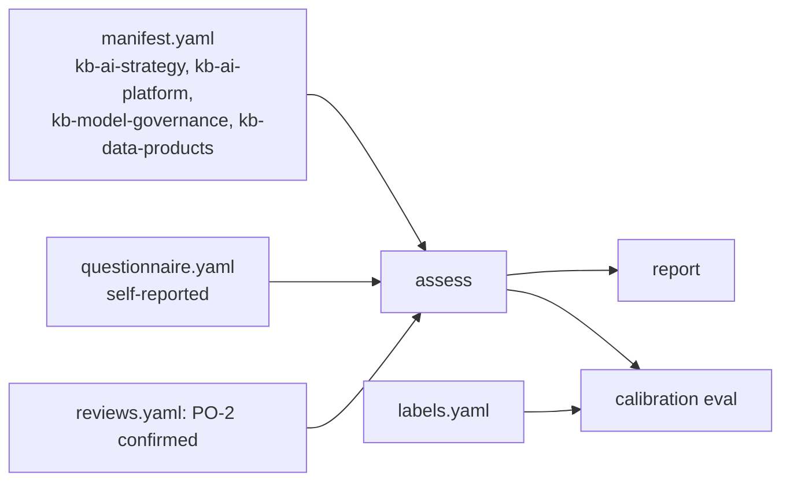

# Sample 2: Kestrel Bay Bank (fictional)

A fictional mid-sized bank with a model risk function. Governance, Risk & Compliance and Security &
Identity are strong (level 4), the platform and agent engineering are at Operate, and people, data and
FinOps lag at Prove. Evidence is a synthetic manifest of four
repositories; answers are self-reported; expert labels support calibration.

Sections: [1. Purpose](#1-purpose) · [2. Architecture](#2-architecture) · [3. How it works](#3-how-it-works) · [4. Key files](#4-key-files) · [5. Code excerpts](#5-code-excerpts) · [6. Configuration](#6-configuration) · [7. Commands](#7-commands) · [8. Real output](#8-real-output) · [9. Tests and gates](#9-tests-and-gates) · [10. Guardrails](#10-guardrails) · [11. Security and governance](#11-security-and-governance) · [12. Observability](#12-observability) · [13. Failure modes](#13-failure-modes) · [14. Mapping to Azure services](#14-mapping-to-azure-services) · [15. Limitations](#15-limitations) · [16. Interview talking points](#16-interview-talking-points) · [17. Adopt this](#17-adopt-this)

## 1. Purpose

* Show a regulated organisation where governance and security lead and the operating model and cost controls lag.

## 2. Architecture



## 3. How it works

1. The manifest lists signals per repository; files are built from each signal's example.
2. Targets: default 3, GR and SI at 4, AE-1 at 4; capacity 4.
3. One review is seeded: PO-2 confirmed at Prove by a fictional model-risk reviewer, who saw a skills matrix but no funded training paths.
4. Labels were judged from the level descriptors alone and differ from the computed level in one capability (SV-2: computed Scale, label Operate), which is realistic and visible in calibration.
5. SV-2 and PO-1 still wait for review, so the result is provisional.

## 4. Key files

| File | Role |
|---|---|
| `samples/kestrel-bay-bank/org.yaml` | Config and targets |
| `samples/kestrel-bay-bank/manifest.yaml` | Synthetic repositories |
| `samples/kestrel-bay-bank/questionnaire.yaml` | Self-reported answers |
| `samples/kestrel-bay-bank/labels.yaml` | Expert labels |
| `samples/kestrel-bay-bank/reviews.yaml` | Seeded review |

## 5. Code excerpts

<!-- code: src/aimaturity/orgs.py::manifest_sources -->
```python
def manifest_sources(manifest: dict[str, Any]) -> list[ManifestSource]:
    out = []
    for repo in manifest["repos"]:
        files: dict[str, str] = {}
        for sid in repo.get("signals", []):
            ex = signals()[sid]["example"]
            files[ex["path"]] = files.get(ex["path"], "") + ex["content"]
        for path, content in (repo.get("files") or {}).items():
            files[path] = files.get(path, "") + content
        out.append(ManifestSource(repo["name"], files))
    return out
```
<!-- /code -->

## 6. Configuration

See `samples/kestrel-bay-bank/org.yaml`.

## 7. Commands

```bash
aimaturity assess --org kestrel-bay-bank
aimaturity roadmap --org kestrel-bay-bank
```

## 8. Real output

<!-- output: assess --org kestrel-bay-bank -->
```text
Kestrel Bay Bank: overall Level 2 (Prove), mean 3.3, Agentic Readiness Index 57.4
dimension  name                           level           mean  capped by
---------  -----------------------------  -----  -------  ----  ---------
SV         Strategy & Value               3      Operate  3.33  -
DF         Data Foundation                2      Prove    2.67  -
PL         Platform & LLMOps              3      Operate  3.33  -
AE         Agent Engineering              3      Operate  3     -
SI         Security & Identity            4      Scale    4     -
GR         Governance, Risk & Compliance  4      Scale    4.67  -
PO         People & Operating Model       2      Prove    2.33  -
FC         FinOps & Cost                  2      Prove    2.5   -

capability  level  computed  conf  status          target
----------  -----  --------  ----  --------------  ------
SV-1        3      3         0.78  auto            3
SV-2        4      4         0.55  pending-review  3
SV-3        3      3         0.98  auto            3
DF-1        2      2         0.83  auto            3
DF-2        3      3         0.98  auto            3
DF-3        3      3         0.64  auto            3
PL-1        2      2         0.82  auto            3
PL-2        4      4         0.78  auto            3
PL-3        4      4         0.74  auto            3
AE-1        3      3         0.98  auto            4
AE-2        2      2         0.96  auto            3
AE-3        4      4         0.68  auto            3
SI-1        5      5         0.91  auto            4
SI-2        4      4         0.67  auto            4
SI-3        3      3         0.98  auto            4
GR-1        5      5         0.86  auto            4
GR-2        5      5         0.89  auto            4
GR-3        4      4         0.68  auto            4
PO-1        3      3         0.5   pending-review  3
PO-2        2      2         0.56  confirmed       3
PO-3        2      2         0.66  auto            3
FC-1        3      3         0.98  auto            3
FC-2        2      2         0.71  auto            3

review queue: SV-2, PO-1; final: False
```
<!-- /output -->

## 9. Tests and gates

* `tests/test_samples.py`: overall levels and readiness index order, seeded review applied, labels agree on at least 85% of capabilities.

## 10. Guardrails

* Fictional name; no real bank data.

## 11. Security and governance

Read-only and offline. Sample organisations other than the portfolio are fictional; their repositories are synthetic manifests built from signal examples.

## 12. Observability

Report under `samples/kestrel-bay-bank/report/`.

## 13. Failure modes

| Failure | Behaviour |
|---|---|
| Manifest signal not found by collectors | test fails (`test_manifest_orgs_find_their_signals`) |

## 14. Mapping to Azure services

* A real bank would add Azure Policy compliance exports and Purview scans as evidence files.
* **Microsoft Foundry**: a hosted model replaces `MockLLM` for rationales, and Foundry evaluations score rationale groundedness against the cited evidence.
* **Azure Monitor / Log Analytics**: job logs, blob access logs and Key Vault audit events land in one workspace, where a query can trend maturity runs over time.

## 15. Limitations

* Synthetic files are one-line examples; real repositories are messier.

## 16. Interview talking points

* "The bank sample shows governance and security carrying the score while the operating model and FinOps hold the overall level at Prove."

## 17. Adopt this

1. Use it as a template for a regulated organisation: copy the folder and edit the manifest.
2. Add your expert labels to grow the calibration set.
