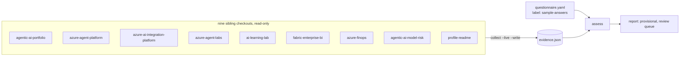

# Sample 1: Jagadish Meduri's portfolio as the assessed organisation

The first sample treats the author's eight public project repositories, plus the profile repository with the written AI principles, roadmap and skills matrix, as a small AI organisation and assesses
them read-only. Artifacts come from a checked-in snapshot of a scan of the sibling checkouts; operating-model,
people and policy items come from questionnaire inputs labelled **sample answers**, so every
capability that rests on them waits for a human reviewer and no review has been recorded.

Sections: [1. Purpose](#1-purpose) · [2. Architecture](#2-architecture) · [3. How it works](#3-how-it-works) · [4. Key files](#4-key-files) · [5. Code excerpts](#5-code-excerpts) · [6. Configuration](#6-configuration) · [7. Commands](#7-commands) · [8. Real output](#8-real-output) · [9. Tests and gates](#9-tests-and-gates) · [10. Guardrails](#10-guardrails) · [11. Security and governance](#11-security-and-governance) · [12. Observability](#12-observability) · [13. Failure modes](#13-failure-modes) · [14. Mapping to Azure services](#14-mapping-to-azure-services) · [15. Limitations](#15-limitations) · [16. Interview talking points](#16-interview-talking-points) · [17. Adopt this](#17-adopt-this)

## 1. Purpose

* Show the assessor on real artifacts, honestly: strong where code is evidence, provisional where only sample answers exist.

## 2. Architecture



## 3. How it works

1. `samples/portfolio/org.yaml` lists the nine repositories (eight project repositories and the profile repository), targets (default 3; PL, AE and GR at 4), capacity 3 and cross-links.
2. `evidence.json` holds the read-only scan; refresh it with `aimaturity collect --org portfolio --live --write`.
3. `questionnaire.yaml` is labelled `sample-answers` (weight 0.3, forced review).
4. No reviews are seeded: the result stays provisional until a real reviewer signs off.
5. Agent Engineering and Security & Identity are the strongest dimensions (mean 4.33); People & Operating Model is the weakest (level 1), as expected for a one-person portfolio, and it caps the overall level at Prove even though the weighted mean is above 3.

## 4. Key files

| File | Role |
|---|---|
| `samples/portfolio/org.yaml` | Config, targets, links |
| `samples/portfolio/evidence.json` | Snapshot of the scan |
| `samples/portfolio/questionnaire.yaml` | Sample answers (labelled) |
| `samples/portfolio/report/` | Report, HTML and radar |

## 5. Code excerpts

<!-- code: src/aimaturity/orgs.py::gather -->
```python
def gather(org: Org, live: bool = False, root: Path | None = None) -> list[Evidence]:
    """Numbered evidence for an org: artifacts (live scan, snapshot or manifest) plus questionnaire."""
    if "manifest" in org.config:
        items = scan(manifest_sources(org.manifest()))
    elif live:
        items = scan(live_sources(org, root))
    else:
        items = read_snapshot(org)
    answers = org.answers()
    if answers:
        items += collect_questionnaire(answers)
    return number(items)
```
<!-- /code -->

## 6. Configuration

See `samples/portfolio/org.yaml`.

## 7. Commands

```bash
aimaturity assess --org portfolio
aimaturity collect --org portfolio --live --write   # needs the checkouts next to this repository
```

## 8. Real output

<!-- output: assess --org portfolio -->
```text
Jagadish Meduri portfolio: overall Level 2 (Prove), mean 3.29, Agentic Readiness Index 57.1
dimension  name                           level           mean  capped by
---------  -----------------------------  -----  -------  ----  ---------
SV         Strategy & Value               3      Operate  3     -
DF         Data Foundation                2      Prove    2     -
PL         Platform & LLMOps              4      Scale    4     -
AE         Agent Engineering              4      Scale    4.33  -
SI         Security & Identity            4      Scale    4.33  -
GR         Governance, Risk & Compliance  3      Operate  3.33  -
PO         People & Operating Model       1      Explore  1.67  -
FC         FinOps & Cost                  3      Operate  3     -

capability  level  computed  conf  status          target
----------  -----  --------  ----  --------------  ------
SV-1        3      3         0.41  pending-review  3
SV-2        2      2         0.71  auto            3
SV-3        4      4         0.71  auto            3
DF-1        1      1         0.57  pending-review  3
DF-2        4      4         0.71  auto            3
DF-3        1      1         0.3   pending-review  3
PL-1        4      4         0.76  auto            4
PL-2        4      4         0.76  auto            4
PL-3        4      4         0.71  auto            4
AE-1        5      5         1.0   auto            4
AE-2        4      4         0.76  auto            4
AE-3        4      4         0.63  pending-review  4
SI-1        4      4         0.67  auto            3
SI-2        4      4         0.64  auto            3
SI-3        5      5         1.0   auto            3
GR-1        2      2         0.57  pending-review  4
GR-2        4      4         0.71  auto            4
GR-3        4      4         0.68  auto            4
PO-1        2      2         0.38  pending-review  3
PO-2        2      2         0.26  pending-review  3
PO-3        1      1         0.3   pending-review  3
FC-1        4      4         0.64  auto            3
FC-2        2      2         0.59  pending-review  3

review queue: SV-1, DF-1, DF-3, AE-3, GR-1, PO-1, PO-2, PO-3, FC-2; final: False
```
<!-- /output -->

<!-- output: links --org portfolio -->
```text
repo                   capability  cited  ok
---------------------  ----------  -----  ----
agentic-ai-model-risk  GR-1        1      True
agentic-ai-model-risk  GR-2        9      True
agentic-ai-model-risk  GR-3        9      True
azure-finops           SV-3        7      True
azure-finops           FC-1        6      True
azure-finops           FC-2        3      True
fabric-enterprise-bi   DF-2        6      True
```
<!-- /output -->

## 9. Tests and gates

* `tests/test_samples.py`: labelled answers, people items never auto-accepted, no seeded reviews, nine repositories, cross-links, engineering strongest and people weakest.
* `tests/test_report.py`: the checked-in report matches a fresh render.

## 10. Guardrails

* Sample answers are labelled in the data, forced into review and announced in the report.

## 11. Security and governance

Read-only and offline. Sample organisations other than the portfolio are fictional; their repositories are synthetic manifests built from signal examples.

## 12. Observability

The report lists 9 capabilities waiting for review with reasons.

## 13. Failure modes

| Failure | Behaviour |
|---|---|
| Snapshot older than the repositories | live comparison test (opt-in) and a one-command refresh |
| A checkout is missing | live mode fails with the path; snapshot mode still works |

## 14. Mapping to Azure services

* In Azure, the scheduled job would scan clones in its container and upload the snapshot to the `evidence` container.
* **Microsoft Foundry**: a hosted model replaces `MockLLM` for rationales, and Foundry evaluations score rationale groundedness against the cited evidence.
* **Microsoft Purview**: register the evidence store and reports as data assets with lineage back to the scanned repositories, and keep questionnaire answers under a sensitivity label.
* **Azure Policy**: audit that the evidence store stays keyless and versioned and that the Key Vault keeps RBAC, so the controls the assessment relies on cannot drift silently.
* **Azure Monitor / Log Analytics**: job logs, blob access logs and Key Vault audit events land in one workspace, where a query can trend maturity runs over time.

## 15. Limitations

* A one-person portfolio cannot evidence organisational culture; the result says so instead of guessing.

## 16. Interview talking points

* "I assessed my own portfolio with the tool: Scale on platform, agent engineering and security, Explore on the operating model, and the people items are marked as sample answers waiting for review."
* "The overall level is Prove because one dimension is at Explore; the readiness index of 57.1 shows how much engineering sits behind that."

## 17. Adopt this

1. Copy `samples/portfolio/` to `samples/<your-org>/`, change `repos` and `links`.
2. Replace the questionnaire with real answers (`label: self-reported`).
3. Run `aimaturity collect --org <your-org> --live --write`, then `aimaturity report --org <your-org>`.
