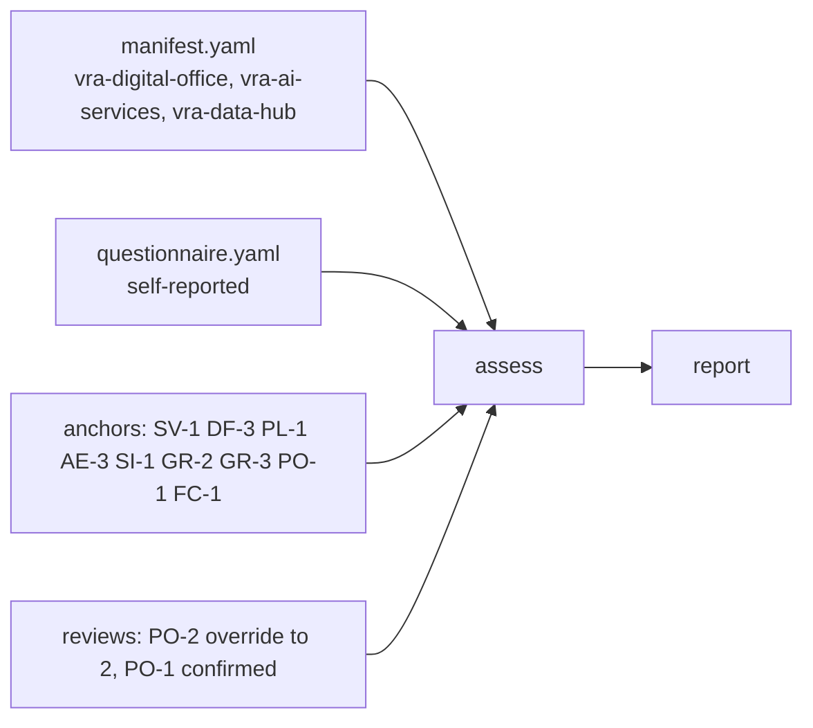

# Sample 3: Valemont Revenue Agency (fictional public administration)

A fictional national tax administration early in its AI journey: governance and transparency are its
strongest dimension, the platform and FinOps are at Explore. It chose its own anchor capabilities (public
trust first) and lowered the unit-economics target. A reviewer overrode PO-2 down to Prove after seeing
that literacy tracks run only inside the digital office.

Sections: [1. Purpose](#1-purpose) · [2. Architecture](#2-architecture) · [3. How it works](#3-how-it-works) · [4. Key files](#4-key-files) · [5. Code excerpts](#5-code-excerpts) · [6. Configuration](#6-configuration) · [7. Commands](#7-commands) · [8. Real output](#8-real-output) · [9. Tests and gates](#9-tests-and-gates) · [10. Guardrails](#10-guardrails) · [11. Security and governance](#11-security-and-governance) · [12. Observability](#12-observability) · [13. Failure modes](#13-failure-modes) · [14. Mapping to Azure services](#14-mapping-to-azure-services) · [15. Limitations](#15-limitations) · [16. Interview talking points](#16-interview-talking-points) · [17. Adopt this](#17-adopt-this)

## 1. Purpose

* Show a public-sector case with a custom anchor list, an override and a confirmation, ending in a final (fully reviewed) result.

## 2. Architecture



## 3. How it works

1. Anchors: SV-1, DF-3, PL-1, AE-3, SI-1, GR-2, GR-3, PO-1, FC-1 (set in `org.yaml`; governance has two).
2. Targets: default 3, GR-2 and GR-3 at 4, FC-2 at 2; capacity 3.
3. Reviews: PO-2 overridden from 3 to 2 (no funded training path), PO-1 confirmed at 2 (executive owner post vacant); both are in the audit log.
4. The review queue is empty, so the result is final: overall Explore, readiness index 29.2.

## 4. Key files

| File | Role |
|---|---|
| `samples/valemont-revenue-agency/org.yaml` | Config, anchor list, targets |
| `samples/valemont-revenue-agency/manifest.yaml` | Synthetic repositories |
| `samples/valemont-revenue-agency/questionnaire.yaml` | Self-reported answers |
| `samples/valemont-revenue-agency/labels.yaml` | Expert labels |
| `samples/valemont-revenue-agency/audit-log.jsonl` | Two chained review entries |

## 5. Code excerpts

<!-- code: src/aimaturity/hitl.py::apply_reviews -->
```python
def apply_reviews(
    results: dict[str, CapabilityResult], evidence: dict[str, Evidence], reviews: list[dict[str, Any]], assessor: str, log: list[dict[str, Any]]
) -> dict[str, dict[str, Any]]:
    """Status and final level per capability. The latest valid review for a capability wins."""
    logged = {e["hash"] for e in log}
    latest: dict[str, dict[str, Any]] = {}
    rejected: dict[str, str] = {}
    for r in reviews:
        try:
            validate_review(r, assessor, results)
        except ReviewError as err:
            rejected[r.get("capability", "?")] = str(err)
            continue
        if r.get("audit_hash") not in logged:
            rejected[r["capability"]] = "review has no matching audit log entry"
            continue
        latest[r["capability"]] = r
    out = {}
    for cid, res in results.items():
        r = latest.get(cid)
        if r and r["evidence_digest"] == capability_digest(res, evidence):
            status = "overridden" if r["decision"] == "override" and r["level"] != res.level else "confirmed"
            out[cid] = {"status": status, "final_level": r["level"], "review": r}
        elif r:
            out[cid] = {"status": "stale-review", "final_level": res.level, "review": r}
        elif res.needs_review:
            out[cid] = {"status": "pending-review", "final_level": res.level, "review": None}
        else:
            out[cid] = {"status": "auto", "final_level": res.level, "review": None}
        if cid in rejected and out[cid]["status"] in {"pending-review", "auto"}:
            out[cid]["rejected_review"] = rejected[cid]
    return out
```
<!-- /code -->

## 6. Configuration

See `samples/valemont-revenue-agency/org.yaml`.

## 7. Commands

```bash
aimaturity assess --org valemont-revenue-agency
aimaturity explain --org valemont-revenue-agency --capability PO-2
aimaturity audit --org valemont-revenue-agency
```

## 8. Real output

<!-- output: assess --org valemont-revenue-agency -->
```text
Valemont Revenue Agency: overall Level 1 (Explore), mean 2.17, Agentic Readiness Index 29.2
dimension  name                           level           mean  capped by
---------  -----------------------------  -----  -------  ----  ---------
SV         Strategy & Value               2      Prove    2     -
DF         Data Foundation                2      Prove    2.33  -
PL         Platform & LLMOps              1      Explore  1.67  -
AE         Agent Engineering              2      Prove    2     -
SI         Security & Identity            2      Prove    2     -
GR         Governance, Risk & Compliance  3      Operate  3.67  -
PO         People & Operating Model       2      Prove    2.33  -
FC         FinOps & Cost                  1      Explore  1     -

capability  level  computed  conf  status      target
----------  -----  --------  ----  ----------  ------
SV-1        2      2         0.77  auto        3
SV-2        2      2         0.74  auto        3
SV-3        2      2         0.96  auto        3
DF-1        3      3         0.82  auto        3
DF-2        2      2         0.96  auto        3
DF-3        2      2         0.75  auto        3
PL-1        2      2         0.82  auto        3
PL-2        2      2         0.98  auto        3
PL-3        1      1         0.93  auto        3
AE-1        1      1         0.93  auto        3
AE-2        2      2         0.96  auto        3
AE-3        3      3         0.88  auto        3
SI-1        1      1         0.93  auto        3
SI-2        2      2         0.96  auto        3
SI-3        3      3         0.98  auto        3
GR-1        5      5         0.86  auto        3
GR-2        2      2         0.96  auto        4
GR-3        4      4         0.73  auto        4
PO-1        2      2         0.43  confirmed   3
PO-2        2      3         0.4   overridden  3
PO-3        3      3         0.73  auto        3
FC-1        1      1         0.93  auto        3
FC-2        1      1         0.93  auto        2

review queue: empty; final: True
```
<!-- /output -->

<!-- output: roadmap --org valemont-revenue-agency -->
```text
step     kind       months  effort  priority  waits on
-------  ---------  ------  ------  --------  --------
AE-1->2  quick-win  1-1     S       32.01     -
SI-1->2  quick-win  1-1     S       32.01     -
FC-1->2  quick-win  1-1     S       29.21     -
PL-3->2  quick-win  2-2     S       24.81     -
SV-2->3  quick-win  2-2     S       13.18     -
FC-2->2  quick-win  2-2     S       12.21     -
AE-1->3  strategic  3-4     M       28.01     AE-1->2
SI-1->3  strategic  3-4     M       28.01     SI-1->2
FC-1->3  strategic  3-3     S       27.21     FC-1->2
GR-2->3  strategic  4-5     M       24.92     -
PL-3->3  strategic  5-5     S       22.81     PL-3->2
PO-1->3  strategic  5-6     M       18.71     -
GR-2->4  strategic  6-7     M       22.92     GR-2->3
SV-1->3  strategic  6-7     M       18.09     -
DF-2->3  strategic  7-8     M       17.72     -
PL-2->3  strategic  8-9     M       17.66     -
PO-2->3  strategic  8-9     M       13.8      -
DF-3->3  strategic  9-10    M       13.35     SI-1->2
PL-1->3  strategic  10-11   M       13.14     -
AE-2->3  strategic  10-11   M       12.92     -
SI-2->3  strategic  11-12   M       12.92     AE-1->2

Month  1: AE-1->2, SI-1->2, FC-1->2
Month  2: PL-3->2, SV-2->3, FC-2->2
Month  3: AE-1->3, SI-1->3, FC-1->3
Month  4: AE-1->3, SI-1->3, GR-2->3
Month  5: GR-2->3, PL-3->3, PO-1->3
Month  6: PO-1->3, GR-2->4, SV-1->3
Month  7: GR-2->4, SV-1->3, DF-2->3
Month  8: DF-2->3, PL-2->3, PO-2->3
Month  9: PL-2->3, PO-2->3, DF-3->3
Month 10: DF-3->3, PL-1->3, AE-2->3
Month 11: PL-1->3, AE-2->3, SI-2->3
Month 12: SI-2->3
backlog: SV-3->3
```
<!-- /output -->

## 9. Tests and gates

* `tests/test_samples.py`: custom anchor list, override and confirmation applied, overall level.
* `tests/test_hitl.py`: checked-in logs intact.

## 10. Guardrails

* Override reasons are recorded and chained.

## 11. Security and governance

Read-only and offline. Sample organisations other than the portfolio are fictional; their repositories are synthetic manifests built from signal examples.

## 12. Observability

Report under `samples/valemont-revenue-agency/report/`.

## 13. Failure modes

| Failure | Behaviour |
|---|---|
| Review edited by hand | audit chain or digest check fails |

## 14. Mapping to Azure services

* A public body would run the job in its own tenant and publish the HTML report internally behind Entra ID.
* **Microsoft Foundry**: a hosted model replaces `MockLLM` for rationales, and Foundry evaluations score rationale groundedness against the cited evidence.
* **Microsoft Purview**: register the evidence store and reports as data assets with lineage back to the scanned repositories, and keep questionnaire answers under a sensitivity label.
* **Azure Policy**: audit that the evidence store stays keyless and versioned and that the Key Vault keeps RBAC, so the controls the assessment relies on cannot drift silently.
* **Azure Monitor / Log Analytics**: job logs, blob access logs and Key Vault audit events land in one workspace, where a query can trend maturity runs over time.

## 15. Limitations

* Fictional agency; its answers are invented to illustrate the method.

## 16. Interview talking points

* "The agency shows why anchors must be configurable: it put public trust (risk, transparency, governed data) ahead of platform maturity."

## 17. Adopt this

1. Copy the folder for a public body and set `anchors:` to its non-negotiables.
2. Record overrides with evidence-based comments using `aimaturity review`.
