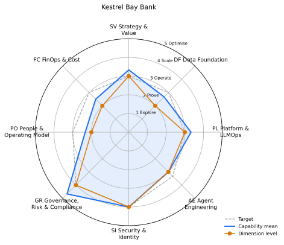

# Agentic AI maturity report: Kestrel Bay Bank

_Fictional retail and business bank_

## Executive summary

Overall maturity: **Level 2 (Prove)**, weighted capability mean 3.3 of 5, Agentic Readiness Index **57.4 / 100**. Assessment status: provisional: 2 capabilities wait for human review.

Strongest dimension: GR Governance, Risk & Compliance (mean 4.67). Weakest: PO People & Operating Model (mean 2.33).

Evidence: 113 items from 4 repositories and the questionnaire. Roadmap: 8 steps, 0 quick wins in Months 1-3, 0 beyond Month 12.

Top priorities: AE-1->4 Evaluation & Quality Gates (priority 17.86); PL-1->3 Paved-Road Engineering Platform (priority 17.14); PO-2->3 Skills & AI Literacy (priority 13.32).

This organisation is fictional; its repositories are synthetic manifests.

## Dimensions

| Dimension | Weight | Level | Capability mean | Target (mean) | Capped by anchor |
|---|---|---|---|---|---|
| SV Strategy & Value | 0.12 | 3 Operate | 3.33 | 3.0 | - |
| DF Data Foundation | 0.13 | 2 Prove | 2.67 | 3.0 | - |
| PL Platform & LLMOps | 0.13 | 3 Operate | 3.33 | 3.0 | - |
| AE Agent Engineering | 0.14 | 3 Operate | 3 | 3.33 | - |
| SI Security & Identity | 0.14 | 4 Scale | 4 | 4.0 | - |
| GR Governance, Risk & Compliance | 0.14 | 4 Scale | 4.67 | 4.0 | - |
| PO People & Operating Model | 0.10 | 2 Prove | 2.33 | 3.0 | - |
| FC FinOps & Cost | 0.10 | 2 Prove | 2.5 | 3.0 | - |

## Capabilities

| Capability | Level | Target | Confidence | Status | Evidence |
|---|---|---|---|---|---|
| SV-1 Agentic AI Thesis (anchor) | 3 | 3 | 0.78 | auto | 5 |
| SV-2 Use-Case Portfolio & Prioritisation | 4 | 3 | 0.55 | pending-review | 6 |
| SV-3 Value Realisation | 3 | 3 | 0.98 | auto | 4 |
| DF-1 Knowledge & Grounding Sources | 2 | 3 | 0.83 | auto | 2 |
| DF-2 Data Quality & Contracts (anchor) | 3 | 3 | 0.98 | auto | 2 |
| DF-3 Governed Access & Synthetic Data | 3 | 3 | 0.64 | auto | 2 |
| PL-1 Paved-Road Engineering Platform | 2 | 3 | 0.82 | auto | 1 |
| PL-2 Release & Lifecycle Automation (anchor) | 4 | 3 | 0.78 | auto | 4 |
| PL-3 Observability & Runtime Operations | 4 | 3 | 0.74 | auto | 3 |
| AE-1 Evaluation & Quality Gates (anchor) | 3 | 4 | 0.98 | auto | 2 |
| AE-2 Tool & Interoperability Design | 2 | 3 | 0.96 | auto | 1 |
| AE-3 Autonomy & Human Oversight | 4 | 3 | 0.68 | auto | 4 |
| SI-1 Agent Identity & Secrets (anchor) | 5 | 4 | 0.91 | auto | 5 |
| SI-2 AI Threat Defence | 4 | 4 | 0.67 | auto | 3 |
| SI-3 Supply Chain & Platform Hardening | 3 | 4 | 0.98 | auto | 2 |
| GR-1 AI Policy & Accountability (anchor) | 5 | 4 | 0.86 | auto | 7 |
| GR-2 Risk & Impact Management | 5 | 4 | 0.89 | auto | 4 |
| GR-3 Regulatory Compliance & Transparency | 4 | 4 | 0.68 | auto | 3 |
| PO-1 Sponsorship & Operating Model (anchor) | 3 | 3 | 0.50 | pending-review | 4 |
| PO-2 Skills & AI Literacy | 2 | 3 | 0.56 | confirmed | 2 |
| PO-3 Adoption & Change | 2 | 3 | 0.66 | auto | 2 |
| FC-1 Cost Guardrails (anchor) | 3 | 3 | 0.98 | auto | 2 |
| FC-2 Unit Economics & Model Routing | 2 | 3 | 0.71 | auto | 1 |

## Human review

2 pending, 1 signed off. Audit log chain: intact.

| Capability | Name | Why it needs a human |
|---|---|---|
| SV-2 | Use-Case Portfolio & Prioritisation | confidence 0.55 below 0.6 |
| PO-1 | Sponsorship & Operating Model | confidence 0.50 below 0.6 |

| Capability | Reviewer | Outcome | Comment |
|---|---|---|---|
| PO-2 | Amara Lindqvist (Model Risk) | confirmed | Skills matrix seen in the HR workforce plan; role literacy tracks and training paths are not funded yet, so Prove is right. |

## Gap analysis

8 of 23 capabilities are below target.

| Capability | Now | Target | Gap | First action |
|---|---|---|---|---|
| AE-1 Evaluation & Quality Gates | 3 | 4 | 1 | Store every evaluation run and compare it with the last. |
| AE-2 Tool & Interoperability Design | 2 | 3 | 1 | Expose agent tools through an MCP server. |
| DF-1 Knowledge & Grounding Sources | 2 | 3 | 1 | Write a glossary or semantic model for each grounding source. |
| FC-2 Unit Economics & Model Routing | 2 | 3 | 1 | Route requests by measured cost and quality per task. |
| PL-1 Paved-Road Engineering Platform | 2 | 3 | 1 | Move infrastructure to Bicep or Terraform and add a devcontainer. |
| PO-2 Skills & AI Literacy | 2 | 3 | 1 | Maintain role-based learning tracks with funded paths. |
| PO-3 Adoption & Change | 2 | 3 | 1 | Publish contribution rules and adopt a change method. |
| SI-3 Supply Chain & Platform Hardening | 3 | 4 | 1 | Add checkov or tflint to CI. |

## Roadmap (Month 1-12)

Capacity 4 items in flight. Milestones: Month 6: Re-assess all capabilities and refresh the plan; Month 12: Full re-assessment and target reset.

| Step | Kind | Months | Effort | Priority | Waits on |
|---|---|---|---|---|---|
| PL-1->3 Paved-Road Engineering Platform | strategic | 1-2 | M | 17.14 | - |
| PO-2->3 Skills & AI Literacy | strategic | 1-2 | M | 13.32 | - |
| DF-1->3 Knowledge & Grounding Sources | strategic | 1-2 | M | 13.11 | - |
| PO-3->3 Adoption & Change | strategic | 1-2 | M | 13.02 | - |
| AE-1->4 Evaluation & Quality Gates | strategic | 3-4 | M | 17.86 | PL-1->3 |
| AE-2->3 Tool & Interoperability Design | strategic | 3-4 | M | 12.92 | - |
| FC-2->3 Unit Economics & Model Routing | strategic | 3-4 | M | 12.87 | - |
| SI-3->4 Supply Chain & Platform Hardening | strategic | 3-4 | M | 12.86 | PL-1->3 |

| Month | In flight |
|---|---|
| 1 | PL-1->3, PO-2->3, DF-1->3, PO-3->3 |
| 2 | PL-1->3, PO-2->3, DF-1->3, PO-3->3 |
| 3 | AE-1->4, AE-2->3, FC-2->3, SI-3->4 |
| 4 | AE-1->4, AE-2->3, FC-2->3, SI-3->4 |
| 5 | - |
| 6 | - |
| 7 | - |
| 8 | - |
| 9 | - |
| 10 | - |
| 11 | - |
| 12 | - |

Everything fits in the twelve months.

## Evidence

| Collector | Items |
|---|---|
| ci | 10 |
| data | 6 |
| docs | 13 |
| governance | 16 |
| iac | 10 |
| ops | 7 |
| people | 3 |
| questionnaire | 48 |

| Source | Items |
|---|---|
| kb-ai-platform | 28 |
| kb-ai-strategy | 16 |
| kb-data-products | 6 |
| kb-model-governance | 15 |
| questionnaire | 48 |

## Method

Model: Enterprise Agentic AI Maturity Model (framework/framework.yaml), eight weighted dimensions, 23 capabilities, five levels from Explore to Optimise. A capability reaches a level when the level below is reached, every must criterion is present and at least half of the support criteria are present (rubric/capabilities.yaml). From Scale upwards every level needs a file-based artifact, so answers alone stop at Operate. Confidence = 0.5 x evidence trust + 0.3 x decision margin + 0.2 x verifiability. A dimension is the floor of its capability mean, capped one level above its weakest anchor; the overall level is the floor of the weighted dimension mean, capped one level above the weakest dimension. The Agentic Readiness Index (0-100) is the weighted capability mean rescaled from levels 1-5.
