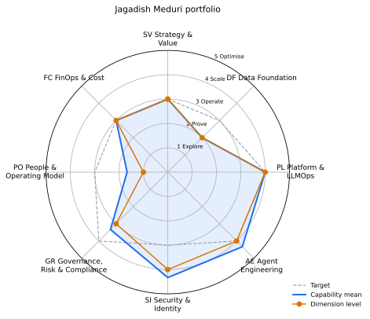

# Agentic AI maturity report: Jagadish Meduri portfolio

_Engineering portfolio (one maintainer, eight project repositories plus a profile repository)_

## Executive summary

Overall maturity: **Level 2 (Prove)**, weighted capability mean 3.29 of 5, Agentic Readiness Index **57.1 / 100**. Assessment status: provisional: 9 capabilities wait for human review.

Strongest dimension: SI Security & Identity (mean 4.33). Weakest: PO People & Operating Model (mean 1.67).

Evidence: 772 items from 9 repositories and the questionnaire. Roadmap: 12 steps, 4 quick wins in Months 1-3, 0 beyond Month 12.

Top priorities: GR-1->3 AI Policy & Accountability (priority 31.09); GR-1->4 AI Policy & Accountability (priority 29.09); DF-1->2 Knowledge & Grounding Sources (priority 27.89).

Operating-model, people and policy answers are SAMPLE ANSWERS (illustrative inputs, not survey results). Capabilities that rest on them wait for human review.

## Dimensions

| Dimension | Weight | Level | Capability mean | Target (mean) | Capped by anchor |
|---|---|---|---|---|---|
| SV Strategy & Value | 0.12 | 3 Operate | 3 | 3.0 | - |
| DF Data Foundation | 0.13 | 2 Prove | 2 | 3.0 | - |
| PL Platform & LLMOps | 0.13 | 4 Scale | 4 | 4.0 | - |
| AE Agent Engineering | 0.14 | 4 Scale | 4.33 | 4.0 | - |
| SI Security & Identity | 0.14 | 4 Scale | 4.33 | 3.0 | - |
| GR Governance, Risk & Compliance | 0.14 | 3 Operate | 3.33 | 4.0 | - |
| PO People & Operating Model | 0.10 | 1 Explore | 1.67 | 3.0 | - |
| FC FinOps & Cost | 0.10 | 3 Operate | 3 | 3.0 | - |

## Capabilities

| Capability | Level | Target | Confidence | Status | Evidence |
|---|---|---|---|---|---|
| SV-1 Agentic AI Thesis (anchor) | 3 | 3 | 0.41 | pending-review | 12 |
| SV-2 Use-Case Portfolio & Prioritisation | 2 | 3 | 0.71 | auto | 13 |
| SV-3 Value Realisation | 4 | 3 | 0.71 | auto | 19 |
| DF-1 Knowledge & Grounding Sources | 1 | 3 | 0.57 | pending-review | 0 |
| DF-2 Data Quality & Contracts (anchor) | 4 | 3 | 0.71 | auto | 17 |
| DF-3 Governed Access & Synthetic Data | 1 | 3 | 0.30 | pending-review | 0 |
| PL-1 Paved-Road Engineering Platform | 4 | 4 | 0.76 | auto | 42 |
| PL-2 Release & Lifecycle Automation (anchor) | 4 | 4 | 0.76 | auto | 57 |
| PL-3 Observability & Runtime Operations | 4 | 4 | 0.71 | auto | 39 |
| AE-1 Evaluation & Quality Gates (anchor) | 5 | 4 | 1.00 | auto | 31 |
| AE-2 Tool & Interoperability Design | 4 | 4 | 0.76 | auto | 42 |
| AE-3 Autonomy & Human Oversight | 4 | 4 | 0.63 | pending-review | 55 |
| SI-1 Agent Identity & Secrets (anchor) | 4 | 3 | 0.67 | auto | 40 |
| SI-2 AI Threat Defence | 4 | 3 | 0.64 | auto | 31 |
| SI-3 Supply Chain & Platform Hardening | 5 | 3 | 1.00 | auto | 38 |
| GR-1 AI Policy & Accountability (anchor) | 2 | 4 | 0.57 | pending-review | 9 |
| GR-2 Risk & Impact Management | 4 | 4 | 0.71 | auto | 9 |
| GR-3 Regulatory Compliance & Transparency | 4 | 4 | 0.68 | auto | 18 |
| PO-1 Sponsorship & Operating Model (anchor) | 2 | 3 | 0.38 | pending-review | 2 |
| PO-2 Skills & AI Literacy | 2 | 3 | 0.26 | pending-review | 2 |
| PO-3 Adoption & Change | 1 | 3 | 0.30 | pending-review | 0 |
| FC-1 Cost Guardrails (anchor) | 4 | 3 | 0.64 | auto | 42 |
| FC-2 Unit Economics & Model Routing | 2 | 3 | 0.59 | pending-review | 4 |

## Human review

9 pending, 0 signed off. Audit log chain: intact.

| Capability | Name | Why it needs a human |
|---|---|---|
| SV-1 | Agentic AI Thesis | confidence 0.41 below 0.6; level rests on sample answers: q_goal_field, q_vision_published |
| DF-1 | Knowledge & Grounding Sources | confidence 0.57 below 0.6 |
| DF-3 | Governed Access & Synthetic Data | confidence 0.30 below 0.6 |
| AE-3 | Autonomy & Human Oversight | level rests on sample answers: q_autonomy_tiers |
| GR-1 | AI Policy & Accountability | confidence 0.57 below 0.6; level rests on sample answers: q_ethics_principles |
| PO-1 | Sponsorship & Operating Model | confidence 0.38 below 0.6; level rests on sample answers: q_coordinator, q_project_sponsors |
| PO-2 | Skills & AI Literacy | confidence 0.26 below 0.6; level rests on sample answers: q_ai_roles_defined, q_awareness_material |
| PO-3 | Adoption & Change | confidence 0.30 below 0.6 |
| FC-2 | Unit Economics & Model Routing | confidence 0.59 below 0.6 |

## Gap analysis

8 of 23 capabilities are below target.

| Capability | Now | Target | Gap | First action |
|---|---|---|---|---|
| DF-1 Knowledge & Grounding Sources | 1 | 3 | 2 | List the grounding sources per use case and name a domain expert. |
| DF-3 Governed Access & Synthetic Data | 1 | 3 | 2 | Publish the data access request process. |
| GR-1 AI Policy & Accountability | 2 | 4 | 2 | Start an agent inventory with owners and charter a review body. |
| PO-3 Adoption & Change | 1 | 3 | 2 | Announce each rollout and join a peer community. |
| FC-2 Unit Economics & Model Routing | 2 | 3 | 1 | Route requests by measured cost and quality per task. |
| PO-1 Sponsorship & Operating Model | 2 | 3 | 1 | Appoint an executive owner and charter a central team. |
| PO-2 Skills & AI Literacy | 2 | 3 | 1 | Maintain role-based learning tracks with funded paths. |
| SV-2 Use-Case Portfolio & Prioritisation | 2 | 3 | 1 | Publish a sequenced roadmap and make a business case mandatory for funding. |

## Roadmap (Month 1-12)

Capacity 3 items in flight. Milestones: Month 6: Re-assess all capabilities and refresh the plan; Month 12: Full re-assessment and target reset.

| Step | Kind | Months | Effort | Priority | Waits on |
|---|---|---|---|---|---|
| DF-1->2 Knowledge & Grounding Sources | quick-win | 1 | S | 27.89 | - |
| DF-3->2 Governed Access & Synthetic Data | quick-win | 1 | S | 26.7 | - |
| PO-3->2 Adoption & Change | quick-win | 1 | S | 26.1 | - |
| GR-1->3 AI Policy & Accountability | strategic | 2-3 | M | 31.09 | - |
| DF-3->3 Governed Access & Synthetic Data | strategic | 2-3 | M | 24.7 | DF-3->2, DF-1->2 |
| SV-2->3 Use-Case Portfolio & Prioritisation | quick-win | 2 | S | 13.27 | - |
| PO-3->3 Adoption & Change | strategic | 3-4 | M | 24.1 | PO-3->2 |
| DF-1->3 Knowledge & Grounding Sources | strategic | 4-5 | M | 23.89 | DF-1->2 |
| PO-1->3 Sponsorship & Operating Model | strategic | 4-5 | M | 20.86 | - |
| PO-2->3 Skills & AI Literacy | strategic | 5-6 | M | 14.22 | - |
| GR-1->4 AI Policy & Accountability | strategic | 6-8 | L | 29.09 | GR-1->3, PO-1->3 |
| FC-2->3 Unit Economics & Model Routing | strategic | 6-7 | M | 13.23 | - |

| Month | In flight |
|---|---|
| 1 | DF-1->2, DF-3->2, PO-3->2 |
| 2 | GR-1->3, DF-3->3, SV-2->3 |
| 3 | GR-1->3, DF-3->3, PO-3->3 |
| 4 | PO-3->3, DF-1->3, PO-1->3 |
| 5 | DF-1->3, PO-1->3, PO-2->3 |
| 6 | PO-2->3, GR-1->4, FC-2->3 |
| 7 | GR-1->4, FC-2->3 |
| 8 | GR-1->4 |
| 9 | - |
| 10 | - |
| 11 | - |
| 12 | - |

Everything fits in the twelve months.

## Cross-repository evidence

| Repository | Capability | Cited files | Examples |
|---|---|---|---|
| agentic-ai-model-risk | GR-1 | 1 | docs/best-practices.md |
| agentic-ai-model-risk | GR-2 | 9 | registry/bramblewood-claims-triage/risk-cards.yaml, registry/cedarhollow-underwriting-assistant/risk-cards.yaml, registry/halcyon-fraud-triage/risk-cards.yaml |
| agentic-ai-model-risk | GR-3 | 9 | CHANGELOG.md, README.md, docs/README.md |
| azure-finops | SV-3 | 7 | CHANGELOG.md, README.md, data/pricing/README.md |
| azure-finops | FC-1 | 6 | infra/bicep/main.bicep, infra/bicep/modules/guardrails.bicep, infra/terraform/main.tf |
| azure-finops | FC-2 | 3 | src/finops/ai/roi.py, src/finops/ai/token_cost.py, src/finops/costing.py |
| fabric-enterprise-bi | DF-2 | 6 | contracts/README.md, contracts/products/README.md, contracts/products/customer-care-insights.yaml |

## Evidence

| Collector | Items |
|---|---|
| ci | 122 |
| data | 91 |
| docs | 79 |
| governance | 154 |
| iac | 136 |
| ops | 114 |
| people | 28 |
| questionnaire | 48 |

| Source | Items |
|---|---|
| agentic-ai-model-risk | 97 |
| agentic-ai-portfolio | 114 |
| ai-learning-lab | 37 |
| azure-agent-labs | 96 |
| azure-agent-platform | 95 |
| azure-ai-integration-platform | 96 |
| azure-finops | 83 |
| fabric-enterprise-bi | 91 |
| profile-readme | 15 |
| questionnaire | 48 |

## Method

Model: Enterprise Agentic AI Maturity Model (framework/framework.yaml), eight weighted dimensions, 23 capabilities, five levels from Explore to Optimise. A capability reaches a level when the level below is reached, every must criterion is present and at least half of the support criteria are present (rubric/capabilities.yaml). From Scale upwards every level needs a file-based artifact, so answers alone stop at Operate. Confidence = 0.5 x evidence trust + 0.3 x decision margin + 0.2 x verifiability. A dimension is the floor of its capability mean, capped one level above its weakest anchor; the overall level is the floor of the weighted dimension mean, capped one level above the weakest dimension. The Agentic Readiness Index (0-100) is the weighted capability mean rescaled from levels 1-5.
