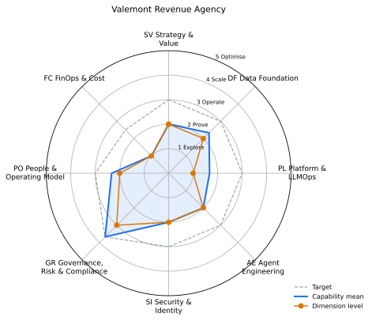

# Agentic AI maturity report: Valemont Revenue Agency

_Fictional public administration (tax and revenue)_

## Executive summary

Overall maturity: **Level 1 (Explore)**, weighted capability mean 2.17 of 5, Agentic Readiness Index **29.2 / 100**. Assessment status: final.

Strongest dimension: GR Governance, Risk & Compliance (mean 3.67). Weakest: FC FinOps & Cost (mean 1).

Evidence: 80 items from 3 repositories and the questionnaire. Roadmap: 22 steps, 6 quick wins in Months 1-3, 1 beyond Month 12.

Top priorities: AE-1->2 Evaluation & Quality Gates (priority 32.01); SI-1->2 Agent Identity & Secrets (priority 32.01); FC-1->2 Cost Guardrails (priority 29.21).

This organisation is fictional; its repositories are synthetic manifests.

## Dimensions

| Dimension | Weight | Level | Capability mean | Target (mean) | Capped by anchor |
|---|---|---|---|---|---|
| SV Strategy & Value | 0.12 | 2 Prove | 2 | 3.0 | - |
| DF Data Foundation | 0.13 | 2 Prove | 2.33 | 3.0 | - |
| PL Platform & LLMOps | 0.13 | 1 Explore | 1.67 | 3.0 | - |
| AE Agent Engineering | 0.14 | 2 Prove | 2 | 3.0 | - |
| SI Security & Identity | 0.14 | 2 Prove | 2 | 3.0 | - |
| GR Governance, Risk & Compliance | 0.14 | 3 Operate | 3.67 | 3.67 | - |
| PO People & Operating Model | 0.10 | 2 Prove | 2.33 | 3.0 | - |
| FC FinOps & Cost | 0.10 | 1 Explore | 1 | 2.5 | - |

## Capabilities

| Capability | Level | Target | Confidence | Status | Evidence |
|---|---|---|---|---|---|
| SV-1 Agentic AI Thesis (anchor) | 2 | 3 | 0.77 | auto | 2 |
| SV-2 Use-Case Portfolio & Prioritisation | 2 | 3 | 0.74 | auto | 2 |
| SV-3 Value Realisation | 2 | 3 | 0.96 | auto | 1 |
| DF-1 Knowledge & Grounding Sources | 3 | 3 | 0.82 | auto | 3 |
| DF-2 Data Quality & Contracts (anchor) | 2 | 3 | 0.96 | auto | 1 |
| DF-3 Governed Access & Synthetic Data | 2 | 3 | 0.75 | auto | 1 |
| PL-1 Paved-Road Engineering Platform | 2 | 3 | 0.82 | auto | 1 |
| PL-2 Release & Lifecycle Automation (anchor) | 2 | 3 | 0.98 | auto | 2 |
| PL-3 Observability & Runtime Operations | 1 | 3 | 0.93 | auto | 0 |
| AE-1 Evaluation & Quality Gates (anchor) | 1 | 3 | 0.93 | auto | 0 |
| AE-2 Tool & Interoperability Design | 2 | 3 | 0.96 | auto | 1 |
| AE-3 Autonomy & Human Oversight | 3 | 3 | 0.88 | auto | 2 |
| SI-1 Agent Identity & Secrets (anchor) | 1 | 3 | 0.93 | auto | 0 |
| SI-2 AI Threat Defence | 2 | 3 | 0.96 | auto | 1 |
| SI-3 Supply Chain & Platform Hardening | 3 | 3 | 0.98 | auto | 2 |
| GR-1 AI Policy & Accountability (anchor) | 5 | 3 | 0.86 | auto | 6 |
| GR-2 Risk & Impact Management | 2 | 4 | 0.96 | auto | 1 |
| GR-3 Regulatory Compliance & Transparency | 4 | 4 | 0.73 | auto | 3 |
| PO-1 Sponsorship & Operating Model (anchor) | 2 | 3 | 0.43 | confirmed | 2 |
| PO-2 Skills & AI Literacy | 2 (computed 3) | 3 | 0.40 | overridden | 4 |
| PO-3 Adoption & Change | 3 | 3 | 0.73 | auto | 4 |
| FC-1 Cost Guardrails (anchor) | 1 | 3 | 0.93 | auto | 0 |
| FC-2 Unit Economics & Model Routing | 1 | 2 | 0.93 | auto | 0 |

## Human review

0 pending, 2 signed off. Audit log chain: intact.

| Capability | Reviewer | Outcome | Comment |
|---|---|---|---|
| PO-1 | Tomas Reyes (Digital Assurance) | confirmed | Every pilot has a named sponsor and an AI coordinator; the executive owner post is still vacant, so Prove stands. |
| PO-2 | Tomas Reyes (Digital Assurance) | overridden | Literacy tracks run only inside the digital office and no training path is funded; the learning portal alone does not make it Operate. |

## Gap analysis

17 of 23 capabilities are below target.

| Capability | Now | Target | Gap | First action |
|---|---|---|---|---|
| AE-1 Evaluation & Quality Gates | 1 | 3 | 2 | Write an evaluation suite for the agent's main tasks. |
| FC-1 Cost Guardrails | 1 | 3 | 2 | Provision budgets and caps as code. |
| GR-2 Risk & Impact Management | 2 | 4 | 2 | Score each risk in code with likelihood and impact. |
| PL-3 Observability & Runtime Operations | 1 | 3 | 2 | Instrument agents with OpenTelemetry or Application Insights. |
| SI-1 Agent Identity & Secrets | 1 | 3 | 2 | Turn on secret scanning and remove keys from code. |
| AE-2 Tool & Interoperability Design | 2 | 3 | 1 | Expose agent tools through an MCP server. |
| DF-2 Data Quality & Contracts | 2 | 3 | 1 | Add automated quality tests that fail the load. |
| DF-3 Governed Access & Synthetic Data | 2 | 3 | 1 | Generate synthetic test data in code. |
| FC-2 Unit Economics & Model Routing | 1 | 2 | 1 | Compute cost per task in code with tests. |
| PL-1 Paved-Road Engineering Platform | 2 | 3 | 1 | Move infrastructure to Bicep or Terraform and add a devcontainer. |
| PL-2 Release & Lifecycle Automation | 2 | 3 | 1 | Add a protected production environment with required reviewers. |
| PO-1 Sponsorship & Operating Model | 2 | 3 | 1 | Appoint an executive owner and charter a central team. |
| PO-2 Skills & AI Literacy | 2 | 3 | 1 | Maintain role-based learning tracks with funded paths. |
| SI-2 AI Threat Defence | 2 | 3 | 1 | Put an API gateway with content filtering in front of AI endpoints. |
| SV-1 Agentic AI Thesis | 2 | 3 | 1 | Put a number on every outcome and publish the thesis. |
| SV-2 Use-Case Portfolio & Prioritisation | 2 | 3 | 1 | Publish a sequenced roadmap and make a business case mandatory for funding. |
| SV-3 Value Realisation | 2 | 3 | 1 | Compute value from usage data in code with tests. |

## Roadmap (Month 1-12)

Capacity 3 items in flight. Milestones: Month 6: Re-assess all capabilities and refresh the plan; Month 12: Full re-assessment and target reset.

| Step | Kind | Months | Effort | Priority | Waits on |
|---|---|---|---|---|---|
| AE-1->2 Evaluation & Quality Gates | quick-win | 1 | S | 32.01 | - |
| SI-1->2 Agent Identity & Secrets | quick-win | 1 | S | 32.01 | - |
| FC-1->2 Cost Guardrails | quick-win | 1 | S | 29.21 | - |
| PL-3->2 Observability & Runtime Operations | quick-win | 2 | S | 24.81 | - |
| SV-2->3 Use-Case Portfolio & Prioritisation | quick-win | 2 | S | 13.18 | - |
| FC-2->2 Unit Economics & Model Routing | quick-win | 2 | S | 12.21 | - |
| AE-1->3 Evaluation & Quality Gates | strategic | 3-4 | M | 28.01 | AE-1->2 |
| SI-1->3 Agent Identity & Secrets | strategic | 3-4 | M | 28.01 | SI-1->2 |
| FC-1->3 Cost Guardrails | strategic | 3 | S | 27.21 | FC-1->2 |
| GR-2->3 Risk & Impact Management | strategic | 4-5 | M | 24.92 | - |
| PL-3->3 Observability & Runtime Operations | strategic | 5 | S | 22.81 | PL-3->2 |
| PO-1->3 Sponsorship & Operating Model | strategic | 5-6 | M | 18.71 | - |
| GR-2->4 Risk & Impact Management | strategic | 6-7 | M | 22.92 | GR-2->3 |
| SV-1->3 Agentic AI Thesis | strategic | 6-7 | M | 18.09 | - |
| DF-2->3 Data Quality & Contracts | strategic | 7-8 | M | 17.72 | - |
| PL-2->3 Release & Lifecycle Automation | strategic | 8-9 | M | 17.66 | - |
| PO-2->3 Skills & AI Literacy | strategic | 8-9 | M | 13.8 | - |
| DF-3->3 Governed Access & Synthetic Data | strategic | 9-10 | M | 13.35 | SI-1->2 |
| PL-1->3 Paved-Road Engineering Platform | strategic | 10-11 | M | 13.14 | - |
| AE-2->3 Tool & Interoperability Design | strategic | 10-11 | M | 12.92 | - |
| SI-2->3 AI Threat Defence | strategic | 11-12 | M | 12.92 | AE-1->2 |

| Month | In flight |
|---|---|
| 1 | AE-1->2, SI-1->2, FC-1->2 |
| 2 | PL-3->2, SV-2->3, FC-2->2 |
| 3 | AE-1->3, SI-1->3, FC-1->3 |
| 4 | AE-1->3, SI-1->3, GR-2->3 |
| 5 | GR-2->3, PL-3->3, PO-1->3 |
| 6 | PO-1->3, GR-2->4, SV-1->3 |
| 7 | GR-2->4, SV-1->3, DF-2->3 |
| 8 | DF-2->3, PL-2->3, PO-2->3 |
| 9 | PL-2->3, PO-2->3, DF-3->3 |
| 10 | DF-3->3, PL-1->3, AE-2->3 |
| 11 | PL-1->3, AE-2->3, SI-2->3 |
| 12 | SI-2->3 |

Backlog beyond Month 12: SV-3->3.

## Evidence

| Collector | Items |
|---|---|
| ci | 4 |
| data | 4 |
| docs | 6 |
| governance | 11 |
| iac | 3 |
| ops | 1 |
| people | 3 |
| questionnaire | 48 |

| Source | Items |
|---|---|
| questionnaire | 48 |
| vra-ai-services | 8 |
| vra-data-hub | 4 |
| vra-digital-office | 20 |

## Method

Model: Enterprise Agentic AI Maturity Model (framework/framework.yaml), eight weighted dimensions, 23 capabilities, five levels from Explore to Optimise. A capability reaches a level when the level below is reached, every must criterion is present and at least half of the support criteria are present (rubric/capabilities.yaml). From Scale upwards every level needs a file-based artifact, so answers alone stop at Operate. Confidence = 0.5 x evidence trust + 0.3 x decision margin + 0.2 x verifiability. A dimension is the floor of its capability mean, capped one level above its weakest anchor; the overall level is the floor of the weighted dimension mean, capped one level above the weakest dimension. The Agentic Readiness Index (0-100) is the weighted capability mean rescaled from levels 1-5.
